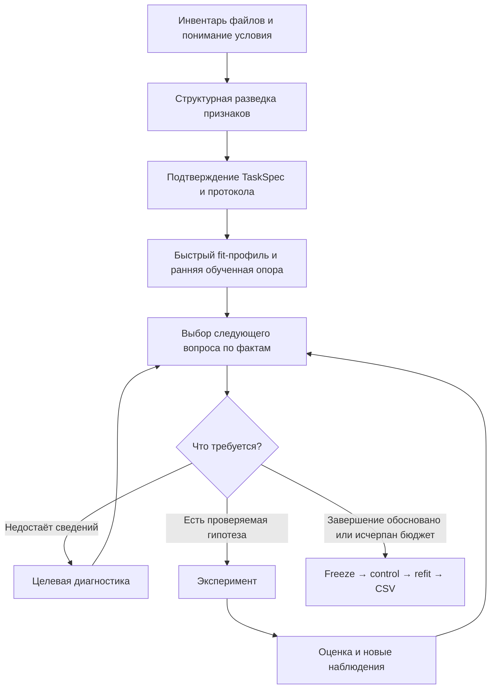

# Решение: модульный агент с этапами подготовки и повторяемой разведкой данных

Дата: 24.10.2026. Основа: текущие исходники checkout `e8b9d98` и документы проекта. Статус: **рекомендуемое архитектурное решение; реализация не выполнена**. Архивы поставок этим исследованием не проверялись заново.

## 1. Решение

Сохранить один управляющий процесс и один исследовательский цикл Qwen. Выделить разведку данных как переиспользуемую возможность с проверяемыми результатами. Подготовку задачи организовать как несколько этапов с условиями готовности; после запуска исследования разрешать возвращение к диагностике по новым наблюдениям.

Модульность и этапы отвечают на разные вопросы:

- **Модуль** определяет, кто вычисляет профиль, проверяет гипотезу, исполняет эксперимент или публикует CSV.
- **Этап** определяет, какие сведения уже подтверждены и какие действия сейчас допустимы.

Поэтому выбирать одно из двух не требуется. Для проекта подходит модульный монолит с управляемой подготовкой и итеративным AutoResearch. Отдельные сервисы, несколько независимых LLM-агентов и новый фреймворк оркестрации сейчас не обоснованы.

Это инженерное решение по устройству системы. Прирост RMSE/Macro F1 от него ещё не измерен.

## 2. Что подтверждено текущим кодом

| Наблюдение | Источник | Значение для решения |
|---|---|---|
| Постановку семантически подтверждает отдельный запрос до исследования | `automl_agent/controller.py:191`, `_task` | Этап понимания задачи уже существует; не нужно создавать его второй раз |
| В `prepare` выбирается validation, создаётся резервный CSV и обучается опора; только затем включается `searching` | `automl_agent/controller.py:264` | Подготовка уже отличается от исследования, но собирает много обязанностей в одном методе |
| `Dataset.profile` считает min/max/median, пропуски, новые категории, дубли, конфликты меток, дисбаланс и тяжёлый хвост | `automl_agent/data.py:471` | Разведка не отсутствует; есть полезное вычислительное ядро |
| Настоящий запрос Qwen получает кешированный профиль и риск-флаги | `automl_agent/context_memory.py:213`, `context_compressor/core.py:197` | Неверно утверждать, что эти риски вообще не доходят до модели |
| `get_dataset_report(report='profile')` идёт через `Dataset.inspect`, а не через `Dataset.profile` | `automl_agent/run_tools.py:126`, `automl_agent/data.py:513` | Два представления профиля расходятся: запрошенный отчёт в обычной ветке содержит dtype/missing/unique/top, но не весь начальный профиль |
| Для отчётов есть словарь, пропуски, категории, корреляции и fit-only срезы | `automl_agent/contracts.py:496`, `automl_agent/data.py:513` | Переиспользовать действующий API и пагинацию; не делать второй комплект одинаковых инструментов |
| Риск-флаги в кратком контексте ограничены фиксированным перечнем | `context_compressor/core.py:216` | Новый детектор нужно подключить также к краткому контексту и подбору знаний; изменения одного профайлера недостаточно |
| Диагностические пути уже существуют: fit diagnostics и custom analysis | `automl_agent/contracts.py:330`, `automl_agent/contracts.py:352`, `automl_agent/worker.py:105` | Углублённый анализ следует проводить через существующий executor и правила агрегатов |
| Подбор знаний уже учитывает профиль, метрику и исследовательский вопрос | `automl_agent/knowledge.py:117` | Старый вывод об отсутствии этих полей больше не соответствует коду |
| Поздняя смена validation сохраняет закрытый control и переоценивает кандидатов | `automl_agent/controller.py:1672`, `automl_agent/protocol_revision.py:11` | Позднее обнаружение неправильного переноса дорого; некоторые исправления уже невозможны в данном запуске |
| Обучения выполняются отдельным worker с общими ограничениями; журнал и восстановление уже есть | `automl_agent/executor.py`, `automl_agent/journal.py` | Новые модули должны использовать эти механизмы, а не заводить собственные процессы, таймеры и журналы |

Вывод о слабом месте: **вычисления разведки, их представление и применение к следующему решению недостаточно согласованы**. Это подтверждается устройством кода. Утверждение, что именно EDA стала причиной нулевого публичного score или что отдельная EDA-роль исправит качество, имеющимися свидетельствами не подтверждается.

В текущем checkout нет `outputs/`, на который ссылаются многие отчёты. Их численные заявления не использованы как заново проверенные результаты. Полезные уже описанные принципы взяты из `docs/agent_ml_policy.md`, `docs/qa_behavior_v2.md`, `Исследование_сложных_ML_задач.md` и `Исследование_качества_агентных_систем.md`; актуальность отдельных механизмов сверена с кодом.

## 3. Сопоставление вариантов

| Вариант | Польза | Ограничение в нашем проекте | Решение |
|---|---|---|---|
| Только разнести `Controller` по файлам | Проще сопровождать код | Не определяет качество разведки и условия готовности | Использовать как последующее извлечение обязанностей |
| Жёсткий конвейер EDA → признаки → модели → HPO | Понятный маршрут | Нельзя заранее знать, какие анализы нужны; ошибки модели требуют возвращения к данным | Не использовать как единственный маршрут |
| Свободный цикл со всеми инструментами | Гибкость | Сам по себе не гарантирует своевременной проверки протокола и полезности наблюдений | Сохранить внутри исследовательской фазы |
| Отдельный EDA-агент, feature-агент, model-агент | Разные инструкции для ролей | Дополнительные вызовы, передача контекста, согласование и бюджет; польза именно здесь не измерена | Отложить до измеренного ограничения одного цикла |
| Модули + этапы подготовки + повторяемая диагностика | Проверяемые границы и адаптивное исследование | Требует согласовать артефакты, кеш и восстановление | **Выбрать** |

Первичные внешние материалы подтверждают применимость отдельных принципов, а не превосходство выбранной схемы на нашем хакатоне:

- [Anthropic, Building effective agents](https://www.anthropic.com/research/building-effective-agents): различать заранее заданный workflow и динамический agent loop; наращивать сложность по необходимости. Для нас это аргумент за заданную подготовку и гибкое исследование, а не за обязательное умножение агентов.
- [AIDE, §3.2](https://arxiv.org/html/2502.13138v1#S3.SS2): раздельные операции draft/debug/improve, краткая история результатов и небольшой data preview. Авторы прямо отделяют preview от полноценной EDA. Полезны компактные сведения и обратная связь; нельзя считать наличие preview достаточной диагностикой.
- [R&D-Agent, §2.1](https://arxiv.org/html/2505.14738v1#S2.SS1): исследование опирается на показатели качества, разработка — на ошибки исполнения. Для нас полезно различать ML-гипотезу и техническое исправление. Многопоточную и многомодельную конфигурацию работы переносить не требуется.
- [AI Scientist-v2, §3.2.1](https://arxiv.org/html/2504.08066v1#S3.SS2.SSS1): этапы с критериями перехода сочетаются с деревом экспериментов. Полная последовательность подготовки статьи, репликаций и абляций решает другую задачу и не должна становиться обязательной для нашего CSV и трёхчасового CPU-бюджета.

## 4. Предлагаемый маршрут запуска



### А. Понимание условия и структурная разведка

Назначение — установить единицу наблюдения, перенос на test, доступность признаков, роли времени и групп, основную метрику и формат выхода.

Используются описания, заголовки и разрешённые признаки. После проверки привязки файлов вычислительный код может проверить типы, покрытие периодов и групп, признаки повторных объектов, точные дубли признаков и различия схем. Семантика группы или времени не выводится автоматически из имени столбца, высокой корреляции или возрастающего ID.

Это предлагаемое расширение существующей подготовки, а не уже работающий этап. Передача новых структурных сведений до финального подтверждения контракта потребует явно определённой области `structural_features`, проверки источников и интеграции в существующий `_task`. Начальное предложение TaskSpec и окончательное подтверждение должны различаться. После подтверждения роли не меняются; при существенной ошибке нужен новый запуск, а не скрытая правка контракта.

До выбора разделения не выдаются исследовательской модели распределения или зависимости по всем train-targets. Допустимые доверенные проверки схемы и реестра классов остаются отдельными от EDA. Проверка признаков не обучает преобразования и не подбирает параметры по test.

Готовность: существенные неоднозначности разобраны, TaskSpec подтверждён, выбран допустимый протокол, сохранено основание выбора. Дубли сами по себе не означают, что строки нужно удалить или сгруппировать: решение зависит от смысла наблюдения и переноса. Если обязательный протокол невозможно реализовать, фиксируется ограничение/ошибка; случайный split не подставляется молча.

### Б. Быстрый fit-профиль и ранняя опора

После фиксации split посчитать доступную дешёвую часть профиля fit и сохранить её. Сохранить существующий ранний резервный CSV и без длинного EDA-диалога получить обученную опору.

Нельзя задерживать первый результат до завершения всех возможных проверок данных. Профиль может иметь статус `partial` с причинами пропуска дорогих проверок. Неизвестный результат отличается от проверенного отсутствия проблемы. Опора должна соответствовать подтверждённой задаче и доступным адаптерам; фиксированная модель не объявляется универсальным решением.

### В. Исследование с возвратом к диагностике

Следующее действие выбирается из наблюдений, ошибок и стоимости: прочитать конкретный материал, выполнить конкретный анализ или проверить гипотезу обучением. Новое наблюдение может вернуть агента к EDA в любой момент до freeze.

Например, сигнал редких классов обосновывает fit-only внутреннюю диагностику precision/recall, но не автоматически веса классов. Тяжёлый хвост обосновывает анализ ошибок внутренней модели на исходной шкале; он не доказывает полезность log-target. Различия test-признаков не доказывают concept drift.

Глубокая диагностика не должна превращаться в обязательный набор анализов перед каждым обучением. Предпочтение следующего вопроса обосновывает Qwen, допустимость и бюджет проверяет код. В начале достаточно текущей гипотезы и исследовательской заметки, без нового автономного планировщика и сложной численной функции «ценности информации».

### Г. Финализация

Сохранить существующие freeze, фиксированный состав финалистов, однократный контроль, полный refit и атомарную публикацию. После freeze нельзя возвращаться к исследованию. При сбое поздней фазы сохраняется последний валидный CSV с честным указанием происхождения.

## 5. Границы модулей

Минимальное начальное изменение — два модуля и расширение действующих контрактов. Это целевые имена, файлов сейчас нет.

| Компонент | Ответственность | Чего он не делает |
|---|---|---|
| `data.py` — существующий | Инвентарь, привязка файлов, проверка и активация TaskSpec, предоставление данных | Не выбирает следующий ML-эксперимент |
| `profiling.py` — новый | Единые вычисления профиля, структурных проверок и ограниченных диагностических агрегатов | Не вызывает Qwen, не выбирает модель и не меняет split |
| `reconnaissance.py` — новый | Сборка отчёта из фактов; реестр находок, статусы проверок, краткое представление и ссылки | Не повторяет исполнение worker и не становится вторым контроллером |
| `validation.py` — существующий | Проверяемое построение и ограничения протокола | Не выбирает split ради более высокого score |
| `Controller` — существующий | Переходы, разрешения, бюджет, запуск исследования и финализация | Не содержит реализацию каждого статистического анализа |
| `run_tools`, `ContextMemory`, `AgentKnowledge` — существующие | Три проекции одних версионированных фактов: инструмент, контекст и подбор знаний | Не пересчитывают независимые несовпадающие профили |
| `Executor` / worker — существующие | Дорогие и пользовательские анализы, обучение, артефакты, ограничения | Не получают закрытые метки для исследования |

Начальные детекторы можно держать в `profiling.py`. Дробить их на пакет из десятков классов до появления реальных различий не нужно. Извлекать всю подготовку в `preparation.py` стоит после закрепления её контрактов, отдельно от изменения поведения EDA.

Дорогая корреляционная матрица, группировки по многим столбцам, OOF и другие потенциально большие вычисления требуют ограничений размера/времени и при необходимости worker. Сейчас `Dataset.profile` и `inspect` исполняются в управляющем процессе; простое увеличение числа анализов там может задержать весь цикл. Дешёвые сканирования также проверяют общий дедлайн между порциями работы. Размер отчёта и стоимость его вычисления — разные ограничения.

## 6. Что является результатом разведки

Один версионированный отчёт с полным содержимым в существующем хранилище и компактной проекцией в контексте. Предлагаемая структура:

```text
ReconnaissanceReport
  schema_version / analysis_version
  data_hash / task_hash / protocol_hash (null до фиксации протокола)
  scope / fit_hash / feature_roles_hash
  status: complete | partial | failed
  checks: checked | skipped_budget | unsupported | failed
  facts: ограниченные агрегаты и их источники
  findings:
    id / kind / affected_columns / scope / evidence_refs
    observation / limitation
    next_question / possible_actions
    status: open | investigated | deferred
  timing / read_reference
```

Факт, интерпретация и предложение разделены. Пример: «в fit мало наблюдений класса» — факт; «оценка recall нестабильна» — ограничение; «измерить внутреннюю диагностику и сравнить умеренные веса» — предложение. Формулировка предложения сама по себе не доказывает ни причину ошибки, ни улучшение качества.

Ключ кеша учитывает данные, роли, область, split и версию анализатора. После ревизии протокола все fit-зависимые сведения и следующие из них предложения пересчитываются либо помечаются устаревшими. Структурные факты можно переиспользовать только при совпадении их собственных зависимостей. Существующий `ProfileCache` расширяется или используется как хранилище этой версии, отдельная параллельная БД не создаётся.

Краткая проекция сохраняет наиболее важные открытые находки, ограничения и точные ссылки. Ограничение контекста остаётся ограничением; расширять его пропорционально размеру EDA нельзя. Новая находка должна быть видна согласованно через инструмент, краткий контекст и подбор знаний. Детали читаются существующими версиями источников и продолжениями.

Переход к следующему этапу определяется готовностью артефактов и бюджетом, а не фразой модели «EDA завершена». Выявленная моделью проблема не становится блокирующей только из-за её формулировки: обязательные ограничения проверяет код. Необязательная неизвестность переносится в исследование явно.

## 7. Содержание EDA по приоритету

| Уровень | Что проверять | Граница |
|---|---|---|
| Структура | Схема и роли, перенос по времени/группам, признаки повторных объектов, дубли, неоднозначность служебных значений | Признаки и описания; до фиксации протокола; без целевого EDA на полном train |
| Дешёвый профиль fit | Покрытие классов, пропуски и константы, квантили и хвосты, кардинальность, дубли и конфликты, разрешённое сравнение с test features | Метки только fit; ограниченные вычисления и отчёт |
| Целевая диагностика | Внутренние OOF/holdout-ошибки, обычные per-class показатели, анализ хвостовых ошибок, групп/времени, проверка конкретной гипотезы об утечке | Через существующие worker, scorer и правила агрегатов; по потребности |

Не добавлять обязательную полную матрицу корреляций, adversarial validation, SHAP, перебор всех пар признаков, поиск «утечки» только по высокой корреляции или автоматическое удаление выбросов. Каждый дорогой метод требует вопроса, поддерживаемой реализации и свободного бюджета.

Внешние validation-отчёты сохраняют `FeedbackPolicy`: EDA не даёт новые произвольные срезы меток, не восстанавливает подавленные сведения и не открывает control. Test используется в пределах действующего контракта; это не разрешение на transductive preprocessing, псевдометки или внешние источники данных.

## 8. Порядок внедрения

1. **Устранить расхождение профилей.** Извлечь единый профайлер, согласовать `get_dataset_report`, кешированное начальное представление и знания. Сохранить области доступа, лимиты ответа и существующие продолжения. Сначала проверить равенство фактов на одном split без добавления новых LLM-вызовов.
2. **Добавить находки и ограничения.** Сохранить доказательства за риск-флагами, различать пропуск и отрицательный результат. Выводить компактный текущий вопрос через существующую заметку и гипотезу. Добавить только отсутствующие полезные дешёвые агрегаты.
3. **Усилить подготовку протокола.** Добавить структурную разведку и checkpoint до окончательной фиксации ролей/control. Это отдельное поведенческое изменение; не смешивать его с переносом файлов. При неоднозначности использовать имеющийся семантический канал, а не обязательного нового агента для каждого запуска.
4. **Замкнуть диагностику на эксперименты.** Подключать существующие fit diagnostics/custom analysis к находкам. Сохранять результат проверки гипотезы, чтобы одно наблюдение не вызывало бесконечную EDA.
5. **Извлекать оставшиеся обязанности контроллера по необходимости.** Не переписывать worker, финализацию, транспорт Qwen и память вместе с EDA.

В первой итерации сохранить 14 действий API v2: улучшать существующий `get_dataset_report`. Новое действие вводить только при доказанной невозможности выразить нужный анализ. Изменения схем результатов, формата профиля и поведения получают необходимые версии; несовместимый старый журнал не переинтерпретируется новым runtime. Отсутствие изменения имени инструмента не гарантирует совместимость.

Не устанавливать заранее «20% времени на EDA», минимальное число вопросов, обязательные семейства моделей или независимые бюджеты для модулей. Весь путь использует один исходный дедлайн и действующий резерв control/refit. После замеров можно задать пределы конкретных дорогих анализов. Мягкий лимит EDA позволяет продолжить с частичным отчётом; timeout одной проверки не делает остальные факты ложными.

## 9. Как проверить пользу

Сначала офлайн на синтетических задачах и существующих проверках:

- Разные интерфейсы дают одни факты при одинаковых версиях/области; повторный запрос не выполняет ту же тяжёлую работу заново.
- Изменение закрытых меток не меняет EDA, её находки или подбор знаний; подавление агрегатов и ограничения custom analysis сохранены.
- Задачи с независимыми строками, группами, временем и их сочетанием выбирают допустимый маршрут; ID и дубли не становятся автоматически временной/групповой ролью.
- Пропуски, конфликтующие дубли, редкие классы и хвосты дают проверяемые находки; отсутствие проверки обозначено как неизвестность.
- Ревизия split инвалидирует зависимые факты; восстановление после сбоя не повторяет уже завершённый анализ и не продлевает дедлайн.
- Большие таблицы не вызывают неограниченный анализ в контроллере; нехватка ресурсов не уничтожает уже опубликованный результат.
- Краткий контекст сохраняет нужную находку и ссылку после сжатия; расширение одного профайлера не теряется в фиксированном списке флагов.

Подходящие существующие опоры: `tests/test_ml_hard_cases.py`, `tests/test_context_integration.py`, `tests/test_knowledge_integration.py`, `tests/test_tool_api_v2.py`, проверки ревизии протокола, завершения и границ данных. Точные имена дополнительных файлов выбирать по актуальному дереву тестов.

Затем ограниченное сравнение старого и нового поведения при одинаковых данных, времени, ресурсах, Qwen-настройках и протоколе оценки. Если меняется сам протокол, сравнивать модели по общей заранее заданной независимой оценке, а не смешивать разные validation-score. Измерять время до обученного CSV, стоимость разведки, полезные/повторные действия, полноту финализации и качество итогового результата. Рост числа найденных флагов не является успехом сам по себе.

Живое сравнение требует отдельного согласованного объёма расхода. При любом обращении к API организаторов обязательны `alpha-api-limits` и снимки before/after. В этом исследовании запросов к Qwen, обучения и изменений runtime не было; выполнены чтение кода и документов, внешних первичных источников и подготовка настоящего решения.

## 10. Критерий пересмотра решения

Выделять отдельную LLM-роль разведки имеет смысл, если измерения покажут, что единый Qwen-цикл систематически теряет диагностические вопросы, а единый отчёт и подходящий контекст это не исправляют. Тогда сравнивать специализированный контекст того же Qwen с текущим циклом на равном бюджете; отдельная роль не обязательно требует отдельного процесса или независимого агента.

Разворачивать микросервисы имеет смысл при появлении внешних пользователей, конкурирующих задач, отдельного масштабирования worker или длительного хранилища вне конкурсного контейнера. Текущий интерфейс хакатона этих требований не создаёт.
