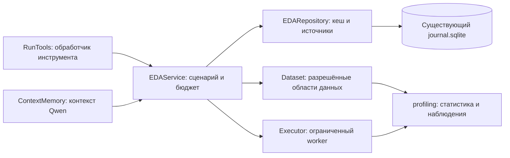

# EDA v1: единая разведка данных

Реализация в текущих исходниках. Конкурсные ZIP и указатели `dist` не обновлялись. Реальный Qwen для этой доработки не использовался.

## Организация



Использовано разделение обработчика, сервиса и репозитория, подходящее для CLI-агента. Зависимости собираются явно в `Controller`. Сервис не зависит от всего контроллера: получает данные, репозиторий, executor, бюджет, рабочий каталог и функцию оценки резерва. Актуальный протокол передаётся в каждый вызов, поэтому смена validation не оставляет старый plan внутри сервиса.

- `automl_agent/profiling.py`: расчёты без I/O, сети, обучения и выбора моделей.
- `automl_agent/eda/service.py`: разрешённый сценарий отчёта, выборка, staging и бюджет worker.
- `automl_agent/eda/repository.py`: сохранение полного профиля и отчётов в существующем SQLite-хранилище. Отдельной БД нет.
- `RunTools`: существующий публичный envelope и пагинация, без статистики и запуска worker внутри обработчика.

## Профиль

Начальный контекст Qwen и `get_dataset_report(report="profile")` используют один сохранённый документ. Выбранные столбцы — проекция; предикат задаёт отдельную явно обозначенную область.

Профиль содержит типы и семантические роли, пропуски, константы, кардинальность, категории, числовые квантили и сохранённые риск-флаги. Числовая статистика включает среднее, стандартное отклонение с `ddof=0`, доли нулевых/отрицательных значений среди конечных значений. Неопределённые из-за численного переполнения агрегаты возвращаются как `null` с перечнем `undefined_statistics`, а не как бесконечности.

Для fit доступны распределения таргета: числовые агрегаты либо количества по объявленным классам, включая отсутствующие. В инструментальном отчёте они запрашиваются через `include_target=true`. Для validation/test метки запрещены. Категориальные и текстовые роли не подменяются числовыми из-за физического dtype столбца.

Наблюдения содержат факт, область, ограничение интерпретации и следующий вопрос. До трёх наиболее приоритетных наблюдений передаются в краткий контекст вместе со ссылкой на полный профиль. Наличие сигнала не запускает автоматическое удаление признаков, дедупликацию или преобразование таргета.

## Корреляции

Пример аргументов существующего инструмента:

```json
{"report":"correlations","scope":"fit","columns":["numeric_feature","numeric_target"],"include_target":true}
```

Действуют ограничения:

- Не более 30 выбранных столбцов; слишком широкий выбор по умолчанию требует явного подмножества.
- Семантически числовые столбцы; категории, текст и классификационные targets получают `unsupported_type`.
- До 20 000 строк, воспроизводимая выборка по seed протокола, без использования значений таргета.
- Для пары необходимо 30 совместных конечных значений. `pair_counts` сообщает поддержку, `pair_status` — доступность, константу, недостаточную поддержку или неопределённость.
- `correlations` сохраняет матрицу Pearson; `spearman` добавляет ранговую матрицу. Пропущенные/неопределённые коэффициенты — `null`.
- Подготовка и исполнение worker делят слот максимум 20 секунд, дополнительно ограниченный общим дедлайном за вычетом резерва финализации. Контроллер не проводит полную корреляционную матрицу при старте.

При нехватке бюджета возвращается `skipped_budget`; при неудаче worker или staging — `failed` с диагностическим статусом. Это неизвестный результат, а не отсутствие связи. Ранее опубликованный CSV сохраняется. Успешные и отрицательные диагностические отчёты сохраняются как неизменные снимки; чтение страниц не повторяет расчёт, в том числе после перезапуска.

## Отдельный запуск разведки

```sh
.venv/bin/python -m automl_agent.eda /path/to/task.md \
  --task-spec /path/to/explicit_task_spec.json \
  --output outputs/eda-new-run \
  --correlations numeric_feature numeric_target
```

Без `--correlations` сохраняется только профиль. По умолчанию выделены 120 секунд, 1 CPU и 4096 МБ. Выходной каталог должен быть новым. Сохраняются `profile.json`, `summary.json`, `REPORT.md`, подтверждённый `task_spec.json`, `validation_plan.json` и, при запросе, `correlations.json`.

Это самостоятельный офлайн-сценарий через тот же EDA-сервис. Он не создаёт Controller/QwenClient, не читает токены, не обучает опорную модель и не публикует `submission.csv`. Для определения ролей нужен явный проверяемый TaskSpec: параметр `--task-spec` либо файл `task_spec.json` рядом с заданием. Контракт передаётся существующему проверяющему коду; семантические неоднозначности не заменяются догадками. Профиль с метками рассчитывается только на fit текущего протокола.

## Совместимость и проверка

Число действий API v2 остаётся равным 14; расширены данные существующих отчётов. Формат профиля — 5. Расчёт перенесён в ограниченный worker; автономный режим описан в [eda_autonomy.md](eda_autonomy.md). Идентичность учитывает исходные данные, TaskSpec/роли, область, строки и версию анализатора; отчёт также привязан к протоколу. Старые источники не перезаписываются. Запуск без совместимой отметки `eda_profile_version` требует прежнего runtime либо нового `run_id`.

Сборщик и реестры отпечатков обходят Python-модули агента рекурсивно: новый пакет EDA не должен потеряться при будущей плоской поставке. Сам архив в рамках этой работы не собирается.

Адресные проверки находятся в `tests/test_profiling.py`: согласованность фактов, границы меток, выборка, статистика и коэффициенты, кеш, пагинация, восстановление, ошибки, оба транспорта и полный цикл с `httpx.MockTransport` вместо API Qwen. Проверки существующего runtime выполняются отдельно. Полная точная Linux-среда всех зависимостей организаторов и рост качества на задачах этим не заявляются.

Результат локальной проверки 24.10.2026: расширенный набор — **188 passed, 2 skipped**, дополнительный тест булевой статистики и количества строк в non-fit профилях — **1 passed**. Пропущены проверки с необязательными Optuna/jsonschema, отсутствующими в локальной среде. Аудит зависимостей: 79 прямых импортов, нарушений нет. В одном прежнем прогоне был системный `Operation not permitted`; изолированный повтор и последующий полный расширенный прогон прошли. Подробности запусков: `outputs/eda_v1/verification.json`.
