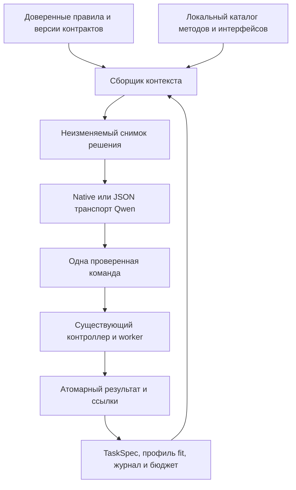

# Стартовый промпт и контекст ML-агента: Pi, Aider и mini-swe-agent

Исследование 2026-10-25. Наша база `32e0e24`, ветка `feat/strong-reference-search`. Пользователь запросил изучение и скачивание Pi. Полный shallow clone находится в `outputs/agent-source-research/pi`, коммит **d5b3de22d0e24a3e9c38a9410d3329b099717283**. Рабочее дерево клона чистое; зависимости не устанавливались, его код не исполнялся. Каталог игнорируется Git и не является частью конкурсной поставки.

## Решение

Стоит переработать **композицию контекста**, сохранив существующие контроллер, исполнители, журнал и границы данных. У Pi полезны отдельные секции системного промпта, загрузка специальных инструкций по потребности и сохранение причинной связи между действием и результатом. У нас уже реализованы структурированная память, версионированные чтения, атомарная доставка наблюдений и защита финализации. Заменять их полной неограниченной перепиской или универсальным bash не обосновано.

Новый короткий промпт — проверяемая гипотеза. Его размер и структурную корректность можно проверить офлайн, влияние на выбор модели и качество предсказаний — только отдельным сравнением.

## Что проверено в исходниках

### Pi

Все ссылки ниже закреплены на скачанном коммите:

- [system-prompt.ts](https://github.com/earendil-works/pi/blob/d5b3de22d0e24a3e9c38a9410d3329b099717283/packages/coding-agent/src/core/system-prompt.ts): собирает упорядоченные независимые секции, правила и подсказки зависят от выбранных инструментов; проектный контекст и каталог скиллов добавляются отдельно. Есть сравнение секций для регистрации изменений. Это не обещание, что провайдеру можно отправлять только diff без полного контекста.
- [skills.ts](https://github.com/earendil-works/pi/blob/d5b3de22d0e24a3e9c38a9410d3329b099717283/packages/coding-agent/src/core/skills.ts): в стартовое описание попадают название, назначение и место чтения скилла. Полное содержимое читается при необходимости. Так каталог возможностей не превращается в руководство по всем возможным действиям сразу.
- [resource-loader.ts](https://github.com/earendil-works/pi/blob/d5b3de22d0e24a3e9c38a9410d3329b099717283/packages/coding-agent/src/core/resource-loader.ts): собирает проектные инструкции по иерархии каталогов и устраняет дубли в некоторых worktree-сценариях. В нашем контейнере автоматически повышать произвольный AGENTS.md из папки задачи до доверенной системной инструкции нельзя.
- [agent-loop.ts](https://github.com/earendil-works/pi/blob/d5b3de22d0e24a3e9c38a9410d3329b099717283/packages/agent/src/agent-loop.ts): сообщения агента преобразуются в формат модели на границе запроса через transformContext и convertToLlm. После действия результаты инструментов добавляются в историю до следующего решения. Подготовка следующего хода вынесена отдельно; неполные tool calls из обрезанного ответа не исполняются.
- [compaction.ts](https://github.com/earendil-works/pi/blob/d5b3de22d0e24a3e9c38a9410d3329b099717283/packages/coding-agent/src/core/compaction/compaction.ts): при сжатии учитываются границы сообщений, чтобы не оставить tool result без соответствующего вызова. Часть недавней истории сохраняется, более старая получает checkpoint с целью, ограничениями, прогрессом, решениями и дальнейшей работой. Лимиты сохранения настраиваются; копировать их числовые значения в наш бюджет оснований нет.

Вывод из кода: Pi отделяет полную сессию от её представления для LLM. Наши Snapshot/ContextStore/Transport уже выполняют сходное разделение, хотя представляют историю иначе. Количество строк кода агента или краткость системного текста сами по себе не объясняют его качество.

### Aider

[Aider base_coder.py, format_chat_chunks](https://github.com/Aider-AI/aider/blob/5dc9490bb35f9729ef2c95d00a19ccd30c26339c/aider/coders/base_coder.py) разделяет системные инструкции, примеры, прошлую историю, карту репозитория, read-only файлы, рабочие файлы и текущую беседу. [Карта репозитория](https://aider.chat/docs/repomap.html) даёт ориентиры для выбора файлов вместо передачи всего проекта. Для нас аналог — компактная карта доступных методов, экспериментов и интерфейсов с точными маршрутами чтения. Поддержка кеширования у конкретного клиента не доказывает поддержку кеша шлюзом Qwen.

### mini-swe-agent

[DefaultAgent](https://github.com/SWE-agent/mini-swe-agent/blob/04d809ceab9df28f9adaed044884180159172930/src/minisweagent/agents/default.py) и [default.yaml](https://github.com/SWE-agent/mini-swe-agent/blob/04d809ceab9df28f9adaed044884180159172930/src/minisweagent/config/default.yaml) явно разделяют system template, задачу, представление результата действия и ошибки формата. Цикл сохраняет ответ и наблюдение перед следующим запросом, ограничения проверяются в коде. Его конкретный bash-формат не подходит нашим типизированным ML-действиям, но способ отделить протокол общения от предметной методики полезен.

Код Aider и mini-swe-agent получен через GitHub connector; соответствие прочитанного содержимого указанным коммитам проверено повторным чтением закреплённых URL. Их отдельные исходные файлы сохранены только в игнорируемом исследовательском каталоге. В репозиторий не копируются внешние реализации.

## Что сейчас получает Qwen

Проверены код `controller.py`, `context_memory.py`, `qwen.py`, `context_compressor/{core,assembler,transport,store}.py` и сохранённые подготовленные запросы двух WDBC-прогонов. Метаданные извлекает [context_structure_audit.py](../../tools/context_structure_audit.py) в read-only режиме без экспорта исходного контекста.

В журналах нашлось 9 подготовленных исследовательских запросов ветки и 8 main. Это не общее число API-вызовов: интерпретация задачи, независимый critic и неотправленные prepared requests имеют другой учёт. Во всех этих 17 записях сообщения имеют роли **system + user**: контекст каждый раз восстанавливается из сохранённого состояния, обычная последовательность assistant/tool сообщений не переигрывается.

Первый native-запрос ветки:

| Блок | UTF-8 bytes |
|---|---:|
| Системный текст в сохранённом wire | 13 896 |
| Native-схемы действий | 47 459 |
| JSON-контекст | 20 556 |
| Внутри контекста: core | 5 622 |
| Профиль | 5 039 |
| Выбранные материалы | 5 537 |
| Краткая история + подробности | 1 968 + 1 836 |

Числа вложенных блоков не следует суммировать с размером всего контекста. Bytes не являются токенами. Сохранённые размеры относятся к прежним запускам, а не к заново отправленному текущему коду. На этих запусках все найденные prepared requests имели stage 0, переполнение не наблюдалось.

У ветки два набора wire-схем объясняются переключением native → JSON, не динамическим исчезновением ML-возможностей. В JSON функции передаются внутри user-контекста как схемы аргументов. Фактический публичный реестр текущего кода и этих запросов — **17 действий**, включая preview_recipe, get_diagnostic_report и отдельные маршруты знаний/истории. Ранняя проектная цель «14» и некоторые прежние формулировки требуют актуализации. Это наш интерфейсный выбор; отдельного требования организаторов ровно о 14 действиях здесь не установлено.

### Сильные стороны, которые нужно сохранить

- Факты контроллера, предположения модели и внешние данные имеют разные источники/уровни доверия.
- Актуальны контракт, протокол, лимиты, резерв, лидер, активная гипотеза и заметка о вопросе. Они не зависят только от памяти LLM.
- Результат операции и очередь доставки фиксируются атомарно. Частичные чтения имеют continuation и не становятся целыми документами.
- Отрицательные результаты и ошибки доступны через постоянные записи и версионированные маршруты.
- Сжатие детерминировано; оно не требует ещё одного платного вызова для каждой summary.

### Где есть основания для улучшения

1. SYSTEM объединяет общие гарантии, исследовательскую политику, советы по конкретным моделям, семантику маршрутов и полный custom-интерфейс. В текущем коде исходный SYSTEM — 13 515 bytes, из них RESEARCH_POLICY — 3 071, INTERFACE — 2 763. Это разные уровни изменений и разные моменты потребности.
2. В начальный контекст автоматически входит до трёх полных методических материалов. Ранее для небольшого числового WDBC туда попали F1 и LightAutoML; релевантность следующему вопросу не доказана. Pi-подобное раскрытие знаний по потребности стоит проверить вместе с исправлением маршрутизации, а не просто выкинуть локальный корпус.
3. Снимок содержит результаты, активную гипотезу и заметку, но причинный переход «что запросил → что получил → что осталось неизвестно» распределён по нескольким структурам. Это проверяемая гипотеза о когнитивной нагрузке, не доказанная причина выбора деревьев.
4. В stage 3 профиль может исчезнуть из прямого текста, хотя чтения и обязательное ядро остаются. Для текущего вопроса полезно отдельно определить минимальные подтверждённые наблюдения, которые следует сохранять даже при давлении контекста.

## Предлагаемая организация

### Постоянные системные секции

Собирать из независимых версионированных частей: роль/цель; полномочия и границы данных; правила научного вывода; протокол действий и восстановления; ресурсы/финализация. У каждой части свой источник и hash. Инструкции конкретного адаптера, примеры параметров и подробные рецепты раскрывать при необходимости. Схемы действий остаются исполнимым контрактом; каталог не заменяет их.

[Черновик системного текста](2026-10-25-llm-system-draft.txt) подготовлен для обсуждаемой структуры. Он **не подключён к runtime**. Текущая инженерная политика classical-only названа именно политикой проекта; нельзя выдавать её за запрет deep learning организаторами.

### Подтверждённое ядро стартового контекста

- Что предсказываем, в каких условиях прогноз используется, основная метрика и точный выход.
- Зафиксированная валидация, её основания и доступные области данных.
- Уже существующий резерв/опора, лидер и краткий измеренный результат; не заставлять модель повторно строить то, что выполнено.
- Несколько приоритетных подтверждённых наблюдений со scope, support, версиями и чтением подробностей.
- Общий оставшийся ресурс и резерв финализации, доступность исполнителей.

Одинаковая структура стартового состояния допустима; содержание и следующее действие зависят от задачи. Она не задаёт одинаковую очередь анализов.

### Рабочее состояние решения

Добавить компактную проекцию последнего завершённого перехода из журнала: идентификатор и назначение команды, исполнена ли она, статус анализа, ключевой результат, scope, что гипотеза предсказывала и что ещё не установлено. Сведения о выполнении и измерениях берутся только из контроллера; интерпретации и будущие вопросы остаются помеченными предположениями агента.

Начать с такой структурированной проекции в существующем snapshot, а не сразу менять оба транспорта на полную переписку. Если позже сравнивать вариант с недавними assistant/tool сообщениями, сохранять целые пары и совместимость gateway; старый tool call в истории никогда не означает повторное исполнение. Хранить объяснения, заявленные гипотезы и результаты, а не требовать раскрытия внутреннего chain of thought.

`current_work` сейчас имеет строгий allowlist. Новый блок должен получить версию и адресные проверки, а не добавляться в обход `configure/validate_core`.

### Методические модули и интерфейсы по запросу

Короткие метаданные: когда полезно, что неизвестно, ограничения, цена и точный read route. Полный метод — через существующие знания и continuations. Не вводить обязательный отдельный шаг чтения для каждого обучения. Каталог влияет на доступность идей, но не утверждает победителя заранее.

**Блокер для простого сокращения SYSTEM:** `candidate_interface` есть в старом query-пути AgentReferences, но не зарегистрирован как документ текущего индексированного корпуса; public `KnowledgeTools.read` сначала требует такой документ. Проверено `ReferenceStore.document('candidate_interface') is None`. До удаления полного INTERFACE из системного текста нужно обеспечить его доставку через рабочий публичный версионированный маршрут и проверить чтение после сжатия. Иначе короткий промпт уменьшит реальные возможности custom-компонентов.

### Сжатие и восстановление

Оставить детерминированное ядро обязательных гарантий. Старые детали можно сокращать, но вопрос, предположения, измеренные опровержения, нерешённые технические исходы и пути чтения сохраняются с происхождением. Не превращать модельную summary в подтверждённый факт и не повышать task-файлы до system authority. Не копировать Pi-числа keepRecentTokens/reserveTokens и не добавлять автоматический платный summarizer.

## Офлайн-проверка черновика

Один и тот же текущий Transport и все 17 неизменённых схем, пустой пользовательский снимок; измеряется header/framing без профиля и истории:

| Вариант | Исходный system | Native overhead | JSON overhead |
|---|---:|---:|---:|
| Текущий | 13 515 | 62 066 | 38 304 |
| Черновик | 3 667 | 52 074 | 28 312 |

Сокращение native overhead — около **16.1%**, а не сокращение всего контекста на 73%. Часть подробностей должна переехать в доставляемые локальные руководства; их будущие чтения тоже стоят времени и токенов. Это замер размера прототипа, не доказательство эквивалентности инструкций, экономии счёта или роста качества.

Три теста аудитора прошли: read-only журнал не изменяется; содержимое секретных тестовых sentinel не экспортируется; пустой журнал не трактуется как наблюдение формата сообщений. Эти тесты не проверяют поведение Qwen с новым промптом. Полная тестовая коллекция остаётся ограничена [ранее найденными отсутствующими fixtures](2026-10-25-preprocessing-contract-audit.md).

## Как проверять внедрение

1. Выделить сборку системных секций без изменения итогового текста; сверить hashes/байтовое равенство и оба транспорта.
2. Зарегистрировать локальные интерфейсы/условные правила с происхождением и рабочими чтениями. Проверить continuations, сжатие, старые сохранённые запуски и отсутствие закрытых меток.
3. Ввести версионированное рабочее состояние решения и краткий стартовый пакет. Отдельно проверить случаи без гипотезы, с неисполненной командой, ошибкой формата, отрицательным опытом и сменой split.
4. Затем сравнивать сокращённые инструкции, загрузку методов по потребности и сохранение недавних переходов как отдельные варианты. Не менять одновременно модели, признаки и валидацию, если измеряется политика контекста.
5. На новой серии задач раздельно измерять ошибки интерфейса, полезность выбранного действия, применение предыдущего результата, стоимость и итоговую метрику. Один удачный ответ или меньший payload не доказывают улучшение полного цикла. Qwen-прогоны — только в согласованном бюджете со снимками before/after.

В этом исследовании API не использован, зависимости runtime и конкурсный код не менялись. Собраны исходники, сравнение архитектур, метаданные реальных запросов, черновик промпта и план адресной проверки. [Evidence](2026-10-25-agent-context-evidence.json) фиксирует версии и измерения.
