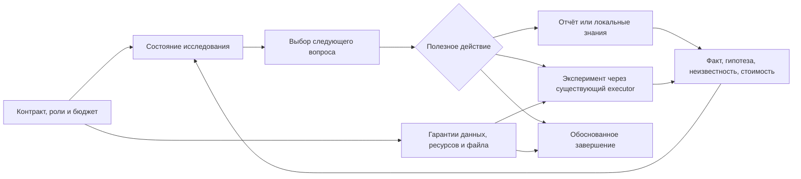

# Подход к улучшению автономного ML-исследования

Дата исследования: 25 октября 2026. Основа кода — `fc8c619`. Рассмотрен **41 первичный источник**: статьи, официальные материалы и авторские решения. Это целевой обзор abstracts и релевантных разделов, а не полное воспроизведение 41 работы или исчерпывающий systematic review. [Реестр источников с выводами и ограничениями](2026-10-25-mega-sources.json).

**Главное решение:** сначала повысить надёжность выбора эксперимента, затем расширять портфель действительно разных представлений данных и моделей. В наших последних сериях поиск регулярно находил лучший development-рецепт и худший следующий период/контроль. Добавление ещё сотни конфигураций при том же выборе способно усилить проблему. При этом новый аудит **не подтвердил refit как причину проигрыша CatBoost**. Следующий модельный блок — числовые embeddings и корректная сильная MLP/TabM-опора; ModernNCA остаётся важным, но более дорогим отдельным кандидатом.

## 1. Какие ограничения обязательны

Источник требований — [исходное ТЗ, с. 5–8 и 17–19](../../research/2026-10-20/evidence/case_pdf_extracted.txt), [уточнения организаторов](../../research/2026-10-20/evidence/organizer_answers.txt), [реестр требований проекта](../requirements_traceability.md).

| Статус | Что сохраняем | Следствие для исследования |
|---|---|---|
| Организаторы | Один автономный код на разные задачи; новый запуск на каждую задачу | Предметные признаки двух примеров — материал разработки, не ветки по названиям датасетов в агенте |
| Организаторы | Qwen3.8-27B как предоставленная управляющая модель | Живые проверки конкурсного агента через неё; offline reference-fit отдельно от оценки самостоятельности |
| Организаторы | Нет runtime-интернета, кроме Qwen API; фиксированные зависимости; нет внешних обучающих данных и готовых весов | Документы и допустимый код готовятся заранее; скачивание пакета/весов при решении не является вариантом |
| Организаторы | 8 CPU, 32 GB, до 3 часов; корректный файл к остановке | Портфель должен учитывать полную стоимость обучения, преобразований и inference; сохраняется резерв финализации |
| Организаторы | Нет промежуточной обратной связи скрытого теста | Нельзя строить AutoResearch вокруг получения hidden score |
| Пользователь | Факты, гипотезы и неизвестности раздельно; отрицательные результаты; адаптивная методика | Нет обязательного набора анализов, bootstrap, общего порога выигрыша или одного временного окна |
| Наше инженерное решение | Локальные reference-workers, snapshots, ограниченный поиск и план ниже | Это проверяемая реализация разработки, не новые правила организаторов |

Современная foundation-модель сама по себе не проходит эти ограничения. Например, [TabFM, сентябрь 2026](https://arxiv.org/abs/2609.37959), использует предварительно обученные веса. Её заявленные результаты не дают права включить веса в поставку. Написанная на разрешённом PyTorch архитектура, обучаемая **с нуля только на текущем fit**, рассматривается отдельно. Метанастройки из научной статьи — методическое знание, не готовые веса.

Собственные RMSE/F1 не переводим в конкурсные очки без метрик организаторского baseline и подтверждённой формулы текущей платформы. Успех public-двух примеров не доказывает перенос на private-задачи.

## 2. Что подтверждено нашими данными

[Аудит данных и сохранённых моделей](../reports/examples/2026-10-25-mega-audit.json) выполнен без новых fit, API и test-меток. Команда: `python tools/mega_research_audit.py --output outputs/new_research_audit`. Для исторических моделей проверено совпадение SHA-256 входов. Скрипт является инструментом разработки, а не инструментом конкурсного агента с расширенными scopes.

### 2.1. Временные условия регрессии неодинаковы

| Период | Строк | Пропуски рейтинга | Средний train-таргет |
|---|---:|---:|---:|
| 1 | 2 117 | 27,87% | 93,82 |
| 2 | 9 058 | 78,98% | 82,71 |
| 3 | 10 879 | 74,05% | 85,54 |
| 4 | 12 946 | 22,25% | 86,99 |
| 5 | 18 308 | 19,35% | 80,36 |
| test, период 6 | 22 449 | 19,99% | Неизвестен |

Это факт различий входов, **не доказанная причина ошибки**. Равное усреднение периодов 3 и 4 означает равную ценность двух довольно разных условий. Оно не автоматически соответствует следующему году с примерно 20% пропусков. Нельзя просто выбрать новый период по уже известному контрольному score. Можно заранее обосновать целевой сценарий, использовать доступные безметочные признаки периода применения и проверить устойчивость такого правила на нескольких исторических задачах.

`mean(RMSE_t)`, `sqrt(mean(MSE_t))` и pooled RMSE по всем строкам — три разные цели. Первая одинаково взвешивает значения RMSE периодов; вторая одинаково взвешивает их MSE; третья взвешивает MSE по числу строк. В аудите сохранены все три, а не выбран постфактум самый приятный агрегат. Внешняя метрика RMSE по объектам не делает любой исторический pooled-протокол автоматически правильным при смене распределения.

### 2.2. В классификации есть неоднозначность наблюдаемых признаков

В train 87 670 строк, 54 228 точных групп входных признаков и 33 442 повторения сверх первой строки. В 1 458 группах присутствуют разные классы; в них 14 829 строк. Если детерминированный классификатор получает **только эти признаки без ID**, максимальная эмпирическая train-accuracy при выборе большинства каждой группы — **0,915102**. Это не достижимая честная валидация: oracle использует все train-метки. И это **не потолок test-accuracy или Macro F1**. Факт показывает ограниченность наблюдаемого описания, а не доказанную ошибку разметки.

В test 3 556 из 41 166 строк (8,64%) имеют точный ключ признаков из train. Меток test нет. Равенство входов не подтверждает одну сетевую сессию. Групповая проверка преимущественно оценивает новые паттерны; если отдельно исследовать повторяющиеся паттерны, этот сценарий нужно явно назвать и взвесить, а не выдавать смешанную случайную проверку за независимые группы. Внешние исходные UNSW-метки из [публичного источника датасета](https://research.unsw.edu.au/projects/unsw-nb15-dataset) не загружаются и не подставляются.

### 2.3. Refit не объяснил проигрыш компактного CatBoost

На том же ранее использованном control применено одно замороженное правило смеси/offsets к моделям разных стадий:

| Рецепт | Модели inner fit | Модели development refit |
|---|---:|---:|
| Сохранённый XGBoost + иерархия | Macro F1 0,634259 | **0,656526** |
| Компактный CatBoost + иерархия | Macro F1 0,629347 | **0,638181** |

У обеих моделей refit улучшил точку. Для старого рецепта вместе со стадией меняются также отдельные выбранные CV-итерации; это не изолированный тест только размера train. В CatBoost-серии число деревьев и узлов сохранено, но меняются строки, словари категорий и fit-derived веса. Ни один вариант не превращает этот аудит в свежий holdout.

Смена частот в post-hoc prior рабочего ансамбля при неизменных development-моделях даёт лишь 0,656516 → 0,656526; она не объясняет проигрыш CatBoost. В CatBoost-рецепте τ=0, поэтому prior-count swap вообще не влияет. Два calibration-направления использовали **один и тот же fit и одни evaluation-строки**; их нельзя называть двумя независимыми OOF-обучениями.

## 3. Валидация и выбор: главный блок изменений

[Cawley–Talbot](https://www.jmlr.org/papers/v11/cawley10a.html) обосновывают риск подгонки критерия выбора; [Roberts et al.](https://www.wsl.ch/lud/biodiversity_events/papers/Roberts_et_al-2017-Ecography.pdf) — необходимость согласовывать блокировку с целью переноса. Это основания для решений, а не доказательство, что конкретно наш проигрыш вызван одним механизмом.

В коде уже есть `EvaluationDesign` с rationale, временным окном, gap, assumptions и выбором uncertainty; `ResearchState` уже хранит факты, допущения, вопросы и бюджет. Предлагаем развить существующий контракт оценочной задачи: явно связать единицу независимости, горизонт, доступность признаков, fit/calibration/selection/control, роль повторных объектов, агрегат метрики и способ refit. Часть этих сведений уже живёт в TaskSpec/validation plan; их нужно связать по lineage, а не дублировать вторыми источниками истины. Существующие protocol/policy hashes и запрет переноса score между разными протоколами сохраняются.

Для временных данных выбирать доступные forward origins по горизонту применения и размеру поддержки. Сравнивать expanding и ограниченные исторические окна только при обосновании наблюдаемой нестационарностью и бюджете. Gap нужен, если задержка меток или перекрытие временных признаков могут дать утечку; он не обязателен для любого столбца даты. Будущий период не должен обучать encoder, imputer, feature selector, retrieval index, scaler или early-stopping policy.

Для групповых задач outer-группы оценивают перенос, inner-группы выбирают рецепт. Дополнительные seeds измеряют устойчивость, но повторное разбиение ранее изученных меток не создаёт новый слепой тест. Для малого класса показывать численность и ошибки каждого fold, а не только средний F1. Nested CV — вариант при достаточном бюджете, не обязательный bootstrap/ритуал.

[Bengio–Grandvalet](https://www.jmlr.org/papers/v5/grandvalet04a.html) объясняют зависимость CV-ошибок; [Bates–Hastie–Tibshirani](https://arxiv.org/abs/2104.00673) различают оцениваемые ошибки и предупреждают об интервалах. Мы не выводим из них запрет полного refit. Вводим раздельные результаты `selection_recipe`, `refitted_model`, `delivery_artifact`; неопределённость одного не приписывается другому без основания.

## 4. Портфель методов и стоимость

Здесь стоимость — наша оценка структуры вычислений, не обещание времени из чужой статьи. Практические CPU-секунды измеряются пилотом. Опубликованный средний ранг обычно относится к другим splits, времени, метрикам и hardware.

| Приоритет | Семейство | Зачем проверять | Цена и границы |
|---|---|---|---|
| P0 | Устойчивый выбор и точный lineage | Отделить вопрос к модели от удачного validation | Несколько сохранённых inference; при новом nested сравнении число fit умножается |
| P1 | Регуляризованные GBDT + 2–3 seeds | Дешёвая сильная опора и снижение зависимости от seed | K моделей на fit и inference; нет гарантии независимых ошибок или выигрыша |
| P1 | Полноценная сильная MLP/TabM + numeric embeddings | Иное представление гладких числовых зависимостей | PyTorch с нуля; масштабирование/embeddings только по fit; пилот CPU/RAM |
| P2 | ModernNCA | Обучать полезную близость строк, дополнять деревья | Соседи, self-mask при обучении, chunked inference, большая цена парных расстояний |
| P2 | OOF blend / неглубокий stacking | Использовать проверенное разнообразие ошибок | Базовые OOF-fit плюс метамодель; мета-оценка тоже вложена |
| P2 | Cross-fitted feature-group ablation | Найти мешающий блок, а не перебирать все подмножества | Один дополнительный рецепт на осмысленный блок; множественный выбор учитывается |
| P3 | Гладкий additive / NAM + деревья | Другая форма числовой зависимости | Слабее по взаимодействиям; может быть полезен только как компонент |
| P3 | Tail mixture / residual expert | Исследовать фактически дорогие ошибки регрессии | Gate + два регрессора; маршрут исключительно из доступных признаков |
| P3 | Covariate/label-shift correction | Обоснованная адаптация к иной смеси объектов | Нужны проверяемые предположения и ограниченные веса |
| P4 | xRFM / локальные ядра | Ещё одно семейство обучения признаков | Авторский GPU-путь имеет дополнительные зависимости; CPU-адаптация — отдельная реализация |

### Сильные нейросетевые ориентиры

[RealMLP](https://arxiv.org/abs/2407.04491) — согласованный рецепт подготовки, инициализации, архитектуры и оптимизации. [TabM](https://arxiv.org/abs/2410.24210) — эффективный ансамбль. Отрицательный результат нашего маленького mini-style и обычного sklearn MLP не является отрицательным воспроизведением этих работ. Разумная следующая проверка меняет представление чисел через [piecewise-linear или periodic embeddings](https://arxiv.org/abs/2203.05556), а не только ширину ещё одного MLP. Сравнение: backbone без embedding → тот же backbone с embedding → смесь с деревьями. При изменении нескольких элементов честно называем результат новым рецептом, а не эффектом одного компонента.

[TabArena](https://arxiv.org/abs/2506.16791) подчёркивает значение ensembling и validation-overfitting; её основной IID-протокол не доказывает качество на наших годах и группах. [Grinsztajn et al.](https://arxiv.org/abs/2207.08815) дают причины сохранять деревья как ориентир, а не автоматически менять их на более сложную архитектуру.

### Retrieval и локальная метрика

[ModernNCA](https://arxiv.org/abs/2407.03257) учит представление и soft-NN предсказания; большинство временных замеров авторов выполнено на V100. Кандидатный пул при оценке — только разрешённый fit, никогда не validation/control-метки. Обучающий self-match исключается. Дубликаты требуют отдельного рассмотрения, но наличие двух разрешённых fit-строк с одинаковыми признаками само по себе не является утечкой evaluation.

Для 41 166 запросов и 87 670 fit-строк полное соседство — около **3,61 млрд пар** до учёта размерности. Хранить полную матрицу нельзя считать бесплатным; chunking снижает пик памяти, но не число пар. Сэмплирование train-соседей и усечение inference до top-k — разные изменения алгоритма. Если потребуется приближение, фиксировать его отдельно. [TabR](https://proceedings.iclr.cc/paper_files/paper/2024/hash/4ef594af0d9a519db8fb292452c461fa-Abstract-Conference.html) добавляет механизм извлечения информации соседей, поэтому следует после более простого варианта.

[xRFM v3, апрель 2026](https://arxiv.org/html/2508.10053v3) совмещает локальные ядра и разбиения дерева. Авторский GPU-путь использует KerMac, которого нет в разрешённых зависимостях. Поэтому не обещаем «pip install и готово». Возможен ограниченный собственный прототип на допустимых операциях, но его нельзя выдавать за полный авторский benchmark. [NAM](https://papers.nips.cc/paper_files/paper/2021/hash/251bd0442dfcc53b5a761e050f8022b8-Abstract.html) даёт другой, более простой гладкий additive-ориентир с ограничением взаимодействий.

## 5. Feature engineering: что ещё имеет смысл

| Идея | Обоснование / триггер | Как не получить ложный выигрыш |
|---|---|---|
| Missing indicators + fit-only imputation | Значение отсутствия может быть информативно | Проверять по периодам; imputer не получает evaluation-метки или статистики будущего |
| Numeric embeddings | Гладкая зависимость плохо приближается текущей моделью | Узлы, quantiles и supervised границы внутри fit; такой же transform при inference |
| Ordered / OOF target statistics | Категории с поддержкой и сложными взаимодействиями | [CatBoost](https://papers.neurips.cc/paper_files/paper/2018/file/14491b756b3a51daac41c24863285549-Paper.pdf) показывает, почему простого leave-one-out недостаточно; для времени статистики только из прошлого |
| Единицы, отношения, отсутствие события | Определены в словаре и доступны при решении | Защита деления, неизвестность отдельно от нуля, измерение фактической добавленной пользы |
| Отбор блоков признаков | Гипотеза о шуме, нестационарности или недоступности блока | Сравнивать осмысленный блок; не обнулять признак лишь по низкой корреляции |
| Target transform и обратное преобразование | Тяжёлый хвост и неоднородный шум | RMSE оценивается в исходной шкале; `exp(E log y)` не равно `E y` |
| Tail / residual mixture | Верхние ~5,5% таргета дали 56–60% квадратов ошибок в прежнем аудите | Истинный tail неизвестен в test: gate обучается на fit и маршрутизирует по X |
| Frequency / density признаки | Наблюдаемые повторы и неоднородность распределения | Словари по fit; явно различать train-only и разрешённый unsupervised transductive режим |

Для преобразований [Duan](https://doi.org/10.1080/01621459.1983.10478017) даёт основание исследовать retransformation; общий smearing-множитель не гарантирован при гетероскедастичности. Условная смесь для squared loss имеет вид `P(tail|X) E[y|tail,X] + (1−P(tail|X)) E[y|not-tail,X]`. Само разложение не даёт хороших оценок трёх функций: маленький tail и плохой gate могут сделать его хуже глобальной модели. Никакого маршрута через истинный validation/test-таргет.

[EPA](https://portfoliomanager.energystar.gov/pdf/reference/ENERGY%20STAR%20Score.pdf) связывает рейтинг с source EUI, тогда как наш таргет site EUI. Уже проверенная gamma-факторизация дала 39,4735 против 39,0361: содержательная идея не равна полезному готовому рецепту. [Pattern submodels](https://arxiv.org/abs/1704.08192) также не отменяют проигрыша нашей простой версии специалистов. Старые отрицательные результаты сохраняются; повтор оправдан существенным изменением гипотезы или проверки, а не надеждой на другой seed.

## 6. Дисбаланс, шум и правило решения

Сначала разделять три вопроса: чему учить модель, как оценивать её вероятности, как выбирать класс ради метрики. [OvA](https://www.jmlr.org/papers/v1/allwein00a.html), [logit adjustment](https://arxiv.org/abs/2007.07314), [Balanced Softmax](https://arxiv.org/abs/2007.10740) меняют разные части решения. Их эффект может быть противоположным на log-loss и Macro F1 — это уже произошло в нашей калибровке.

[F1-thresholding](https://arxiv.org/abs/1402.1892) не даёт универсального multiclass-порога «половина F1». [Оптимизация функций confusion matrix](https://proceedings.mlr.press/v37/narasimhanb15.html) полезна как направление; наши coordinate offsets остаются эвристикой. Их размерность и стабильность следует сопоставлять с поддержкой класса. Временные зависимости, общий fit двух calibration-направлений и выбор лучшего в большой сетке ограничивают трактовку результата.

[SMOTE](https://www.cs.cmu.edu/afs/cs/project/jair/pub/volume16/chawla02a.pdf) не первый приоритет: интерполяция протоколов, TTL и взаимосвязанных счётчиков может создавать несуществующий трафик. Даже допустимый sampler применяется только внутри fit. Validation сохраняет естественные частоты. [Focal loss](https://arxiv.org/abs/1708.02002) может повысить внимание к трудным примерам, но трудными бывают и противоречивые метки; исходная работа про детекцию не доказывает пользу здесь.

[Confident learning](https://research.google/pubs/confident-learning-estimating-uncertainty-in-dataset-labels/) требует out-of-sample вероятностей и предположений о шуме. Использовать для ранжирования подозрительных областей и сравнения soft-label/weighting гипотез, а не автоматической замены класса по уверенности модели. Наши точные конфликты доказывают неоднозначность входов, не конкретную истинную метку. Обычное удаление редкого/трудного класса несовместимо с целью Macro F1.

## 7. Shift, неопределённость и ансамбли

[Importance-weighted CV](https://www.jmlr.org/papers/v8/sugiyama07a.html) предполагает сохранение `p(y|X)`. Высокая точность domain-classifier сама по себе не доказывает это условие. Веса по odds требуют учёта sampling prior, cross-fitting и контроля effective sample size: `(sum w)² / sum(w²)`. Если период/ID идеально отделяет test, overlap может отсутствовать — такие веса не исправляют экстраполяцию. Ограничение весов меняет bias/variance и является инженерным выбором.

[BBSE](https://proceedings.mlr.press/v80/lipton18a.html) предполагает стабильное `p(X|y)` и идентифицируемую confusion matrix. При одновременной смене признаков и условий нельзя объявлять любое изменение частот label shift. [Group DRO](https://arxiv.org/abs/1911.08731) рассматривает худшие заранее определённые группы и регуляризацию; оно оптимизирует иную цель и может ухудшить средний RMSE/F1. Эти методы — условная ветка после диагностики, не обязательная стадия каждого запуска.

Ансамблирование начинать с двух дополняющих стабильных моделей. [Caruana](https://www.cs.cornell.edu/~alexn/papers/shotgun.icml04.revised.rev2.pdf) — основание поиска библиотек, [Super Learner](https://pubmed.ncbi.nlm.nih.gov/17910531/) — OOF-комбинаций, [AutoGluon](https://arxiv.org/abs/2003.06505) — практического многослойного подхода. Для времени метамодель получает только прогнозы моделей, обученных на более ранних строках. Random OOF под временной задачей недопустим. Обучение blender на in-sample прогнозах также не является OOF. Два наших calibration-направления на общем fit не превращаются в полноценную stacking-матрицу.

Парные ошибки и support полезнее одних одиночных рангов. Но выбирать десятки вариантов по тем же ошибкам — новый этап обучения, которому нужна своя оценка. Для uncertainty доступны описательные срезы, повторные допустимые splits/seeds или парные интервалы с явными предположениями. [CQR](https://arxiv.org/abs/1905.03222) даёт интервалы при соответствующих условиях exchangeability; не обещает покрытие будущего года. [Adaptive conformal inference](https://arxiv.org/abs/2106.00170) использует онлайн-обратную связь, которой нет у скрытого test. Поэтому её гарантию нельзя приписать нашему batch CSV.

## 8. Как организовать автономный цикл

Это предлагаемое развитие текущей архитектуры, не уже реализованный новый агент. Сохраняются существующие transport, журнал, память, фабрика моделей, workers и finalization. Профиль и словарь дают входные основания; инструменты читаются при необходимости. Отдельные LLM-EDA/критик/исследователь не требуются. Гарантия готового файла не означает обязательного bootstrap-обучения перед любым решением.

| Существующий модуль | Что уже подтверждено кодом | Предлагаемое развитие |
|---|---|---|
| `contracts.py`: ResearchState, EvaluationDesign | Факты/допущения/вопросы/бюджет; окно/gap/uncertainty | Связанный описатель цели переноса и полный recipe/refit lineage |
| `research.py`: COMMON_RESEARCH_RULES | Уже запрещены причинные выводы из одной точки, обязательный порядок чтения и выдуманное исчерпание бюджета | Проверять фактическое соблюдение в Qwen-трассах, не переписывать эти принципы с нуля |
| `evaluation.py`: align_predictions | Data/protocol/split/row-order/class checks | Сохранить гарантии при новых recipe; OOF и refit-стадии явно различать |
| Фабрика и worker | Разрешённые зависимости и действующие модели | Новый алгоритм сначала становится проверенной capability; документ не делает неподдерживаемый импорт доступным |

Единица эксперимента — **recipe**, включающий preprocessing, feature provenance, модель, fitting design, postprocessor, refit policy, inference strategy, source/dependency hashes и ресурсный результат. Сравнение использует одинаковый evaluation hash и совместимую цель. История хранит также отказ, таймаут, отрицательный эффект и неотвеченный вопрос. Предлагаемое поле `decision_basis` связывает решение с конкретными наблюдениями; ссылка на статью не считается подтверждением эксперимента.

Разрешённая методическая гибкость: выбрать отсутствие дополнительного анализа, другой блок признаков, обычную модель, ограниченный AutoML, ансамбль или завершение. Обязательная жёсткость: scopes, непротекание меток, фиксированные зависимости, допустимая управляющая модель, воспроизводимость, ресурсы и корректный output. Здесь не добавлены новые API-действия и не изменены runtime-инструкции: изменения сначала должны пройти отдельные offline и Qwen-оценки.

## 9. Очерёдность следующих проверок

Полный [машиночитаемый дизайн](2026-10-25-mega-experiments.json) отделяет предлагаемые эксперименты от выполненного аудита. Числа ниже — ограниченный пилот разработки, не постоянные лимиты агента и не доли конкурсных трёх часов.

| ID | Эксперимент | Сравнение и критерий | Пилотная цена |
|---|---|---|---|
| E0 | Стабильность selector | До fit зафиксировать deployment-сценарий, splits, агрегат и refit; сравнить небольшой фиксированный портфель на нескольких origins/группах | Пример: 3 рецепта × 3 outer × 2 inner = 18 inner-fit, ещё минимум 3 outer-refit и финальный fit. Два seeds удваивают соответствующие fit; начинать с посильного числа |
| E1 | Numeric embeddings + сильная MLP/TabM | Без/с embedding при одном backbone; затем проверенная смесь с деревьями | 2–3 рецепта × 2 допустимые части; ограниченный CPU-пилот до полного цикла |
| E2 | ModernNCA | Качество и дополнительные ошибки против деревьев; self-match, fit-only pool, память и время | Сначала один bounded fit и полный inference-пилот; после прохождения ресурсов — оценочная серия |
| E3 | OOF blend | Простая смесь против regularized OOF blender; metadata остаётся вне обучения blender | Число base-fit определяется folds; сначала неглубокий уровень |
| E4 | Feature-group / tail experiment | Один вопрос из подтверждённых ошибок, одна заранее заданная трансформация или gate | Один пакет против прежнего; для tail — 3 компонента и проверка маршрута |
| E5 | Shift correction | Испытать только при обоснованных предположениях и overlap; показать ESS и устойчивость | Cross-fitted domain/label-shift модель + базовый рецепт |
| E6 | Локальное ядро / xRFM-прототип | Только после оценки зависимостей и CPU-реализуемости; не объявлять авторским воспроизведением | Малый fit/inference-пилот; полный benchmark не обещан |

Для E0 старые данные — development-полигон выбора алгоритма, а не новая слепая приёмка. На действительно новых задачах контракт и протокол фиксируются до просмотра оценочных ответов. Дополнительный temporal origin при наличии времени и групп должен сохранять конкретный горизонт/перенос; выбирать все возможные окна или всегда три folds не требуется. Для каждого кандидата сохранять score, распределение ошибок, support, wall time, пик памяти и полный refit/inference outcome.

Портфель поиска задавать по наблюдениям и бюджету. [Random search](https://jmlr.org/papers/v13/bergstra12a.html) — полезный ориентир, [Hyperband](https://www.jmlr.org/papers/v18/16-558.html) — вариант распределения ресурсов. Раннее отсечение не должно автоматически наказывать медленный warm-up другого семейства. Остановка разумна при недостатке ресурсов для проверяемой гипотезы, повторяющихся неудачных направлениях или отсутствии обоснованного следующего вопроса. Универсального процента выигрыша не вводим.

## 10. Что сделано в этой работе

Выполнены исследование, привязка методов к ТЗ и прошлым опытам, новый read-only аудит, проверка конфликта меток и counterfactual refit/prior. Добавлены воспроизводимый скрипт и адресные тесты; рабочие модели, CSV, runtime и поставка не менялись. Новые нейросети, xRFM, stacking, смена validation selector и платные Qwen-прогоны здесь **не выполнены**. Их ожидаемая полезность остаётся гипотезой. [Прошлая серия](../reports/examples/2026-10-25-reductions-and-features.md) сохраняет реальные отрицательные результаты.

Проверка: **72 passed, 0 failures, 0 errors, 0 skipped** — шесть новых случаев аудита и существующие проверки reference-моделей, истории, pipelines и границ runtime. В опубликованном свидетельстве сохранены хеши данных, моделей, скрипта, каталога источников, плана и JUnit XML. SHA-256 обоих рабочих CSV совпал с резервом. Это подтверждает воспроизводимость указанных фактов, а не рост предсказательной метрики.

Из двух авторских WiDS-источников [Leonie](https://www.kaggle.com/competitions/widsdatathon2022/writeups/leonie-solution-writeup) сообщает 112-е место, [Imputers](https://github.com/nd265/wids-2022-datathon) — 16-е и RMSE 19,425. Последний балл не сопоставим с нашим периодом 5; независимое подтверждение места и эквивалентности разбиения не выполнено. Воспроизводимое подтверждённое решение победителя именно нашей постановки не найдено. «Здесь наверняка есть лучший вариант» не превращается ни в доказанный максимум, ни в разрешение использовать чужие test-метки.

Готовность оценивается отдельно: (1) соблюдение ТЗ и полный контейнерный путь; (2) качество самостоятельных решений Qwen; (3) предсказательная способность выбранного recipe. Этот обзор улучшает обоснование следующего шага, но не добавляет подтверждённых конкурсных очков.
