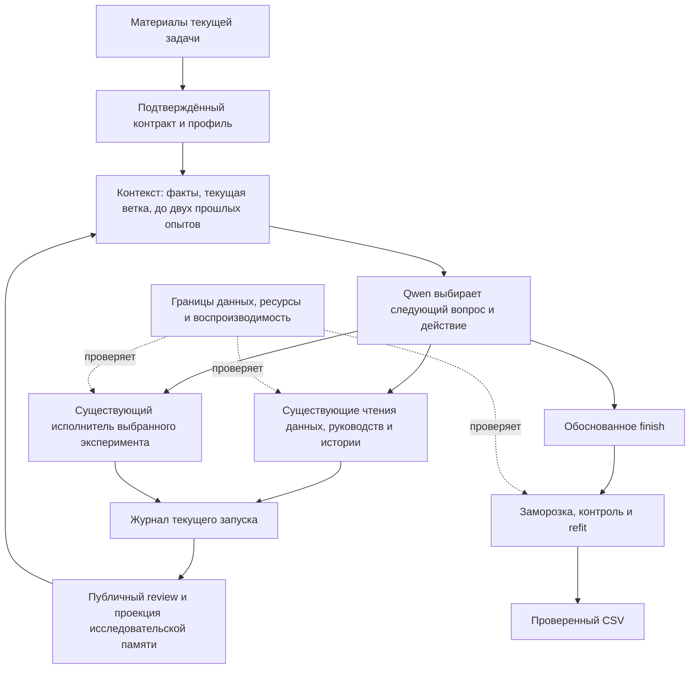

# Исследовательская память: реализация и протокол проверки

## Основания и границы

Перенос из AIDE/MLZero ограничен памятью ветки, сравнением рецептов и возвратом к альтернативам. Исследование и первичные ссылки: [обзор](2026-10-25-related-ml-agents.md). Чужой runtime, MCTS, дополнительные модели и зависимости не включались.

Требования организаторов проверены по `research/2026-10-20/evidence/case_pdf_extracted.txt`, страницы 7 и 17: Qwen через предоставленный API, данные текущей задачи, до трёх часов от запуска, 8 CPU / 32 GB, автономная валидация и файл предсказаний к окончанию. Дневной лимит ключа указан организаторами отдельно. Пользователь отменил дополнительные денежные ограничения тестов и квоты генераций/кандидатов; это не отменяет ресурсных ограничений ТЗ. Поиск не доказывает глобальную оптимальность.

Первый checkpoint `4155037` закрепляет модульный контекст и публичные руководства. Следующий checkpoint добавляет память; старые запуски сохраняют версии 1/2, новые получают версию 3. Все 17 действий и исполнители переиспользованы.

## Проблема → изменение → адресная проверка

| Подтверждённая проблема / запрос | Инженерное решение | Проверка |
|---|---|---|
| Семейство модели считалось исследованным после одного рецепта | Единый ключ структуры: семейство, представление, признаки, преобразования, imputation, objective, decision, transfer, composition | Другой preprocessing остаётся доступным; HPO и seed не создают новую ветку |
| Последний слабый вариант мог затереть лучший результат ветки | Лучший измеренный результат, последний результат и число вариантов хранятся отдельно | Регрессия с ухудшившимся HPO |
| Исход опыта теряется после сжатия контекста | Текущая ветка и до двух релевантных прошлых опытов, полные версионированные чтения | Native/JSON, все уровни компрессии, публичные маршруты |
| Числовое улучшение можно ошибочно принять за принятие гипотезы | Фактическая метрика и область отдельно от предположения агента; неизвестная интерпретация явно `unknown` | Отрицательные, unresolved и technical_failure исходы сохраняются |
| Несопоставимые измерения могут влиять на вывод | Фильтр task/data/split/library versions | После изменения протокола прежние опыты не попадают в текущую память |
| Закрытые данные не должны попасть в новые карточки | Только публичная проекция результатов, без labels, predictions и произвольного feedback | Проверки sentinel и закрытого control |
| Обязательные тесты зависели от отсутствующих outputs | Подлинный исторический baseline извлечён из отслеживаемого ZIP, проверен SHA; тесты отклонённого кандидата вынесены в research/tests | Основная коллекция: 1457 тестов без ошибок сбора; отсутствующий исторический эксперимент не объявляется успешным |

Новых обязательных полей команд, квот веток или порядка методов нет. Техническая ошибка не становится свидетельством плохого качества семейства. Полные hypotheses и recipe diff остаются в существующем experiment_review; inline содержит ограниченную проекцию. Защищённое ядро не расширено.

Чтение и эксперимент — альтернативы следующего действия, а не обязательная последовательность. Прежний резерв CSV и опора остаются в подготовке контроллера. При недоступности модели контроллер может закончить публикацию сохранённого результата; такая защита отдельно учитывается как техническое завершение, а не успешное решение агента. Между конкурсными задачами журнал и память не переносятся.

Ключ ветки описывает нормализованную декларативную структуру. Он не доказывает функциональную эквивалентность всех custom-преобразований или неактивных опций; интерпретацию полезности варианта по-прежнему проверяют экспериментом.

## Офлайн-свидетельства

Отдельные наборы (частично пересекаются): 77 проверок памяти/обзоров/legacy/контекста; 152 проверки компрессора, ML-регрессий, API и публичных границ. Ранее checkpoint контекста проверен HTTP-имитациями и полным маршрутом train → finish → refit → CSV. Эти проверки устанавливают доставку и гарантии, а не улучшение самостоятельного мышления или качества предсказаний.

## Живой протокол после уточнений пользователя

`tools/research_memory_series.py` экспортирует A=`6b0c0cd` и B=зафиксированный checkpoint. Adult AB, Bank BA, Bike AB, HAR BA. Одни и те же пять файлов, SHA из существующего manifest, seed 42, Qwen `qwen/qwen3.8-27b`, без квот вызовов/кандидатов, до 10800 секунд; 7 CPU / 28000 MB для worker с запасом под контроллер. Автоматическая ранняя остановка допустима. Снимки alpha-api-limits до/после каждого запуска. Смена периода/ключа, неизвестный расход или исход запрещают автоматическое продолжение серии.

Исторический preflight в `outputs/research_memory_ab_20261025` не выполнял генераций и остановился на неизвестном соответствии тарифов единицам шлюза. Его прежний денежный cap отменён последующими сообщениями пользователя. Этот preflight не является результатом сравнения.

Внешние labels не копируются в task-каталоги. До открытия оценок фиксируются проверяемые варианты и технические исправления. Наборы уже использованы в разработке: это исследовательская проверка, не свежий слепой тест. A/B измеряет совокупное изменение контекста и памяти, не вклад отдельных частей. Нативный локальный запуск не доказывает Docker-приёмку. Конкурсный ZIP и main не меняются.

Итоговая оценка должна разделять гарантии, основания решений и внешнюю метрику опубликованного CSV; пропущенные/ошибочные запуски отмечаются явно. Уменьшение SYSTEM и успешные тесты не считаются улучшением ML-качества.
