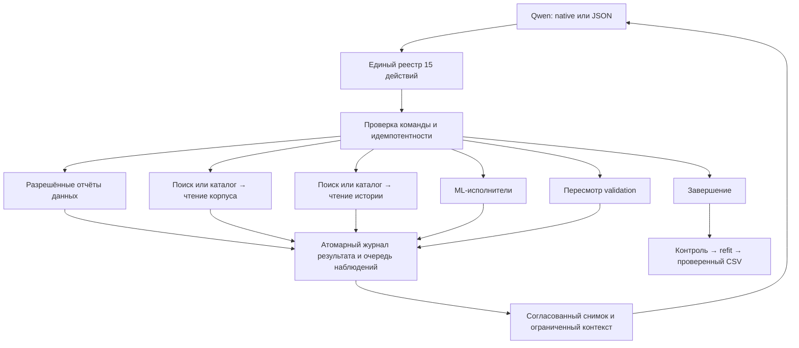

# API инструментов агента, версия 2

Публичный интерфейс содержит ровно 15 действий. Контроллер задаёт версию API и сохраняет её в журнале. Старые запуски открываются своим прежним runtime; API v2 отклоняет несовместимый журнал до обучения. Новые автоматические идентификаторы начинаются с `api2_`.

## Реестр и последствия

| Действие | Назначение | Последствия |
|---|---|---|
| `get_dataset_report` | Профиль, пропуски, категории, корреляции, разрешённые срезы и словарь | Чтение разрешённой области; протокол не меняется |
| `get_diagnostic_report` | Распределения, матрица ошибок или остатки: числовой отчёт и optional PNG | Изолированное вычисление; для ошибок — отдельное бюджетируемое обучение внутри fit; лидер и протокол не меняются |
| `revise_validation` | Предложение другой стратегии и обоснование | Проверка допустимости, переоценка, атомарная фиксация и восстановление |
| `search_knowledge` | Поиск документов, методов, рецептов и пространств параметров | Версионированные карточки, явная стратегия и причина резервного поиска |
| `list_knowledge` | Просмотр каталога | Каталог не обозначается совпадением с запросом |
| `read_knowledge` | Чтение конкретной версии материала | Точный фрагмент, диапазон, хеш, условия, предупреждения и продолжение |
| `search_run_records` | Поиск по словам и структурным фильтрам | Поиск в разрешённой истории текущего запуска |
| `list_run_records` | Просмотр истории по фильтрам | Устойчивая последовательность записей |
| `read_run_records` | До десяти записей или один версионированный источник | Код читается только для одного объекта; большой ответ разбивается на страницы |
| `train_model` | Декларативный кандидат | Существующий прямой ML-исполнитель |
| `run_automl` | Автоматический поиск | Существующие FLAML и AutoGluon |
| `tune_model` | Настройка параметров | Существующий Optuna |
| `run_custom_experiment` | Собственный Python-кандидат | Существующая проверка кода и изоляция работника |
| `build_ensemble` | Объединение совместимых кандидатов | Существующий исполнитель ансамблей |
| `finish` | Завершение исследования | Заморозка выбора, закрытый контроль, refit и проверенный CSV |

Источники машинных схем — `automl_agent/contracts.py` и `automl_agent/tool_results.py`. Снимок с диагностикой сохраняется в `outputs/visual_diagnostics_20261023/api_registry.json`; исторический реестр из `outputs/tool_api_v2_20261021` не изменяется. Старые имена сохранены только для внутренних исполнителей и диагностических тестов. Схемы, доступные Qwen, и валидатор принятой команды используют новый реестр.

## Визуальная диагностика, контракт 1

`get_diagnostic_report` принимает `kind=distributions|confusion_matrix|residuals`, до трёх `columns`, область `scope`, `include_target`, `experiment_id` и `budget_seconds` от 5 до 300 секунд. Распределения доступны по fit и разрешённым внешним признакам; таргет — только по fit. Модельные отчёты поддерживают single-target classification/regression и завершённые direct/Optuna-кандидаты текущего протокола. Выбранные параметры Optuna фиксируются, поиск заново не запускается.

Матрица и остатки относятся к заново обученной диагностической копии рецепта на внутренней части fit с сохранением групп и хронологии. Все обучаемые стадии остаются внутри этой части. Это исследовательская диагностика; она не заменяет внешнюю метрику или закрытый контроль. Малые классы подавляют матрицу целиком. Остатки определены как `y_true - y_pred` в исходной шкале, график зависимости от прогноза содержит агрегированные интервалы с поддержкой не менее 30 строк.

Инструмент возвращает компактный `summary`, версионированную ссылку `read` на полный числовой отчёт, `artifacts` с SHA-256/размером/происхождением и причину отсутствия PNG при необходимости. Рендер использует опубликованные агрегаты. Предельный PNG — 64 KiB и 1280 × 720; точные числа не заменяются считыванием с картинки. Повторная операция идемпотентна; одинаковый отчёт кешируется. Fit, предсказание и рендер учитываются в общем дедлайне и не вытесняют control/refit.

Изображение включается только для ещё не доставленного наблюдения, с проверкой данных, протокола, scope, источника и SHA-256. Snapshot фиксирует сами байты. Native и JSON передают текстовый блок и inline PNG; размер base64 входит в wire budget и аудит. При сжатии изображение можно опустить с явной отметкой, сохранив числа. Явный отказ модальности отключает изображения на текущем канале; неизвестный исход запроса сохраняет обычную остановку без текстового повтора. Одинаковые длинные и короткие описания полей в native-схемах передаются один раз; типы, обязательность и ограничения аргументов сохраняются.

Исследователь может сослаться на `evidence_ref` диагностики в следующей гипотезе. Дорогое исследовательское обучение проходит отдельного критика: порог — 120 секунд измеренной оценки, ограниченной выделенным временем; при неизвестной стоимости используется выделенный лимит. Критик получает короткий JSON с гипотезой, её ссылками, fit-агрегатами и разрешёнными результатами сравнения. Рисунок предназначен исследователю; сырьё предсказаний и закрытые метки критик не получает. Его оценка не заменяет числовую проверку гипотезы.

Замечания критика возвращают `hypothesis_revision_required`, невалидный ответ — `hypothesis_review_unavailable`; в обоих случаях `experiment_started=false`, кандидат не обучается и отрицательная ML-метрика не создаётся. Исправленную гипотезу проверяют повторно, неизменённый вердикт кешируется. Время критика входит в общий бюджет, после проверки доступное время обучения пересчитывается. Контроллер сохраняет полномочия над протоколом, доступом к данным и финальным control/refit.

Один шаг принимает только одну операцию. Если завершённый native-ответ содержит несколько вызовов, проверяется первый; остальные вызовы и их заметки отбрасываются без постановки в очередь. Недопустимый первый вызов не заменяется вторым. В native-аргументах однократно декодируются JSON-строки только для объявленных схемой объектов `PipelineSpec`, `Hypothesis` и nullable `RunSourceRef`; все последующие проверки доступа, версий и аргументов сохраняются. JSON-канал требует объекты сразу.

## Общий результат

В текущих исходниках профиль и корреляции расширены EDA v1: [единые факты, области доступа, worker и совместимость](eda_v1.md). Число публичных действий сохранено.

Ответ содержит `tool`, `tool_api_version`, `operation_id`, устойчивый `observation_id`, `evidence_ref`, `status`, `error_code`, `provenance`, `complete`, `continuation` и типизированный `data`. Происхождение включает текущий запуск, данные, протокол, корпус и хеш полезного результата. Отдельные источники добавляют область доступа и хеш содержимого.

Статусы: `success`, `no_matches`, `ambiguous`, `missing_version`, `unknown_id`, `incompatible`, `technical_failure`, `invalid_cursor`, `budget_too_small`, `interrupted`, `outcome_unknown`. Поисковая карточка всегда имеет `answer_confirmed=false`: совпадение слов не подтверждает ответ или применимость метода.

Результат пересмотра validation включает решение, состояние переоценки, предыдущий, предложенный и действующий хеши протокола, завершённых и ожидающих кандидатов. Отказ сохраняет прежний CSV; неизвестный исход не разрешает повторное обучение вслепую. Повтор того же `operation_id` возвращает сохранённый результат.

## Поиск и чтение

`auto` сначала проверяет точный символ, затем FTS5 и при необходимости лексический резерв. `exact_symbol`, `fts` и `lexical` можно запросить явно. Для коллекций методов, рецептов и пространств параметров используются каталог и лексический поиск. Неподдерживаемая стратегия возвращает диагностический статус.

Фильтры библиотеки и версии применяются до ограничения выдачи; оба значения должны принадлежать одной библиотечной паре. Сохранено исходное преимущество точных символов и связанных сигнатур. `match_strength` описывает это преимущество; BM25 в `score` меньше для лучшего совпадения. `score=null` у явно связанной сигнатуры означает отсутствие собственной оценки FTS, а не нулевую релевантность.

Курсор связан с действием, запросом, фильтрами и версией. Курсор истории дополнительно связан с запуском, правами и сохранённым списком ID. Изменение этих условий даёт ошибку, а не переход на другую выдачу. Чтение корпуса использует символьные диапазоны; чтение источников контекста — корректные границы UTF-8 в байтах.

`evidence_refs` гипотезы проверяются контроллером. Журнал связывает ссылку с конфигурацией и исходом эксперимента; наличие ссылки само по себе не доказывает применение рекомендации. Перестановка карточек, новое имя операции или чтение собственных новых квитанций не считаются новым исследовательским свидетельством.

## Маршруты

Контекст содержит обязательное ядро до 16 КиБ, наблюдения до 8 КиБ и ссылки на полные источники. Запрос проверяется вместе с инструкциями, схемами, обрамлением, запасом ответа и защитным запасом. Консервативная оценка по байтам не является числом токенов. Минимальный поддерживаемый бюджет — 131072 единицы этой оценки. Повторная подгонка использует один снимок.

Для памяти знаний сохранены форматы и семантика исходного компонента. Слой интеграции добавляет индексы темы и событий, инкрементальный перенос завершённых результатов и кеш действующего пакета; сам корпус и его поставляемые исходники не меняются.

## Статус приёмки

Доказательства и все попытки сохраняются в `outputs/tool_api_v2_20261021`. Краткая техническая проверка и один разрешённый живой прогон не заменяют четыре сценария S1–S4, парную серию качества или полную репетицию проекта. Прирост RMSE/Macro F1 этой работой не установлен. Указатель принятой версии сохраняется отдельно от нового кандидата.

Dataset report schema v3 adds fit-only `errors` in the autonomous development runtime. It consumes one of the same two fits as `train_model`. Responses expose separate analysis/delivery statuses; failed diagnostics are not successful analyses. See [development EDA](eda_autonomy.md). The upstream registry now has 15 actions; EDA exposes nine and retains its shared two-fit gate.

## Просмотр параметров библиотеки

Документация уже находится в замороженном корпусе. `search_knowledge(collection="documents", strategy="exact_symbol", query="<API symbol>")` возвращает прежний маршрут `read` и маршрут `parameters_read`. Через `read_knowledge` доступны:

- `view="document"` — прежний документ, условия и предупреждения;
- `view="parameters"` — раздел параметров с исходными декларациями, значениями по умолчанию и описаниями;
- `view="parameters", parameter="<exact parameter name>"` — один параметр.

Нужны реальные `id` и `corpus_version` из поиска. Продолжения привязаны к виду и выбранному параметру; диапазоны и хеши фрагментов относятся к исходному документу. Корпус не перезаписывается, неизвестные параметры и неподдерживаемые форматы не додумываются. Сохраняются исходные условия и предупреждения.

`entry.parameter_view.adapter` отдельно показывает разрешённые гиперпараметры готового адаптера, параметры под управлением контроллера и возможности, доступные лишь в самой библиотеке. Это описание интерфейса, а не рекомендация значений. Просмотр не обучает модель и не расходует fit. Число действий API остаётся 15.

## Методическая оценка v3

`get_dataset_report(report="errors")` и `train_model` в разработческом EDA принимают необязательный `evaluation`: rationale, assumptions, temporal_window_periods, gap_periods, method (`descriptive` / `moving_block`), block_periods, resamples, confidence, optional minimum_effect_abs/rel. Временной fit требует явного окна; после первой попытки design заморожен. Другие отчёты это поле не применяют. Full controller не рекламирует EDA-only поле и отклоняет его при исполнении.

В полном цикле существующий `revise_validation` принимает temporal_window_periods/gap_periods и может сохранить strategy, изменив окно. Закрытый control не меняется; сравнимые кандидаты пересчитываются с новым protocol hash. Подтверждённая forecasting-горизонтальность и group/time запреты не снимаются. Число действий остаётся 15.
