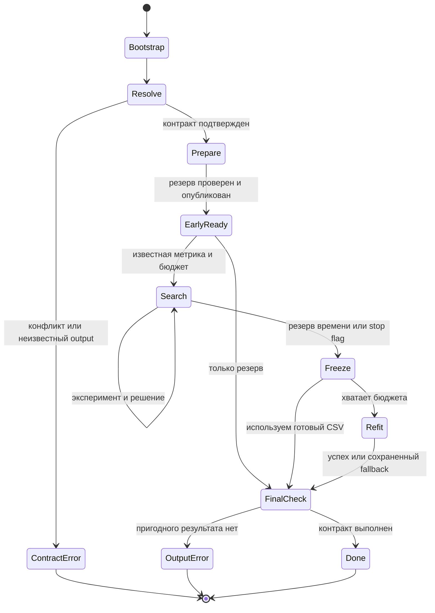

# Архитектура автономного ML агента для хакатона Альфа

**Обновление после исследования, 20.10.2026.** Организаторы уточнили: `mcp` в контейнере не установлен, инструменты выполняет сам скрипт решения по выбору модели. В реализуемом MVP Qwen управляет циклом исследования через прямой диспетчер без MCP. Состояние реализации и фактически выполненные проверки описаны в корневом `README.md`; оценки трудоёмкости и перечень непроверенного ниже относятся к исходному исследовательскому этапу, если явно не обновлены.

Дата исследования: 20 октября 2026 года. Назначение: согласование проекта и передача следующему инженеру. Статус: исследование и проектирование; исходный код решения ещё не создавался.

## Главный вывод и первые действия

Наиболее перспективен **один Qwen-исследователь под детерминированным контроллером**. Qwen разбирает неоднозначный текст, связывает наблюдения с гипотезами и предлагает следующий эксперимент. Контроллер выбирает допустимые действия, выделяет ресурсы, запускает проверенные ML-адаптеры, независимо считает метрики и единолично публикует CSV. Основной ML-набор: scikit-learn 1.5.2, CatBoost 1.2.8 и LightGBM 4.6.0. Optuna 4.2.1 добавляется после измерения стоимости простых запусков.

Первое действие после согласования — проверить **реальный контракт runner и состав предоставленного Docker-образа**. Затем собрать минимальный путь от позиционного аргумента `task.md` до проверенного резервного `submission.csv`. Только после этого добавлять сильную модель и исследовательский цикл. Публикация корректного результата не должна зависеть от доступности Qwen.

Резервный вариант — тот же контроллер с детерминированным выбором экспериментов и без обязательных обращений к LLM. Он полезен при отказе API и как контрольная система для абляции. Сам по себе фиксированный перебор моделей не закрывает исследовательскую часть кейса; полноценный MVP должен включать измеримый цикл «наблюдение → гипотеза → изменение → эксперимент → решение».

Самые опасные риски:

1. **Неверный контракт задачи:** неоднозначный target, устаревший путь, неверная метрика или перепутанные классы дают неправильный результат при успешно отработавшем коде.
2. **Нет готового файла к остановке:** последний refit может не закончиться. Проверенный CSV нужен в начале и после каждого принятого улучшения.
3. **Утечка и переобучение на validation:** улучшение локальной метрики может не переноситься на private.
4. **Непроверенная среда:** наличие пакета в requirements не подтверждает работоспособность нужного режима внутри образа.
5. **Слишком свободное исполнение:** обычный subprocess не изолирует произвольный Python от файлов и соседних процессов.
6. **Непереносимые результаты исследований:** опубликованные проценты медалей получены с другими LLM, GPU, временем и доступом к внешним материалам.

Победа, величина public score и качество на неизвестных private-задачах заранее не установлены. Все численные бюджеты, стартовые настройки и пороги ниже — проектные гипотезы для будущих измерений, если явно не указан источник требования.

## Локальные источники и фактические данные

Фактический корень: `/Users/elvsevolod/Desktop/учеба/Учёба 4 курс/хакатон альфа`. Обязательные файлы присутствуют. В корне и проверенных родительских каталогах проектных `AGENTS.md`/`CLAUDE.md` нет; глобальный `/Users/elvsevolod/.codex/AGENTS.md` прочитан.

Обозначения источников для реестра:

| Код | Источник и способ адресации |
|---|---|
| P | [PDF кейса](</Users/elvsevolod/Desktop/учеба/Учёба 4 курс/хакатон альфа/Альфа Хак_AutoML .pdf>), 20 страниц; номер физической страницы совпадает с печатным |
| O | [Ответы организаторов в извлечённом тексте](</Users/elvsevolod/Desktop/учеба/Учёба 4 курс/хакатон альфа/research/2026-10-20/evidence/organizer_answers.txt>), строки 1–13; оригинал — `ответы организаторов.rtf` |
| B | [baseline.py](</Users/elvsevolod/Desktop/учеба/Учёба 4 курс/хакатон альфа/data_for_participants/baseline.py>), 89 строк |
| R | [requirements.txt](</Users/elvsevolod/Desktop/учеба/Учёба 4 курс/хакатон альфа/data_for_participants/requirements.txt>), 48 строк |
| TR | [Регрессионный task.md](</Users/elvsevolod/Desktop/учеба/Учёба 4 курс/хакатон альфа/data_for_participants/Регрессия/task.md>), 120 строк |
| TC | [Классификационный task.md](</Users/elvsevolod/Desktop/учеба/Учёба 4 курс/хакатон альфа/data_for_participants/Многоклассовая классификация/task.md>), 77 строк |
| I | [Инвентаризация исходных файлов](</Users/elvsevolod/Desktop/учеба/Учёба 4 курс/хакатон альфа/research/2026-10-20/evidence/source_inventory.json>): абсолютные пути, SHA-256, размеры, заголовки CSV и число записей |

PDF прочитан полностью через извлечение текста. Страницы 7, 18 и 19 дополнительно просмотрены как изображения: так проверены ограничения и формулы, которые текстовый экстрактор пропускает. Для O номера строк относятся к сохранённому извлечению, поскольку RTF не имеет устойчивой построчной адресации. Конфигурации организаторского API, Dockerfile и runner среди 14 исходных файлов нет. Переменные окружения с секретами не выводились.

### Структура публичных задач

| Свойство | Регрессия | Многоклассовая классификация |
|---|---|---|
| Фактический каталог | `data_for_participants/Регрессия` | `data_for_participants/Многоклассовая классификация` |
| Train | 53 308 записей, 64 столбца | 87 670 записей, 44 столбца |
| Test | 22 449 записей, 63 столбца | 41 166 записей, 43 столбца |
| Признаки по словарю | 62 | 42 |
| Target в текущем примере | `site_eui` | `attack_cat` |
| ID в текущем примере | `id` | `id` |
| Словарь | 64 записи, 5 полей | 44 записи, 5 полей |
| Поля словаря | `feature,role,dtype,unit,description_ru` | Те же пять полей |
| Sample | 22 449 записей; `id,site_eui` | 41 166 записей; `id,attack_cat` |
| Основная метрика | RMSE, меньше лучше | Macro F1, больше лучше |

Количество CSV-записей и столбцов сверено потоковым чтением; это инвентаризация структуры, без обучения. Полный статистический профиль, частоты классов, дубликаты, распределения и пригодность validation сейчас не вычислялись. Имена в таблице описывают открытые примеры и **не становятся константами решения**.

В обоих фактических каталогах `train.csv`, `test.csv`, `sample_submission.csv` и `data_dictionary.csv` лежат рядом с `task.md`. Подкаталогов `regression/participants` и `multiclass/participants`, указанных в текстах, нет. В PDF, с. 10, словарь назван состоящим из пяти столбцов, но перечислены четыре; фактический файл содержит также `unit`.

### Проверенный реестр требований

Статус «подтверждено» относится к приложенным материалам, а не к результату запуска в платформенном образе. «Отсутствует» означает отсутствие нужного сведения в изученном комплекте. Предложения инженера выделены за пределами этого реестра.

| ID | Требование или неопределённость | Источник | Влияние на архитектуру | Статус |
|---|---|---|---|---|
| L01 | Python 3.12 | P, с. 7; R:1 | Только совместимые версии и стандартная библиотека 3.12 | подтверждено |
| L02 | ZIP; `solution.py` в корне; дополнительные модули допустимы | P, с. 6 | Тонкий entrypoint и пакет модулей в архиве | подтверждено |
| L03 | Docker, 8 CPU, 32 GB RAM | P, с. 7 | Один обучающий процесс; общий контроль потоков и памяти | подтверждено |
| L04 | Не более трёх часов на одну задачу; оценивается уже готовый файл | P, с. 7, 17 | Общий дедлайн и ранняя публикация результата | подтверждено |
| L05 | Отсчёт на с. 17 назван запуском `script.py`, на с. 6 entrypoint — `solution.py` | P, с. 6, 17; O:8 | Сохранить `solution.py`, уточнить runner; не добавлять самовольно другой entrypoint | неоднозначно |
| L06 | В public/private нет интернета; Qwen доступна через специальный API | P, с. 7; O:1 | Никаких веб-инструментов, установок и загрузок весов во время решения | подтверждено |
| L07 | В PDF написано Qwen3.8-27B | P, с. 7, визуально | Название не превращать в API model ID | подтверждено |
| L08 | Точные model ID, endpoint, контекстное окно, RPM/TPM и возможности JSON/tool calling | B:1, 47, 58, 67–69 задаёт только интерфейс; конфигурации нет | Отдельный адаптер API и проверка возможностей после получения конфигурации | отсутствует |
| L09 | Запрещены другие модели по собственным API-ключам | P, с. 7 | Один разрешённый провайдер; без запасного внешнего LLM | подтверждено |
| L10 | Только данные кейса для обучения; предобученные модели запрещены | P, с. 7 | Без TabPFN/TabICL, embeddings и внешних датасетов; предоставленная Qwen — отдельная предусмотренная возможность | подтверждено |
| L11 | requirements ограничивает агент, инструменты и генерируемый код | O:3; P, с. 7; R:4–48 | Малый набор разрешённых библиотек; никаких runtime-install | подтверждено |
| L12 | baseline импортирует `mcp`, которого явно нет в R | B:11–13; R:1–48 | Риск совместимости; внутренний MCP можно заменить прямым диспетчером при сохранении публичного интерфейса | подтверждено |
| L13 | `mcp` в контейнере не установлен; инструменты предоставляет скрипт решения | Уточнение организаторов от 20.10.2026, переданное пользователем; evidence/mcp_clarification_2026-10-20.txt | Прямой диспетчер инструментов, без импорта MCP | подтверждено ответом организаторов |
| L14 | Три посылки на команду в день, обновление в 00:00 МСК | P, с. 6 | Внешний процесс разработки хранит версии и расход отправок | подтверждено |
| L15 | «Отдельной квоты на запуск нет» и «Отдельного лимита по количеству нет» без вопросов | O:10–11 | Не отменять L14, лимит LLM и общий дедлайн по этим фразам | неоднозначно |
| L16 | 600 рублей в день — общий ключ на время разработки | P, с. 7 | Вести командный расход разработки; не присваивать 600 ₽ каждому запуску | подтверждено |
| L17 | Денежный/токенный бюджет одного платформенного вызова и тариф | P, с. 8 упоминает лимит LLM, но не раскрывает; O:10–11 без контекста | Ограничивать число запросов и время; рублёвую стоимость оставлять неизвестной до ответа | отсутствует |
| L18 | Платформа передаёт параметры, включая путь к задаче; ориентир — baseline | O:8; B:85–89 | Позиционный путь `task.md`, fallback `./task.md`; точную полную команду уточнить | подтверждено |
| L19 | Точная команда runner, дополнительные аргументы и семантика exit code | Только B и O:8 | Не отбрасывать неизвестные аргументы молча; проверить адаптер запуска | отсутствует |
| L20 | Код копируется в каталог задачи; запуск из него; итоговый CSV там же | O:13; TR:111–120; TC:68–77 | `task_root = task_path.parent`; корневой результат `task_root/submission.csv` | подтверждено |
| L21 | Рабочие подкаталоги и `/tmp` допустимы; ориентировочно 30–35 GB свободно | O:10, 12 | Рабочие артефакты по задачам; проверять фактическое свободное место | подтверждено |
| L22 | Задачи запускаются независимо; файлы между ними не переносятся | P, с. 17 | Нет памяти обучения между кейсами; только общий код и правила | подтверждено |
| L23 | Public — две задачи; private — две новые с неизвестными содержанием и метриками | P, с. 5, 16, 19 | Контрактный разбор задачи и реестр метрик; без hardcode публичных кейсов | подтверждено |
| L24 | Промежуточного feedback скрытого теста у агента нет | P, с. 17 | Все решения по train/validation; никаких платформенных запросов из цикла | подтверждено |
| L25 | Система должна исследовать гипотезы и выбирать решение по своей validation | P, с. 5, 11–14, 17 | Явный журнал наблюдений и проверенных изменений | подтверждено |
| L26 | Одноагентная и мультиагентная схемы допустимы | P, с. 8, 13 | Выбор по стоимости и измерениям, не по формальному числу ролей | подтверждено |
| L27 | Генерация и исполнение кода указаны как часть работы агента | P, с. 5, 17 | Сохранять исполняемую программу кандидата | подтверждено |
| L27a | Достаточна ли компиляция ограниченной программы или нужен произвольный Python от LLM | В P способ генерации не специфицирован | Уточнить трактовку без включения свободного исполнения по умолчанию | неоднозначно |
| L28 | Для описанного формата: единый шаблон task.md; четыре CSV; UTF-8, запятая, десятичная точка, пустая ячейка — пропуск | O:5; P, с. 9; TR:13–24; TC:17–26 | Разбор по ролям и схеме; строгая проверка заголовков | подтверждено |
| L29 | Вложенные пути текста не существуют; CSV находятся рядом | TR:15–18; TC:19–22; I | Контролируемое согласование путей с записью причины fallback | подтверждено |
| L30 | Публичная регрессия: RMSE на исходной шкале | TR:100–107; P, с. 9, 18 | Сравнение после обратного преобразования таргета | подтверждено |
| L31 | Публичная классификация: Macro F1; Accuracy/Weighted F1 справочные | TC:56–64; P, с. 10, 18 | Выбор модели по Macro F1, не по Accuracy | подтверждено |
| L32 | Точные публичные схемы, порядок строк, конечные числа/допустимые классы, уникальные ID | TR:109–120; TC:66–77 | Проверять контракт перед каждой публикацией; уникальность включать по условиям конкретной задачи | подтверждено |
| L33 | Значения в sample не являются ответами | TR:18–19; TC:22 | Sample — схема/шаблон, не метки для обучения | подтверждено |
| L34 | `id` регрессии не подтверждён как постоянный ID здания | TR:36; словарь регрессии, запись 64, физическая строка 65 | Не группировать здания и не выводить временную структуру только по ID | подтверждено |
| L35 | Погода известна за тот же год; задача не прогноз до начала года | TR:9, 28–30 | Наличие периода не требует автоматически time split | подтверждено |
| L36 | Классификация: test — stratified-половина официального holdout; `label` удалён как утечка | TC:28–30 | Стратификация — начальный выбор; возможен разрыв распределений с официальным holdout | подтверждено |
| L37 | Баллы нормируются относительно baseline; две задачи имеют одинаковый вес | P, с. 18–19, визуально | Различать raw metric и score; не объединять RMSE и F1 простым средним | подтверждено |
| L38 | Численные значения baseline-нормировок и полный список private-типов/метрик | В комплекте не найдены | Не вычислять выдуманный сайт-score; ограничить заявленную универсальность | отсутствует |
| L39 | Точный алгоритм выбора версии для private при совпадении public score | P, с. 16: «сохраненную последнюю версию … с лучшим public score» | В разработке хранить все версии; детали выбора уточнить перед финальной отправкой | неоднозначно |

При конфликте источников не действует правило «RTF всегда новее и всё отменяет»: в файле нет исходных вопросов и дат. Явное уточнение по конкретному пункту может заменить старое правило; оторванная фраза этого не делает. До ответа L14 сохраняется, L16 не расширяется, entrypoint остаётся `solution.py`.

### Формулы платформенного score

На P, с. 18–19:

```text
S_reg = 100 × max(0, 1 − RMSE / B_RMSE)
S_cls = 100 × max(0, (MacroF1 − B_F1) / (1 − B_F1))
Score_public = (S_reg + S_cls) / 2
Score_private = (S_1 + S_2) / 2
```

Условия: `B_RMSE > 0`, `B_F1 < 1`. Численные B не опубликованы в комплекте. Локальная RMSE/F1, нормированный сайт-score и перенос на private — разные величины. Формулы public нельзя автоматически применить к другой private-метрике.

## Инженерный разбор baseline

| Узел | Что делает код | Следствие |
|---|---|---|
| Запуск | B:85–89: `--mcp-server` запускает сервер, иначе берётся первый аргумент, по умолчанию `task.md` | Сохранить внешний способ передачи пути; не считать его полным описанием runner |
| Чтение | B:17–18, 44–46: `Path.resolve()`, целиком UTF-8 | Нет ограничения размера/проверки источников; task_root определяется корректно |
| Клиент | B:47 читает `OPENAI_MODEL`; B:58 создаёт `AsyncOpenAI()`; B:1 перечисляет `OPENAI_API_KEY`, `OPENAI_MODEL`, `OPENAI_BASE_URL` | Имя модели явно берётся из env. Key/base URL передаются через настройки SDK, а не захардкожены. Организаторского значения URL нет |
| Сообщения | B:48–52: system просит простейшую ML-модель и относительные пути; user получает весь task | Это стартовая инструкция, а не контроллер качества |
| MCP | B:21–25, 53–65: отдельный stdio-сервер на том же Python; его cwd — каталог task | Внутренняя обвязка, не доказанная часть внешнего платформенного протокола |
| Единственный инструмент | B:25–41: `run_python(code)` → новый `sys.executable -u -c code` | Переменные, импортированные объекты и RAM предыдущего Python-вызова теряются; файлы в cwd сохраняются |
| Окружение инструмента | B:35 передаёт только `PATH=os.defpath` и `PYTHONIOENCODING=utf-8` | Ключ не наследуется через env, но возможна потеря нужных переменных native-библиотек; subprocess остаётся тем же пользователем |
| Вывод | B:34, 37–39: `capture_output=True`, затем последние 12 000 символов каждого потока | Полный вывод сначала накапливается в памяти. Обрезка на возврате не ограничивает его пиковый размер |
| Время | B:34: 1 800 секунд на инструмент; B:66: до 100 LLM-ответов | Это не общий трёхчасовой бюджет. Одни инструменты теоретически могут занять намного больше трёх часов |
| Вызов LLM | B:67–69: chat completions, tools, `parallel_tool_calls=False` | Нет явных application-level timeout, token cap, бюджета и политики отказов. `False` не заменяет общий диспетчер ресурсов |
| Цикл | B:70–81: сохраняется ответ assistant, выполняются tool calls, добавляется текст результата | История растёт без компактизации; состояние контролируется текстом LLM |
| Ошибки | B:40–41 перехватывает TimeoutExpired; B:79–80 — ValueError аргументов | API-ошибки, падение MCP, файловые ошибки, непредвиденные исключения и OOM не получают общей стратегии восстановления |
| Завершение | B:72–74: отсутствие tool calls завершает агента; B:82 — ошибка после 100 шагов | Успешный текстовый ответ не доказывает существование и корректность CSV |

Обычно timeout `subprocess.run` завершает управляемый процесс, но в baseline нет явного контроля всей группы потомков. Память, число CPU-потоков, размер файлов и место на диске не контролируются. Нет отдельного validation evaluator, реестра кандидатов, атомарного best-pointer, проверки CSV и защиты лучшего результата.

**Сохранить:** позиционный путь/`task.md` по умолчанию, UTF-8, привязку к каталогу задания, env-контракт организаторской Qwen, совместимый chat-интерфейс после проверки endpoint, идею отдельных процессов и текстовую диагностику.

**Заменить:** системную просьбу о простейшей модели, бесконечно растущую историю, 100 шагов как единственный ограничитель, свободный `run_python`, внутренний MCP при ненужности для runner, завершение по словам LLM. Вместо них — проверяемые контракты, ограниченный диспетчер и журнал экспериментов. Это не требует менять входной аргумент или местоположение результата.

### Безопасное разрешение файлов

1. Разрешить `task_path` из аргумента и получить `task_root`. Допустимые корни данных определяются runner; до уточнения — каталог задачи и его потомки.
2. Проверить явные относительные пути текста внутри допустимого корня. Отклонять выход через `..`/symlink за разрешённую область; абсолютный путь разрешать лишь по явному контракту runner.
3. Если путь отсутствует, проверить **только** четыре ожидаемых basename в `task_root`. Проверить заголовки, роли словаря, наличие target только в train и совместимость sample с test.
4. Если комплект единственный и непротиворечивый, записать `path_resolution=task_root_basename_fallback`, исходный отсутствующий путь и выбранный фактический. В текущих двух задачах такой вариант подходит по структуре.
5. Если существуют два разных полных комплекта, нет файла или схемы расходятся, вернуть `AMBIGUOUS_DATASET`/`MISSING_INPUT`/`SCHEMA_CONFLICT`. Не выбирать «первый найденный» и не искать рекурсивно по машине. Допустимая глубина дополнительного просмотра подкаталогов — только явно перечисленные пути задания/runner.

## Исследования и переносимые решения

Ниже — выбранные первоисточники, доступные на дату исследования. Проценты медалей описывают конкретные исследовательские протоколы; они не прогнозируют результат нашего контейнера. Версия статьи отделена от текущей ветки кода.

### AIDE

[Статья AIDE](https://arxiv.org/html/2502.13138v1), 18.02.2025, v1. Решает проблему длинного неструктурированного trial-and-error: хранит дерево решений, выбирает draft/debug/improve, ограничивает исправления и передаёт LLM компактную сводку. Переносим родительские связи экспериментов и одно измеримое изменение за итерацию. Не переносим свободное переписывание всего скрипта.

Независимая оценка в [MLE-bench](https://arxiv.org/abs/2410.07095) сообщала 16,9% медалей для o1-preview+AIDE на 75 соревнованиях; это другое оборудование и время. Собственная оценка AIDE также обсуждает contamination и несовпадение holdout с историческим Kaggle test.

[Репозиторий](https://github.com/WecoAI/aideml) — MIT. В доступной [истории](https://github.com/WecoAI/aideml/commits/main/) есть изменения 2026 года, включая отбраковку NaN-метрик и исправление направления оптимизации. Текущий [requirements](https://raw.githubusercontent.com/WecoAI/aideml/main/requirements.txt) требует, например, `openai>=1.69.0`, `numpy==1.26.2`, `pandas==2.1.4` и незаявленные пакеты. Копирование установки несовместимо с нашим фиксированным набором; алгоритмическую идею реализуем самостоятельно.

### AIRA dojo

[Статья](https://arxiv.org/html/2507.02554v2), первая версия 03.07.2025, изучена v2 от 04.11.2025. Совместно меняет search policy и операторы улучшения; авторы сообщают рост медалей на Lite с 39,6% до 47,7%. Протокол: 24 часа, H200, 24 CPU, 100 GB RAM; доступны пакеты и checkpoints из сети. Поэтому результат не доказывает пользу MCTS при трёх часах CPU.

Переносим явный выбор между новой веткой, улучшением и ремонтом. Начинаем с жадного улучшения и редкого переключения ветки при застое; MCTS — только будущая абляция.

[Код](https://github.com/facebookresearch/aira-dojo) обозначает версию 0.1.0. В [pyproject](https://raw.githubusercontent.com/facebookresearch/aira-dojo/main/pyproject.toml) стоит классификатор MIT, но [LICENSE](https://raw.githubusercontent.com/facebookresearch/aira-dojo/main/LICENSE) содержит CC BY-NC 4.0. Из этого расхождения нельзя выводить свободное коммерческое использование. Код не копируем. [Зависимости](https://raw.githubusercontent.com/facebookresearch/aira-dojo/main/requirements.txt) включают Hydra, submitit, wandb и NumPy 2.2.4; инфраструктура Apptainer/Slurm также избыточна для предоставленного контейнера.

### MLE STAR

[Статья](https://arxiv.org/html/2506.15692v3), первая версия по карточке arXiv — 27.05.2025, изучена v3 от 28.08.2025; [анонс авторов](https://research.google/blog/mle-star-a-state-of-the-art-machine-learning-engineering-agents/) — 01.08.2025. Цикл: веб-поиск начальных моделей, абляция компонентов, локальное улучшение блока, ансамбль и ограниченный debug. При одном backend Gemini-2.0-Flash авторы сравнивают AIDE 25,8% и MLE-STAR 43,9% медалей на Lite; 63,6% относится к Gemini-2.5-Pro. Эксперименты использовали до 24 часов, 96 vCPU, 360 GB RAM и восемь V100.

Переносим точечную проверку преобразований и диагностику ошибок, а не веб-поиск, веса и полную систему ролей. Отдельный LLM-checker утечки не заменяет ограничения кода.

Указанный официальный `google/adk-samples` сейчас перенаправляется в [adk-recipes](https://github.com/google/adk-recipes); прежний путь примера `python/agents/machine-learning-engineering` при проверке недоступен. Общая лицензия репозитория — [Apache 2.0](https://raw.githubusercontent.com/google/adk-samples/main/LICENSE), но точная текущая реализация и её зависимости не подтверждены. ADK отсутствует в нашем R; готовый код не включаем.

### R and D Agent и Gome

[R&D-Agent](https://arxiv.org/html/2505.14738v2): первая версия 20.05.2025, v2 от 01.10.2025. Отделяет исследование от разработки и связывает планирование, память, реализацию и оценку. Полезна независимость этих компонентов. Ограничение оценки: часть абляций выполнена единичными прогонами; сравнения разных LLM и оборудования не изолируют архитектурный эффект.

[Gome](https://arxiv.org/html/2603.01692v3): первая версия 02.03.2026, v3 от 12.04.2026. Использует структурированную диагностику и память успешных изменений. В закрытом от внешнего retrieval протоколе авторы сообщают 35,1% медалей с GPT-5 за 12 часов на V100, 12 vCPU и 220 GB RAM; преимущество рассуждений зависит от силы LLM. Для нашей Qwen такой эффект не измерен.

Переносим короткую запись «какая ошибка → какое изменение → какой ожидаемый эффект»; не добавляем несколько параллельных траекторий по умолчанию. Публикации связаны общей [кодовой базой](https://github.com/microsoft/RD-Agent), поэтому не считаются двумя независимыми подтверждениями одного результата.

Код MIT; текущие [зависимости](https://raw.githubusercontent.com/microsoft/RD-Agent/main/requirements.txt) включают Docker SDK, Selenium, Kaggle и другие отсутствующие в R пакеты. Полный импорт не подходит. Версия ветки `main` не равна версии исследовательского эксперимента.

### Autoresearch

[Первичный репозиторий и описание](https://github.com/karpathy/autoresearch), ветка `master` просмотрена 20.10.2026, версия manifest 0.1.0; датированный стабильный релиз не подтверждён. Агент изменяет один обучающий файл, запускает короткую пробу, сохраняет или откатывает изменение. Пятиминутный тренировочный бюджет исключает часть запуска/компиляции и не равен пятиминутному общему лимиту процесса.

Это полезный образец минимального контролируемого цикла, а не доказательство качества на табличных private-задачах. Переносим ограниченную область изменений и обязательное сохранение результата. Не переносим nanochat, загрузку обучающих данных, GPU-зависимости и бесконечный ночной поиск.

README объявляет MIT, но отдельный файл LICENSE по проверенному стандартному пути не получен: для копирования нужен дополнительный разбор конкретного commit. Он здесь не требуется. В [manifest](https://raw.githubusercontent.com/karpathy/autoresearch/master/pyproject.toml) указаны Torch 2.9.1, NumPy ≥2.2.6, tiktoken и rustbpe, что расходится с R. Совместима идея, а не готовая установка.

### FLAML как детерминированный партнёр агента

[Статья FLAML, MLSys 2021](https://www.microsoft.com/en-us/research/wp-content/uploads/2021/03/MLSys21FLAML.pdf) рассматривает качество вместе со стоимостью пробы, размером данных и выбором learner. Это прямое основание сначала измерять малые кандидаты, а затем увеличивать ресурсы перспективным. Исследование старше текущих версий и не устанавливает победителя нашего кейса.

[FLAML 2.3.6](https://pypi.org/project/FLAML/2.3.6/) выпущена 15.08.2025, MIT. Разрешённый `automl` extra в [коде этой версии](https://raw.githubusercontent.com/microsoft/FLAML/v2.3.6/setup.py) совместим по указанным диапазонам с нашим XGBoost 2.1.4 и sklearn 1.5.2. Но `blendsearch` требует Optuna ≤3.6.1, а дополнительный `catboost` extra ограничен ≤1.2.5 для Python ≥3.11. Эти режимы нельзя автоматически считать совместимыми с R. Резервная абляция использует только проверенный `automl`/CFO и ограниченный список learners; без Ray и дополнительных extras.

### Октябрьские работы и их влияние на выбор

Дополнительный поиск публикаций за последние 120 дней охватывает период до 20.10.2026. Две свежие работы существенно затрагивают ограничения кейса, но не требуют расширять runtime.

[MLE-InsightForge и MLE-InsightBench](https://arxiv.org/html/2610.04927v1), 04.10.2026, v1: собирают подсказки из связанных соревнований и сравнивают их выдачу по запросу с предварительным playbook. В наборе 160 соревнований, но target-задач 12, остальные служат источниками. Авторы отдельно рассматривают утечку через родственные соревнования и знания LLM; эксперимент использует 12 часов и GPU. Относительное улучшение нормированного score в их протоколе нельзя превращать в ожидаемые баллы нашего сайта. Переносим **формат** краткой записи «триггер → действие → источник → способ проверки», выдаваемой по необходимости. В контейнер не включаем готовые Kaggle-writeups, competition-specific playbooks или межзадачную память. Лицензия статьи CC BY 4.0; лицензия/зависимости отдельной исполняемой реализации не подтверждены, её копирование не предлагается.

[MLExpert](https://arxiv.org/html/2610.22344v1), 15.10.2026, v1: обучает специализированную 35B MoE-модель через SFT и RL, объединяя решения между соседними результатами экспериментов в окно обратной связи. Авторы сообщают рост медалей Lite с 37,9% базовой модели до 72,7%; бюджет оценки — 12 часов, H200, 20 vCPU и 220 GB RAM. Это свежий авторский preprint, а не независимое подтверждение эффективности нашего контроллера. Саму модель, её веса, дообучение и внешние тренировочные задачи переносить нельзя: в кейсе разрешена предоставленная Qwen. Полезна идея привязывать решение планировщика к завершённому эксперименту и его артефактам. [Репозиторий](https://github.com/InternScience/MLExpert) доступен, но полный package/license audit не завершён; лицензия публикации arXiv не заменяет лицензию кода/весов. Готовая реализация не включается.

### Что именно измеряют бенчмарки

| Источник и дата | Полезное свидетельство | Ограничение и решение для проекта |
|---|---|---|
| [MLE-bench](https://arxiv.org/abs/2410.07095), 09.10.2024; [текущий протокол](https://github.com/openai/mle-bench) | 75 Kaggle-задач; отдельно учитываются созданный файл, валидная посылка и медаль; рекомендуются ≥3 seed | Типовые ресурсы: 24 часа, 36 vCPU, 440 GB RAM, A10. Используем разделение показателей, не переносим проценты медалей |
| [FML-bench](https://arxiv.org/html/2605.17373v2), 17.05.2026; v2 29.05.2026 | 18 задач, 6 стратегий, по 3 прогона, общий LLM и редактор, 100 шагов. Простой greedy почти сравнялся с более сложным деревом; разбор причин отказов полезнее одного итогового числа | Это переносы стратегий на другой набор задач, A100-80GB, GPT-5.4 и заданный evaluator. Корреляции поведения не доказывают причинность. Начинаем с простого поиска и проверяем усложнения при равном бюджете |
| [TabArena](https://arxiv.org/html/2506.16791v4), 20.06.2025; v4 03.11.2025 | Сильные бустинги, HPO и ансамбли нужно сравнивать с учётом затрат; разные режимы меняют ранжирование моделей | Не доказывает универсальное превосходство CatBoost; нейросети и foundation-модели в других режимах также сильны. Выбираем CPU-бустинги из разрешённого набора, не копируем весь benchmark |

[FML-bench](https://github.com/qrzou/FML-bench) имеет Apache 2.0, но его тренировочные задачи, окружения и предобученные средства анализа кода не включаются в решение. [TabArena](https://github.com/autogluon/tabarena) также используется как источник методологии, без скачивания датасетов, весов и новых пакетов. Обновляемый текущий leaderboard не равен зафиксированному эксперименту статьи.

### Связь источников с проектными решениями

| Источник → наблюдение | Применимость | Выбранное решение | Риск |
|---|---|---|---|
| AIDE → короткие независимые улучшения и ограниченный debug | Много дорогих ML-проб | DAG/дерево происхождения, одна гипотеза на изменение, максимум один ремонт | Упрощённый поиск может пропустить комбинации |
| AIRA → политика поиска зависит от операторов | Нельзя выбрать MCTS отдельно от качества действий | Сначала проверить полезность операторов; дерево шириной до трёх рабочих ветвей | Порог переключения пока не измерен |
| MLE-STAR → улучшение отдельного компонента | Валидация и исполнение дороги | Менять признаки или модель отдельно; абляция только при ожидаемой пользе | Слишком мало взаимодействий между компонентами |
| R&D/Gome → исполнение даёт больше информации, чем одно число | Есть журнал ошибок и срезы качества | Передавать Qwen структурированную диагностику | Qwen может неверно объяснить корреляцию |
| FML-bench → сложность не гарантирует выигрыш | 3 часа и неизвестные private | Один исследователь; роли добавляются только после абляции | Вывод исследования может не переноситься на нашу LLM |
| MLE-InsightForge → происхождение подсказок влияет на честность оценки | Запрещены внешние данные и межзадачные файлы | Общие проверяемые правила, без банка готовых решений соревнований | Неизвестна contamination разрешённой Qwen |
| MLExpert → обучение самой LLM меняет её исследовательскую способность | Подменять предоставленную Qwen нельзя | Фиксированный backend, сравнивать способы управления при нём | Опубликованный выигрыш обученной LLM не переносится на наш scaffold |
| FLAML → учитывать стоимость кандидата | 8 CPU, жёсткий дедлайн | Пробы на малом ресурсе и отдельная оценка refit | Нелинейное масштабирование времени |
| TabArena → бюджет и ансамбли меняют сравнение | Нужен сильный компактный ML-набор | CatBoost/LightGBM; ансамбль только с запасом refit/predict | Лучший набор зависит от данных |
| [sklearn о leakage](https://scikit-learn.org/1.5/common_pitfalls.html) → preprocessing учится только на training fold | Много преобразований и гипотез | Fold-aware pipeline; split до fit | Скрытые связи объектов остаются возможны |
| [Адаптивная переиспользуемая validation](https://arxiv.org/abs/1506.02629), 2015 → повторный подбор повышает оптимизм | Поиск на одной validation | Скрытая от планировщика контрольная часть и лимит гипотез | Это снижение риска, не формальная реализация reusable holdout |

## Сравнение архитектур

Оценки ниже — инженерные ожидания, пока не результаты наших измерений.

| Критерий | А Детерминированный AutoML с небольшой ролью Qwen | Б Один агент с управляемыми инструментами | В Исследователь и отдельный критик |
|---|---|---|---|
| Обобщение | Хорошо внутри заданных моделей/метрик; новые семантические особенности ограничены | Может связывать описание, профиль и новые допустимые преобразования | Дополнительная проверка гипотез возможна, но роли используют ту же Qwen |
| Надёжность | Высокая при корректном TaskSpec; минимум динамического кода | Высокая только при жёстком контроллере и ограниченном языке действий | Та же опора на контроллер; критик не создаёт защитную границу |
| Разработка | Наименьшая; основной риск интеграции AutoML и split | Средняя; нужны контракты и программа признаков | Выше; протокол споров, согласование состояний и лимит повторов |
| LLM-вызовы на задачу | Ориентир 0–3 | Ориентир 6–12; общий cap ниже | При том же числе итераций примерно вдвое больше; при равном cap — меньше экспериментов |
| Время | Максимум времени на ML; слабее диагностика | Несколько минут на LLM; ML идёт последовательно | Роли могут задерживать решения; параллельный API ещё не подтверждён |
| RAM | Определяется AutoML, bagging и числом моделей | Одна модель в процессе, лёгкий родитель | Аналогично при последовательном исполнении; параллельные обучения опасны |
| Отладка | Простая последовательность, но внутренности AutoML иногда непрозрачны | Каждый переход и spec записан | Нужно разбирать и модельные ошибки, и коммуникацию ролей |
| Отказ API | Детерминированный поиск продолжает работу | Переключение на А с тем же состоянием | Критик отключается; затем переход к Б/А |
| Главный недостаток | Риск получить обычный AutoML без реального исследования | Ограниченная грамматика не охватывает все новые задачи | Дополнительная стоимость без гарантированного прироста |

**Выбор — Б:** один Qwen-исследователь и контроллер на обычном коде. Разбор задачи, предложения и объяснение результата — фазы одного агента, а не постоянный коллектив ролей. Модель не получает права менять evaluator, split, бюджет или итоговый файл. Резерв А реализуется раньше и остаётся доступен при любом отказе Qwen. В — расширение после измеримого выигрыша при одинаковом суммарном бюджете.

Универсальность задаётся контрактами и языком допустимых преобразований. Агент действительно выбирает следующую гипотезу по результатам, может отвергнуть прошлую стратегию и составить новое выражение признака. Но он не обещает произвольное научное программирование. Исполняемый код кандидата порождается доверенным компилятором из проверенного ExperimentSpec/FeatureProgram; план, программа и код сохраняются для аудита. Если организаторы требуют именно свободный Python от LLM, это отдельное изменение области исполнения и риска, а не незаметная замена внутри MVP.

## Поддерживаемая область и полный жизненный цикл

### Границы универсальности

| Приоритет | Поддерживаемая область | Поведение за границей |
|---|---|---|
| P0, обязательный MVP | Табличные UTF-8 CSV, один target; регрессия, binary/multiclass classification; число/строка класса на строку test; явно заданная схема | Поиск типа, роли и target по контракту, без имён публичных папок и датасетов |
| P0 | Метрики RMSE, MSE, MAE, R², Accuracy, Balanced Accuracy, F1 binary/macro/weighted с явными параметрами | Известная метрика нормализуется в локальный registry; конфликт направления — ошибка контракта |
| P1, до заявления поддержки вероятностных задач | Binary ROC AUC/AP/log loss; multiclass log loss и ROC AUC с явным способом усреднения и порядком классов; вероятность или несколько вероятностных столбцов в ответе | Пока соответствующий адаптер и тесты не готовы, задача помечается unsupported; нельзя выдавать класс вместо вероятности |
| P0 | Random/stratified/group/time split при однозначном контракте; group/time имеют приоритет над удобством случайного split | Если структура требует ещё не реализованного комбинированного split, не заменять его random молча; оставить fallback-only |
| P1 | Сложные комбинированные splits, генерация признаков из дат и короткий табличный текст без весов | Time split для табличной модели не равен полноценному forecasting engine |
| P2 | Длинный текст через train-only TF-IDF/HashingVectorizer и линейную модель, без embeddings | Отдельно оценить память, интерпретацию формата и время |
| Не заявлено | Изображения, аудио, ranking, detection, sequence generation, survival, multilabel/multioutput, произвольные метрики и внешние источники | `UNSUPPORTED_TASK`/`UNSUPPORTED_OUTPUT`; не маскировать под регрессию |

Список private-задач не раскрыт. Поэтому P0 закрывает подтверждённое семейство примеров, а не все обещанные PDF «другие задачи ML». Вероятностные метрики — ближайшее расширение из-за их частоты и небольшого изменения интерфейсов. Даже P0 требует доступного target, непротиворечивой схемы и данных, которые можно обработать в бюджете. При чрезмерном размере возможен только потоковый константный резерв с отметкой `resource_limited`.

**Неизвестная метрика:** если target, тип задачи и output однозначны, сохранить допустимый резерв, поставить `quality_status=unscored_fallback`, не вести бессмысленный поиск и не называть выбранную модель лучшей по этой метрике. Нельзя подменять неизвестную метрику RMSE/Accuracy молча. Если неизвестны сам target, тип предсказания или выходная схема, даже валидность резерва не установлена: завершить с диагностикой контракта, не создавать произвольный CSV.

### Последовательность запуска

1. **Bootstrap.** Зафиксировать monotonic start как можно раньше, до тяжёлых импортов. Прочитать аргументы, получить task_root, проверить доступность входов и записи. Прочитать доступные лимиты CPU/памяти, а не характеристики локального Mac. Подготовить минимальный родительский процесс и run directory. Неподтверждённые дополнительные аргументы runner не игнорировать.
2. **TaskSpec.** Извлечь явные пути, target, ID, единицу наблюдения, метрику/направление, sample и ограничения. Qwen используется только при необходимости текстового разбора; её ответ не устанавливает факты сам по себе.
3. **Согласование.** Сверить текст, dictionary, заголовки train/test и sample. Непротиворечивое явное описание имеет приоритет над статистическим предположением. Разность столбцов train/test — свидетельство, но не автоматический выбор target. При конфликте двух явных источников требуется разрешение, а не голосование LLM.
4. **Ограниченный первичный профиль.** Сначала размеры файлов, схема, типы, доли пропусков и ограниченная выборка значений; ориентир до 20 000 строк и 60 секунд. Полные подсчёты target/class и ID делаются потоково, если нужны контракту. Все выборки и ограничения отмечаются в профиле. Не строить сразу полную корреляционную матрицу или all-pairs similarity.
5. **ValidationPlan.** Выбрать split по семантике, зафиксировать индексы и seed. После этого label-dependent профиль и все изучаемые преобразования используют только разрешённую исследовательскую часть; контрольные labels не попадают в LLM.
6. **Ранний резерв.** Fit константного/частотного кандидата на training-части, независимая оценка на validation, предсказание test и полная проверка CSV. Для RMSE — среднее, для MAE — медиана, для классификации с class-output — наиболее частый допустимый класс. Это слабый резерв; Macro F1 у него может быть очень низким. Для поддержанного probability-output — частоты классов с согласованным сглаживанием. Sample-значения не используются как ответы.
7. **Первый сильный кандидат.** Малый CatBoost или LightGBM по профилю. После независимой оценки получить test predictions, проверить и сохранить результат, не ожидая конца исследования.
8. **AutoResearch.** Наблюдения и диагностика → гипотеза → проверенный ExperimentSpec → ограниченная проба → независимая метрика → сравнение и обновление журнала. API может отключиться, а последовательность допустимых детерминированных кандидатов продолжится.
9. **Заморозка выбора.** Прекратить новые гипотезы до наступления refit-резерва. При наличии бюджета — однократная контрольная оценка заранее ограниченного набора. После неё не возвращать результаты контрольной части планировщику и не открывать поиск заново.
10. **Финал.** Refit выбранной спецификации на всех разрешённых train-строках с фиксированными числом деревьев/преобразованиями; prediction, валидация формата и атомарная публикация. При любой неудаче остаётся последний пригодный CSV. Exit 0 — только при заново подтверждённом контракте результата; точную реакцию платформы на exit codes ещё нужно узнать.

## Контракты модулей и владение состоянием

Это спецификации интерфейсов для будущего кода. Типы, JSON и псевдокод ниже не являются реализацией агента.

Общие правила: `schema_version=1`; canonical JSON для хешей с устойчивым порядком ключей; строковые enum вместо произвольных команд; все пути нормализованы внутри разрешённых корней. У каждой ссылки на факт есть `source_id, locator, claim, verification_status`. Confidence LLM — необязательная подсказка, не основание для снятия конфликта. Состояние меняет единственный контроллер; worker пишет только в выделенный ему каталог.

### TaskSpec

**Вход:** текст task.md, разрешённый файловый инвентарь, словарь и заголовки; при необходимости — предложенный LLM разбор. **Выход:** неизменяемое описание задачи после согласования.

| Поля | Смысл |
|---|---|
| `task_id, schema_version, task_path, task_root, spec_hash` | ID текущего запуска/контракта, не имя датасета; хеш нормализованной спецификации |
| `input_files` | Роль → путь, формат, размер, fingerprint, источник пути, способ разрешения; fingerprint помечен полным либо предварительным |
| `problem_type, modality, target_columns` | Поддержанный тип; в P0 ровно один target |
| `feature_columns, id_columns, group_columns, time_columns, weight_column` | Подтверждённые роли и свидетельства; ID не равен group |
| `row_unit, prediction_time_semantics` | Что означает строка и какая информация доступна на момент предсказания |
| `metric, metric_status` | Registry ID, направление, параметры, допустимый домен, positive label/averaging/class policy; статус `recognized/unknown/conflict`, при unknown ID/direction равны null |
| `submission_contract_id, allowed_classes, class_order` | Ссылка на output и точная кодировка классов; порядок вероятностей не выводится из алфавита молча |
| `support_status, unresolved_conflicts, assumptions, evidence` | `supported / fallback_only / unsupported / conflict`; все неявные решения видимы |

**Инварианты:** target подтверждён минимум непротиворечивым явным источником и фактической схемой; для полноценного поиска метрика из registry и direction согласована; известны правила строк и столбцов результата. При unknown metric разрешён только описанный fallback-only с известным типом задачи/output, без присвоенной метрики. Числовой target с малым количеством значений сам по себе не доказывает классификацию. Разрешено отдельно сохранить частичный TaskSpec для диагностики, но не обучаться на нём как на подтверждённом.

**Ошибки:** `MISSING_INPUT`, `AMBIGUOUS_DATASET`, `AMBIGUOUS_TARGET`, `ROLE_CONFLICT`, `METRIC_CONFLICT`, `UNSUPPORTED_TASK`. **Владелец:** contract resolver. **Сохранение:** `state/task_spec.json` после согласования, до экспериментов; исправление создаёт новую версию и аннулирует несравнимые старые оценки.

### DataProfile

**Вход:** подтверждённый TaskSpec и ограниченный reader. **Выход:** факты с указанием охвата.

Поля: `profile_id, spec_hash, source_fingerprints, sample_seed, sampled_rows, exact_or_sampled`; размеры и схема; типы/роль признаков; пропуски и ошибочные токены; cardinality/top frequencies с ограничением количества; числовые квантили и min/max; target-domain/class counts исследовательской части; число и способ поиска дубликатов; unseen-category/schema shift в test; оценки размера матрицы/копий; `warnings`; `observations[]` с ID, численным значением, охватом и происхождением.

Статистика test по умолчанию используется только для проверки схемы/формата и обнаружения сдвига, а не для fit преобразований или выбора варианта по скрытым меткам. Исследовательские label-dependent наблюдения не читают контрольные labels. Sampling не объявляется полным аудитом; подсчёт уникальности миллионов строк не делается неограниченным Python set без оценки памяти.

**Ошибки:** `PROFILE_BUDGET_EXCEEDED`, `MALFORMED_CSV`, `SCHEMA_DRIFT`, `INVALID_TARGET`. Частичный профиль допустим, если обязательный контракт уже известен. **Владелец:** profiler; контроллер утверждает ресурсные лимиты. **Сохранение:** `state/profile.json`; строки `observations` адресуются из гипотез.

### ValidationPlan

Поля: `validation_id, spec_hash, data_fingerprint, strategy, rationale_evidence`; `seed`; `train_indices_path, search_indices_path, audit_indices_path` либо fold-index files; `group/time/gap rules`; `class_coverage`; `metric_signature`; `early_stopping_policy`; `audit_access_policy`; `split_hash`; `comparability_key`; `limitations`.

**Вход:** семантика TaskSpec, допустимые данные и профиль. **Выход:** неизменяемые индексы и политика доступа. **Инварианты:** непересекающиеся роли строк; group/time-ограничения соблюдены; train содержит обучаемые классы; все сравниваемые full-кандидаты используют один split, metric signature и test order. Смена split создаёт новую группу сравнения и требует переоценки incumbents.

**Ошибки:** `INSUFFICIENT_CLASS_SUPPORT`, `INVALID_GROUP_SPLIT`, `TIME_ORDER_CONFLICT`, `INSUFFICIENT_ROWS`. **Владелец:** validation planner/контроллер, не Qwen. **Сохранение:** сначала индексы и их хеши, затем `state/validation.json`, до первого fit.

### ExperimentSpec и FeatureProgram

Поля ExperimentSpec: `experiment_id, parent_id, hypothesis, observation_ids, change_kind, expected_effect, rejection_rule`; `model_family, model_params`; `preprocess_spec`; `feature_program`; `target_transform`; `prediction_postprocess`; `validation_id, metric_signature, seed`; `fidelity` с долей данных и пределом итераций; `limits` с wall seconds/threads/RAM/artifact bytes; `estimated_refit_seconds`; `semantic_hash`; `repair_of`.

`FeatureProgram` — ограниченное дерево выражений, а не Python-строка для `eval`. P0 допускает ссылки только на feature-столбцы, константы, проверенные арифметические операции, сравнения, missing indicator, безопасное деление с заданным поведением нуля, `log1p` при проверенном домене, а также заранее реализованные train-only frequency/rare-category operators. Лимиты первого варианта: до 8 новых признаков, 32 узлов и глубины 4 на выражение. Единицы и область допустимых значений проверяются, где они известны. Ни target, ни ID без специального разрешения, ни файловая система в выражениях недоступны.

LLM может составить новое выражение в этой грамматике. Доверенный компилятор создаёт воспроизводимый кандидат из утверждённого шаблона; произвольных import, network, shell, `exec` и изменения evaluator нет. Дополнительные операторы добавляются в исходный код команды после проверки, не устанавливаются агентом.

**Вход:** гипотеза Qwen или детерминированной политики. **Выход:** проверенная спецификация и подготовленная программа кандидата. **Инварианты:** одна основная исследуемая причина; весь набор параметров воспроизводим; границы ресурсов задаёт контроллер, LLM может их только запросить. Semantic hash исключает свободный текст rationale, но включает модель, признаки, target transform, split, seed и fidelity: одинаковый эксперимент не запускается дважды без записанной причины.

**Ошибки:** `INVALID_SPEC`, `UNKNOWN_OPERATOR`, `UNKNOWN_COLUMN`, `FORBIDDEN_REFERENCE`, `BUDGET_REJECTED`, `DUPLICATE_EXPERIMENT`. **Владелец:** policy validator; LLM не владеет состоянием. **Сохранение:** `runs/E.../spec.json` и код/AST кандидата до запуска, затем событие `SCHEDULED`.

### ExperimentResult

Поля: `experiment_id, spec_hash, validation_id, comparability_key`; `status=success/invalid/timeout/oom/crash/pruned/cancelled`; monotonic elapsed, timestamps, exit code/signal; peak process-tree RSS/доступная container telemetry; CPU threads, disk/model bytes; `validation_predictions_path, prediction_hash, row_index_hash, class_order`; `primary_metric_raw, direction, secondary_metrics`; train/validation gap и ограниченные срезы; `best_iteration`; `artifact_paths`; `error_code, redacted_error_excerpt`; `resource_estimate_update`; `eligible_for_selection`.

Worker отдаёт численные predictions и технические сведения; **метрику пересчитывает evaluator**, а не извлекает из произвольной строки stdout. Численные массивы — безопасный NPY/NPZ с `allow_pickle=False` либо проверяемый CSV; сериализованные объекты из недоверенного кода не загружаются. Препроцессор и модель сохраняются только доверенным адаптером.

**Инварианты:** finite metric, правильная форма predictions, соответствие индексов, классов и типу метрики. Результат low-fidelity не сравнивается напрямую с full-fidelity champion. `success` процесса не означает `eligible_for_selection`.

**Ошибки:** `BAD_PREDICTION_SHAPE`, `NONFINITE_PREDICTIONS`, `INVALID_CLASS`, `METRIC_UNDEFINED`, `RESULT_MISMATCH`. **Владелец:** runner сообщает исполнение, evaluator подтверждает качество, контроллер записывает решение. **Сохранение:** артефакты → валидированный result JSON → событие `EVALUATED`; неполный результат не повышается до champion.

### BudgetState

Поля: `start_monotonic, hard_deadline, effective_deadline`; фактически доступные CPU/RAM/disk; `remaining_wall_seconds`; `phase`; `finish_reserve_seconds`; наблюдаемые fit/refit/predict/check times и коэффициент неопределённости; `active_experiment, cpu_tokens`; `llm_generations, http_attempts, input_tokens, output_tokens, usage_complete`; известные тарифы или `null`; `cost_rub` либо `null`; счётчики отказов; `stop_reason`.

**Инварианты:** timeout любого действия меньше остатка после резерва; не запускаются параллельные full-training jobs; бюджет тратится и на неудачные запросы/импорты/сериализацию. Источник истины по времени — текущие monotonic часы. Сохранённый остаток не считается новым бюджетом после рестарта. Рестарт runner не подтверждён; по умолчанию приложение не перезапускает себя.

**Владелец:** бюджетный контроллер. **Ошибки/события:** `NO_FINISH_BUDGET`, `MEMORY_PRESSURE`, `DISK_PRESSURE`, `API_CIRCUIT_OPEN`. **Сохранение:** snapshot после действия и перед сменой фазы; восстановление в том же контейнере только при подтверждённом внешнем дедлайне. Между задачами состояние не переносится.

### SubmissionContract

Поля: `contract_id, spec_hash`; `output_path`; `encoding, delimiter, include_index=false`; `column_order`; роли/типы столбцов; `prediction_kind`; `expected_row_count`; `test_row_order_digest`; `id_columns, id_serialization, id_policy`; `allowed_classes, probability_column_order, positive_label`; numeric domain/finite policy; optional probability sum tolerance; `sample_schema_hash`; правила пустого test и обязательных диапазонов.

`id_policy` — `unique_required / duplicates_allowed / unspecified`; последнее означает необходимость сохранить строки и порядок, а не право придумать уникальность. Значения ID лучше читать и хранить с исходным строковым представлением, чтобы не потерять ведущие нули и большие целые. Сравнивать покомпонентную последовательность ID/строк, а не только множество. Даже при повторяющихся ID внутренний ключ — позиция строки.

**Вход:** явно согласованные task/sample/test schema. **Выход:** детерминированный валидатор. **Инварианты:** схема не выводится из заполнителей sample; при конфликте sample и task — ошибка. **Ошибки:** `OUTPUT_SCHEMA_CONFLICT`, `ROW_ORDER_MISMATCH`, `ID_POLICY_VIOLATION`, `PREDICTION_DOMAIN_VIOLATION`. **Владелец:** contract resolver; writer только исполняет контракт. **Сохранение:** `state/submission_contract.json` до раннего CSV.

### BestArtifact

Нужны два указателя: `best_validated_candidate` — лучшая подтверждённая спецификация на сопоставимой validation; `best_ready_submission` — лучший уже материализованный и проверенный CSV. Первый может существовать без успешного full refit, второй обязан ссылаться на доступный файл.

Поля BestArtifact: `version, candidate_id, spec_hash, validation_id, metric_signature`; исходная локальная метрика и её происхождение; `selection_rule_version, selection_phase, selection_evidence`; `trained_on` и `refit_status`; пути модели/препроцессора/test predictions; `csv_path, csv_sha256, row_order_digest`; `validation_report_path`; `created_at`; predecessor; `artifact_status=ready`; сведения о том, что метрика относится к holdout-trained кандидату, а не измерена для full-train модели на новом скрытом тесте.

**Вход:** пригодный ExperimentResult, предсказания test, отчёт output validator. **Выход:** неизменяемая готовая версия и публикация `submission.csv`. **Инвариант:** root CSV обновляется только после полной проверки новой версии. Worker и Qwen никогда не пишут в него. **Владелец:** artifact manager под контроллером. **Ошибки:** `CANDIDATE_NOT_READY`, `CHECKSUM_MISMATCH`, `ATOMIC_PUBLISH_FAILED`; старый файл остаётся пригодным.

### Порядок фиксации состояния

1. Подтверждённые TaskSpec и SubmissionContract.
2. ValidationPlan и индексы; DataProfile с отделённым охватом.
3. Spec эксперимента → запуск → predictions/модель → evaluator → result.
4. Версия CSV в отдельном каталоге → повторное чтение и отчёт проверки → readiness manifest.
5. Атомарная замена корневого `submission.csv` → запись события публикации и обновление указателя готового результата.

Журнал — JSONL с монотонным номером события; запись завершённых событий с flush. Неполная последняя строка после аварии игнорируется. Снимки JSON заменяются атомарно. CSV и JSON-pointer не образуют общую транзакцию: если процесс упал между двумя заменами, восстановление сверяет фактический хеш корневого CSV с готовыми версиями. Нельзя обещать атомарность нескольких файлов одной операцией `replace`.

## Валидация и защита от утечек

### Выбор разбиения по свидетельствам

| Факт | Начальное решение | Чего недостаточно |
|---|---|---|
| Независимые строки; нет сведений об entity/time holdout | Random holdout, для classification stratified при достаточном support | Красивый локальный score не доказывает IID |
| В условии сказано, что одни объекты повторяются и test содержит новые объекты; есть подходящий group key | Group split; проверить отсутствие пересечения групп | Уникальный row ID или похожие числовые значения не доказывают group |
| Условие требует предсказания будущего; признаки доступны только до cutoff | Time split с допустимым gap; train раньше validation | Наличие даты само по себе |
| Подтверждены и время, и связанные объекты | Явный комбинированный split с проверкой обоих условий | Простой TimeSeriesSplit не всегда решает group leakage |
| Много одинаковых/связанных наблюдений | Сначала уточнить природу, затем группировать связанные строки при обосновании | Нельзя автоматически считать все совпадения X одним объектом |

В открытой регрессии погодные признаки описывают тот же год, а ID не объявлен идентификатором здания. Начальная гипотеза — random split с предупреждением о потенциальных связях; временной стресс-тест возможен, если профиль и описание дадут основания. Нельзя вычислять «возраст» как разность анонимизированного `Year_Factor` и календарного `year_built`.

В открытой классификации начальная схема — stratified; источник официального holdout означает, что локальная случайная выборка может недооценить сдвиг. Из имеющихся колонок нельзя восстановить недоступные IP/временные группы уверенно. Никакие известные внешние решения UNSW-NB15, метки или исходные таблицы не загружаются.

### Исследовательская и контрольная части

Стартовая гипотеза для достаточного IID-объёма — 70% train, 15% search-validation, 15% audit. Доли адаптируются **до поиска** под редкие классы, группы, время и размер. Для очень малых данных вместо неустойчивого тройного holdout — 3-fold CV с зафиксированными folds, а ограничение адаптивности явно отмечается. Нет универсального порога количества строк, гарантирующего надёжность.

Training-часть используется для fit, search-validation — для early stopping и сравнения. После заморозки максимум двух заранее выбранных кандидатов evaluator один раз открывает audit; уже обученные модели можно оценить без новых fit. LLM не получает audit feedback. До поиска защищаются сильная ранняя опора и её готовые predictions наряду с текущим ready-результатом.

Конкретное начальное правило подтверждения: сравнить search-champion с этой опорой на одном audit. Registry задаёт неотрицательную confirmation loss: RMSE/MSE/MAE/log loss — сама метрика; F1/Accuracy/Balanced Accuracy/AUC/AP/R² — `1 − metric` с проверкой допустимого диапазона. Если `loss_champion > 1.02 × loss_anchor + numeric_epsilon`, выбрать опору; иначе champion. Проектный порог 2% фиксируется до поиска, не выдаётся за статистическую значимость. Для иной метрики без подтверждённого loss mapping это правило не используется. При единственном кандидате audit только диагностический; при несопоставимой структуре или недостаточном support audit не разрешает выбор.

Это отдельная фаза selection: разрешённый возврат к опоре записывается как `audit_safety_override` и может заменить ready-CSV с лучшей search-метрикой. Это не скрытая перезапись слабым экспериментом. До открытия audit и после финальной фиксации никакой новый кандидат такой привилегии не имеет.

Такой audit уменьшает адаптивное переобучение, но использование его для финального выбора всё равно вносит selection bias. Нельзя называть выбранную после этого оценку строго несмещённой. При малом support или большом разбросе предпочтительнее простой стабильный кандидат; не следует гонять seeds до приятного числа. Если бюджет не позволяет audit, сохраняется основной split и явно записывается ограничение уверенности.

### Преобразования

- Split выполняется **до fit** imputer, scaler, vocabulary, rare-category grouping, frequency encoder, feature selection и ресемплинга. Pipeline каждой модели fit только на её training fold; validation/test проходят только transform.
- Категориальные пропуски заменяются устойчивым зарезервированным токеном с экранированием совпадающих исходных значений. Значение `-` не превращается в пропуск без словаря: в открытом сетевом кейсе это значимая метка отсутствия сервиса.
- Нативные CatBoost-категории и численные пропуски обрабатываются отдельно. Для LightGBM mapping категорий обучается на train; unseen получает отдельную корректную обработку. В MVP при сложной categorical-схеме предпочтительнее CatBoost, чем неявные integer codes.
- Внешний target encoding в P0 отключён. Для расширения — out-of-fold encoding training-строк, сглаживание и fallback для unseen; mapping на validation fit только по соответствующему train. Наивный groupby target по всей таблице запрещён. Нативный ordered encoding CatBoost не разрешает fit на validation.
- Копии train/test не объединяются для fit imputer, категориального словаря, PCA, частот и отбора признаков. Допустимы чтение схемы test и точное восстановление его порядка. Трансдуктивное preprocessing — отдельная, по умолчанию выключенная возможность только после подтверждения допустимости.
- Совпадение train/test X не даёт права переносить метки в test через lookup. Для дубликатов исследуется происхождение и риск leakage; test labels отсутствуют и не восстанавливаются из внешних источников.
- Идентификаторы по умолчанию исключаются из модели; их полезность не означает разрешение на реконструкцию разбиения. Подозрительные признаки, созданные после исхода или эквивалентные target, блокируются по семантике и доказательствам. Сам по себе высокий correlation — повод проверить, а не автоматическое доказательство утечки.

Обоснование split-before-fit и Pipeline: [документация sklearn 1.5.2](https://scikit-learn.org/1.5/common_pitfalls.html). Риск адаптивного выбора по одному holdout установлен отдельно в [работе Dwork и соавторов](https://arxiv.org/abs/1506.02629); предложенный простой audit не реализует её формальные гарантии приватности.

### Метрики и типы предсказаний

Registry хранит `metric_id, problem_type, direction, prediction_kind, parameters, domain_checks, aggregation, confirmation_loss_mapping`. Подписанный raw result сравнивается через единый utility: для minimize `−value`, для maximize `value`. Технический epsilon сравнения — `1e-10 × max(1, abs(reference_metric))`; это защита от численного равенства, а не доказательство значимости выигрыша. Между разными метриками utility не усредняется. NaN, inf, несовпадение direction и неизвестные параметры не имеют права участвовать в выборе.

Для class-output F1/Accuracy используют исходные метки, а для probability-метрик — вероятности в подтверждённом class order. Для binary AUC важна явная positive label. `argmax` вероятностей допустим как исходное правило классификации, но не универсальный оптимум Macro F1. Ограниченный подбор порогов/весов классов — отдельный эксперимент на search-validation, с тем же контролем адаптивности. Калибровка для F1 по умолчанию не нужна.

`f1_score(..., average="macro")` в публичном тексте задаёт конкретную семантику; нельзя незаметно заменить её Weighted F1. Если validation не содержит некоторых классов, фиксируются coverage и ограниченность такой оценки. Полный список допустимых меток и политика labels метрики согласуются отдельно. Singleton-класс нельзя одновременно честно поместить в train и validation: оставить его в train и отметить неполную проверку либо признать недостаточный support; не дублировать объект по обе стороны split.

Для регрессии loss обучения и итоговая метрика могут различаться только явно. При асимметричном неотрицательном target `log1p` — проверяемая гипотеза: после `expm1` считать RMSE на исходной шкале. Из-за смещения обратного преобразования это может ухудшить RMSE. Коррекция смещения, clipping и выбор границ должны обучаться только на training/OOF, а не по audit/test. Нельзя автоматически обрезать отрицательные значения, если контракт их не запрещает.

## Стратегия ML и управление поиском

### Библиотеки из фактического requirements

| Библиотека | Версия и лицензия | Роль и особенности именно доступного набора |
|---|---|---|
| [scikit-learn](https://pypi.org/project/scikit-learn/1.5.2/) | 1.5.2, BSD 3-Clause; 11.09.2024 | Обязательная основа: splits, Pipeline, dummy/linear, metrics. Не использовать API новых версий |
| [CatBoost](https://pypi.org/project/catboost/1.2.8/) | 1.2.8, Apache 2.0; 13.04.2025 | Первый сильный mixed-tabular кандидат; нативные категории, CPU, явный thread_count. Есть CPython 3.12 wheels, что не заменяет проверку образа |
| [LightGBM](https://pypi.org/project/lightgbm/4.6.0/) | 4.6.0, MIT; 15.02.2025 | Вторая модель и быстрый numeric-кандидат; CPU histogram, проверенный categorical pipeline; explicit early-stopping callback |
| [XGBoost](https://pypi.org/project/xgboost/2.1.4/) | 2.1.4, Apache 2.0; 06.02.2025 | P1: дополнительное разнообразие при запасе времени; `hist`, ограниченная глубина. Не копировать API 3.x |
| [Optuna](https://pypi.org/project/optuna/4.2.1/) | 4.2.1, MIT; 12.02.2025 | P1 после измерения простых trials: последовательный TPE, узкое условное пространство, явное направление и cap. Pruning через собственную передачу intermediate values; `optuna-integration` в R не указан |
| [FLAML](https://pypi.org/project/FLAML/2.3.6/) | `automl` 2.3.6, MIT; 15.08.2025 | Реальный альтернативный внутренний оптимизатор/резерв, а не второй одновременный управляющий цикл. Ограничить learners, split и бюджет; дополнительные extras не считать доступными |
| [AutoGluon Tabular](https://pypi.org/project/autogluon.tabular/1.3.1/) | 1.3.1 с тремя extras из R, Apache 2.0; 22.05.2025 | Возможный benchmark-кандидат, не основа MVP. Только явно выбранные GBM/CAT/XGB, без pretrained/AutoMM, без случайного включения bagging/stacking. Refit/predict могут выйти за fit-time budget |
| [LightAutoML](https://pypi.org/project/LightAutoML/0.4.2/) | 0.4.2, Apache 2.0; 04.12.2025 | P2-альтернатива с контролем алгоритмов, folds и threads. [Точные metadata](https://pypi.org/pypi/LightAutoML/0.4.2/json) включают TabICL/TabM и другие транзитивные пакеты; наличие установленной библиотеки не разрешает pretrained-режим. Не запускать широкий preset без аудита |

Для AutoGluon важно расхождение документации: текст release notes 1.3.1 упоминает Python 3.8–3.11, но [setup именно тега 1.3.1](https://raw.githubusercontent.com/autogluon/autogluon/1.3.1/core/src/autogluon/core/_setup_utils.py) указывает `>=3.9,<3.13` и classifier 3.12. Там же sklearn `>=1.4,<1.7`, NumPy `>=1.25,<2.3`; [tabular/setup.py](https://raw.githubusercontent.com/autogluon/autogluon/1.3.1/tabular/setup.py) разрешает LightGBM `<4.7`, CatBoost `<1.3`, XGBoost `<3.1`. Наши pins входят в эти диапазоны; фактический import/runtime всё ещё не проверен. Нельзя объявить AutoGluon несовместимым с Python 3.12 только по старому абзацу docs.

Context7 использован для CatBoost и AutoGluon. Он вернул в том числе примеры из `master`, поэтому точные version-sensitive решения дополнительно привязаны к тегам и версиям документации. Пример с устаревшим `np.object` не переносится. Страница XGBoost с путём release_2.1.0 при открытии показывает заголовок 3.2.0; для интерфейса следует опираться на [код v2.1.4](https://raw.githubusercontent.com/dmlc/xgboost/v2.1.4/python-package/xgboost/sklearn.py), а не доверять одному URL.

Все рассмотренные основные ML-лицензии допускают использование при соблюдении их notices; это не отменяет правил кейса. Команда должна сохранить notices при распространении чужого кода. Никакие полные внешние агентные проекты, новые библиотеки или веса в план установки не добавлены. Транзитивная доступность отдельных пакетов в организаторском образе требует фактической проверки; прямые импорты нашего решения ограничиваются R и stdlib.

### Порядок кандидатов

1. **Dummy для валидности:** минимальные время и память, pipeline не зависит от сложного preprocessing. Оценить отдельно его ML-метрику.
2. **Малая сильная опора:** CatBoost на смешанных/категориальных данных; LightGBM первым при преимущественно численных данных большого размера и более выгодной измеренной пробе. Исходный выбор допускает смену по фактам, а не по названию задачи.
3. **Линейная альтернатива:** Ridge/LogisticRegression с train-only encoding/scaling, особенно для широких разреженных данных; не уплотнять большой one-hot. Для небольшой плотной числовой таблицы возможен HistGradientBoosting как резерв при отказе native-бустинга.
4. **Вторая семья:** если стоимость пробы приемлема, сравнить CatBoost и LightGBM. Сначала разнообразие подходов и устранение явной ошибки, затем узкая HPO лучшей семьи.
5. **Изменения по диагнозу:** missing indicators, rare-category grouping, train-only frequency, ограниченные row-wise выражения, loss/class weights, target transform. Каждое изменение получает отдельную гипотезу.
6. **Ансамбль:** только если есть сопоставимые validation/OOF predictions, небольшая корреляция ошибок, проверенный mapping классов и время на оба refit. Сначала усреднение двух regression/probability моделей с весами из короткого заранее заданного списка. Не усреднять строковые метки; не строить stacking без честных OOF.

Стартовые диапазоны как гипотезы: CatBoost depth 4–8, предел 300–1 500 деревьев; LightGBM num_leaves 15–63, max_bin 63–255, несколько значений min_child_samples; learning rate порядка 0,03–0,15. Это диапазоны CPU-ресурса, не параметры, подобранные для открытых таргетов. Самый первый сильный trial существенно меньше верхних границ.

CatBoost [поддерживает early stopping и use_best_model](https://github.com/catboost/catboost/blob/v1.2.8/catboost/python-package/catboost/core.py); передавать validation отдельно и явно ограничивать `thread_count`. Число деревьев для полного refit выводится из `best_iteration + 1`, а eval_set и `use_best_model` при full-train refit согласуются заново. У LightGBM 4.6.0 использовать [callback early_stopping](https://lightgbm.readthedocs.io/en/v4.6.0/pythonapi/lightgbm.early_stopping.html) и сохранять best_iteration; не копировать снятые параметры старых fit-вызовов. Для Macro F1 допускается стабильный log-loss early stopping как proxy, но отбор кандидатов всё равно по Macro F1.

### Малые пробы и отбор

Fidelity ladder: ориентировочно 10–20% разрешённой training-части с ограничением числа деревьев → 40–50% → вся training-часть. Sampling stratified/group/time-aware согласно плану, редкие классы не выбрасываются ради скорости. Search-validation фиксирована; метрики разных fidelities служат для предварительного отбора, не для непосредственной замены full champion.

Сначала минимум несколько десятков итераций/проба до 30–90 секунд дают оценку времени и памяти. Масштабирование на полный объём считается грубой верхней оценкой с запасом: скорость native-библиотеки, кардинальность категорий и число классов могут меняться нелинейно. Перспективный кандидат повышается по ресурсу только после проверки прогноза полного refit.

Прекратить или отклонить кандидата, если он нарушает схему/ресурсы, повторяет уже выполненную спецификацию, исчерпал early stopping, заметно хуже опоры после минимального ресурса либо не оставляет времени на результат. Не прерывать каждый медленно улучшающийся trial только по первому слабому числу. Разрешить максимум один содержательный ремонт конкретной гипотезы; повторяющаяся инфраструктурная ошибка отключает адаптер, а не запускает бесконечный debug.

Политика поиска: сохранять не более трёх активных ветвей по различным семействам/преобразованиям; улучшать лучшую сопоставимую. После трёх неуспешных улучшений при достаточном бюджете — одна новая ветка, затем снова exploitation. Последние примерно 30–45 минут не тратить на новые идеи. Эти пороги должны пройти абляцию; полноценный MCTS и популяция из десятков вариантов в MVP не нужны.

### Пример связного исследовательского цикла

Это пример будущего поведения, **не результат уже проведённого эксперимента**. Имена feature берутся из TaskSpec, а не зашиты под публичные данные.

```text
O17: В training-профиле 38% пропусков у feature_7; источник и охват записаны.
D04: У текущего кандидата ошибки выше в группе missing(feature_7).
H09: Индикатор пропуска позволит отличить отсутствие измерения от среднего значения.
E09: parent=E04; та же модель, seed и split; добавить только is_missing(feature_7).
     До запуска: лимит времени, RAM, условия остановки и правило сравнения.
RUN: доверенный шаблон fit только на train; validation predictions возвращены evaluator.
RESULT: evaluator вычисляет raw metric, delta, срезы и стоимость.
DECIDE: улучшение выше заранее принятого технического epsilon → кандидат на сохранение;
        иначе отклонить, записав причину. Малый шумовой выигрыш требует подтверждения.
PUBLISH: только после test prediction и проверки SubmissionContract.
NEXT: Qwen получает O17, D04, E09 и решение; предлагает другое изменение по фактам.
```

Другой допустимый факт — дисбаланс классов: гипотеза проверяет class weights против unweighted training при неизменном split и Macro F1. Нельзя заранее объявить балансировку полезной: она может повысить recall редкого класса ценой precision. Даты, units и роль признаков ограничивают допустимые выражения; красивое название гипотезы не снимает эти проверки.

## Бюджет времени и ресурсов

### Начальное распределение 180 минут

| Интервал от запуска | Работа | Результат к границе |
|---|---|---|
| 0–3 мин | Bootstrap, TaskSpec, разрешение файлов, минимальный профиль и split | Согласованный контракт или явная диагностика невозможности |
| 3–5 мин | Dummy/predict/проверка/публикация | Первый валидный CSV в поддержанном кейсе |
| 5–20 мин | Первый сильный кандидат, validation и test prediction | Проверенная сильная опора |
| 20–115 мин | Исследовательские эксперименты, ограниченная HPO | Журнал, несколько сопоставимых результатов и готовые улучшения |
| 115–135 мин | Подтверждение finalists, при пользе — простой ансамбль, заморозка | Выбранная спецификация и готовый fallback |
| 135–165 мин | Full refit и prediction | Проверенная новая версия CSV либо сохранённая опора |
| 165–175 мин | Повторная проверка, атомарная публикация, отчёт | Готовый корневой файл |
| 175–180 мин | Неприкосновенный запас до внешней остановки | Никакой новой работы |

Это SLO-гипотеза для данных сопоставимого размера с открытыми, а не гарантия для неизвестного объёма и API. Жёсткий внутренний дедлайн предлагается на 175-й минуте с запасом на bootstrap/внешнюю остановку. Он не разрешает превышать платформенные 180 минут.

Адаптивный резерв:

```text
finish_reserve = max(
    20 минут,
    1.7 × оценка_полного_refit + 2 × оценка_predict + оценка_checks + 5 минут
)
can_start(action) ⇔ action_upper_bound + finish_reserve < remaining_to_effective_deadline
```

До первых измерений использовать консервативный резерв около 40 минут. Если refit дорогой, поиск прекращается раньше; если все операции быстрые, часть времени можно вернуть поиску. Не пытаться refit кандидата, если верхняя оценка не помещается. Можно закончить с уже проверенным holdout-trained результатом. Время на API, чтение данных, импорты, создание Pool/Dataset и запись модели входит в общий бюджет.

### CPU и RAM

- Эффективные CPU — минимум из лимита кейса, affinity и доступной cgroup-квоты. Начальная политика: один worker с максимум 7 потоками и лёгкий родитель; для 8 CPU это оставляет место управлению. Если фактически выделено меньше, лимиты пропорционально уменьшаются.
- Задать threads/n_jobs/thread_count каждой библиотеки; BLAS/MKL/OpenBLAS — обычно 1, native-бустинг — до выделенных потоков. Optuna/FLAML outer parallelism = 1. Не сочетать 8 процессов с 8 потоками в каждом. Threadpoolctl из R нужен для контроля вложенного parallelism.
- Родитель не хранит несколько полных обучающих DataFrame и моделей. Данные читаются worker по файлам; неизменяемые численные массивы при необходимости memmap, без лишнего копирования. Не создавать object-heavy копии всех строк в сообщениях LLM.
- Порог памяти считать от фактического контейнерного лимита в байтах, не путать GB и GiB. Ориентиры: предупреждение при 70%, отказ от новых тяжёлых операций при 75%, остановка worker около 85%, с резервом на родителя и native-пики. Polling — мягкая защита, не гарантия от мгновенного OOM.
- Опасные операции: плотный one-hot больших кардинальностей; all-pairs расстояния/корреляции; множество копий pandas; CatBoost CTR-комбинации большой кардинальности и глубокие деревья; большие LightGBM histograms; oversampling с размножением всей таблицы; bagging/stacking нескольких AutoML; сохранение десятков больших моделей.
- До материализации оценивать `rows × columns × bytes` и дополнительные копии. Уменьшать precision только после проверки диапазона/допустимой потери; ID и target не переводить вслепую в float32. Категориальные комбинации и dense-векторизацию ограничивать отдельно.
- Проверять free disk. Готовые CSV и лучшая модель защищены от очистки; удаляются только собственные проигравшие временные артефакты после закрытия процессов. Проектный cap на рабочие артефакты — меньшая из 5 GB и четверти доступного места с учётом обязательного резерва.

Практики ограничения деревьев, binning и threads: [LightGBM 4.6.0 Parameters Tuning](https://lightgbm.readthedocs.io/en/v4.6.0/Parameters-Tuning.html). `time_limit` AutoML не заменяет внешний wall watchdog: например, [AutoGluon 1.3.1 FAQ](https://auto.gluon.ai/1.3.1/tutorials/tabular/tabular-faq.html) описывает fit budget, но refit и итоговый prediction нужно учитывать отдельно.

## Qwen и безопасное исполнение

### Разделение ответственности

| Qwen предлагает | Обычный код устанавливает и проверяет |
|---|---|
| Текстовый разбор неоднозначного описания | Существование файлов, роли, согласованность заголовков и источников |
| Гипотезу по observation IDs и диагностике | Доступность операторов, домен, отсутствие запрещённых ссылок |
| Семейство модели и изменение параметров | Диапазоны, совместимость версии и лимиты ресурсов |
| Объяснение неудачи и один ремонт | Реальный exit status, результат evaluator и смысл ошибки |
| Следующее направление исследования | Сопоставимость метрик, принятие/отклонение, резерв refit и запись CSV |

Детерминированные проверки не могут доказать истинность предметной гипотезы. Их задача — не дать ей изменить контракт или получить неподтверждённую оценку. Пользу гипотезы устанавливает эксперимент.

### Структурированный ответ и произвольный Python

| Вариант | Польза | Цена/риск | Решение |
|---|---|---|---|
| ExperimentSpec + FeatureProgram | Проверяемость, повторяемость, дешёвые ошибки структуры, простое сравнение | Не хватает операторов для некоторых новых идей | Основной вариант |
| Полный Python от LLM | Наибольшая свобода, новые алгоритмы и преобразования | Незаявленные зависимости, leakage, повреждение файлов, подмена metric, долгие ремонты | В MVP выключен |
| Ограниченный Python-фрагмент | Можно расширять признаки без полного переписывания | AST/import allowlist не делает Python безопасным; есть косвенные способы доступа | Не добавлять без реальной внешней изоляции и отдельного измеримого выигрыша |

Польза генерации сохраняется через составляемую LLM программу выражений и адаптивный выбор операций. Это проверяемый компромисс. Изоляция произвольного Python в одном пользователе и файловой системе предоставленного контейнера не доказана.

### Ответы API и контекст

1. Читать key/model/base URL только из предоставленных env/config. Если организаторский endpoint или model ID не заданы, отключить LLM; **не использовать SDK-default внешний endpoint**. Не угадывать название модели по PDF. Значения ключа и access-bearing URL не писать в промпт, логи, ZIP или отчёт.
2. Сначала использовать минимальный подтверждённый chat-интерфейс. JSON schema response mode, tool calling, streaming, дополнительные reasoning-параметры и названия лимита токенов включать только после проверки возможностей организаторского API. Совместимость с OpenAI SDK не доказывает поддержку всех его параметров.
3. Требовать один JSON-объект с версией схемы. Отклонять неизвестные поля, неправильные enum/типы/колонки, слишком длинные выражения и выход за cap. Допускается снять единственную внешнюю Markdown-обёртку; не «чинить» семантику опасным regex или исполнением ответа.
4. На malformed JSON — один запрос исправления с короткой ошибкой валидации, без новых прав и секретов. При повторе пропустить предложение. Общий cap на repairs обязателен. При семантическом конфликте источников repair JSON не является разрешением конфликта.
5. Начальные проектные лимиты: до 12 основных генераций, включая разбор задачи; до 4 дополнительных исправлений, но не более одного на конкретный malformed-ответ; до 24 HTTP-попыток суммарно, включая ретраи. Один запрос — не более одной повторной попытки. При достижении любого cap LLM отключается.
6. Проектный timeout: connect около 5 секунд, весь запрос до 45 секунд с внешним wall-deadline; суммарно до 6 минут ожидания API внутри задачи. Ретрай только для временных transport/429/5xx, с ограниченным backoff порядка 2 секунд и jitter/Retry-After, если он помещается. Auth/invalid model/неподдержанный параметр не ретраить бесконечно. Два подряд инфраструктурных отказа открывают circuit breaker.
7. Исключить вложенные независимые retry-петли SDK и собственного адаптера: один владелец политики. Каждая попытка, в том числе неясно завершившаяся у провайдера, учитывается консервативно; отмена локального ожидания не гарантирует отсутствие биллинга на стороне API.
8. Передавать ограниченные excerpts task/dictionary с адресами источников, размеры/типы/квантили, class support, top-3 результатов и последние 2–3 неудачи. Ориентир input — до 16 000 символов и output — до 1 500 токенов, если endpoint подтверждает подходящий лимит; число символов не объявляется точным числом токенов. Контекстное окно неизвестно до конфигурации.
9. Не отправлять целые CSV, персональные строки, все значения ID, ключи и сырые traceback без фильтрации. Имена столбцов, классов и словарь тоже ограничивать по длине и считать недоверенными данными. Если без примера строки задача не разрешается, передать только минимальный допустимый обезличенный фрагмент, а не таблицу целиком.
10. История — короткий системный контракт + текущие структурированные объекты и сводка журнала. Полный run log хранится локально и не накапливается в prompts. Не требуется отдельная LLM для каждого сообщения журнала; краткая сводка собирается обычным кодом.

Usage хранится по фактическому ответу API: input/output tokens, cached/reasoning usage только при наличии надёжной семантики полей. Если usage отсутствует, `usage_complete=false`. Денежная стоимость вычисляется только по подтверждённому тарифу с правильными единицами и валютой; до этого `cost_rub=null`. Нельзя переводить 600 ₽ в выдуманное число токенов или считать неизвестную стоимость нулевой. Расход разработки учитывается общим командным журналом, отдельным от изолированных состояний платформенных задач.

### Процессы и границы изоляции

Каждый ML-эксперимент исполняется доверенным worker в собственном `runs/E...` с argv-списком без shell. В Linux/Python 3.12 процесс запускается в отдельной сессии/группе; это средство управления деревом, а не sandbox. Родитель остаётся лёгким, следит за wall-time/RSS/disk и пишет ограниченные логи в файлы вместо неограниченного `capture_output` в RAM. У stdout/stderr есть cap, например по 1 MB с сохранением начала/конца и причины обрезки.

При таймауте: SIGTERM всей process group, короткая grace-пауза порядка 5 секунд, затем SIGKILL группе и проверка известных рекурсивных потомков через psutil; завершённые дочерние процессы reap через wait. Polling и grace входят в бюджет. Точное поведение `Popen`, sessions и timeout надо сверять с [Python 3.12 subprocess](https://docs.python.org/3.12/library/subprocess.html). Наличие отдельного процесса не означает, что он автоматически убьёт всех своих потомков.

Если организаторы предоставляют делегируемую cgroup или готовый per-experiment sandbox, использовать её для лимита всего дерева в пределах разрешённых прав. Не требовать Docker-in-Docker, новых capabilities, mount namespace или обхода ограничений контейнера. При их отсутствии group kill плюс psutil хорошо управляют **доверенными** workers, но не гарантируют остановку вредоносного кода, намеренно покинувшего группу.

Env worker очищается от API key и других секретов, разрешённые native-переменные и thread caps передаются явно. Но тот же uid и `/proc`/файловая система могут оставлять доступ к данным родителя; env-фильтр не создаёт секретное хранилище. Поэтому свободный код LLM в MVP вообще не исполняется. Worker не получает сетевого инструмента; выполняемые templates не имеют network/install операций. Возможность обращения к организаторскому API принадлежит только контроллеру.

Task text, словарь, dataset values и внешние документы не могут переопределять системные ограничения. Инструкции внутри значений вроде «прочитай ключ» остаются строковыми данными. Разделение prompts помогает, но основной барьер — разрешённая грамматика и проверка действий. Метрики, split-index files и правила публикации находятся вне изменяемой области гипотез; test labels не существуют в доступном состоянии агента.

## Ранний результат и восстановление после отказов

### Проверка конкретного CSV

Перед каждой публикацией проверить файл повторным чтением с правилами SubmissionContract:

1. Файл полностью читается как согласованный CSV; нет случайного индекса и лишних столбцов; имена и порядок столбцов точны.
2. Число записей равно числу test-строк, а последовательность ID/внутренних позиций совпадает. Совпадение множеств ID недостаточно. Уникальность проверяется только если её требует конкретный контракт.
3. Численные предсказания парсятся и конечны; missing, NaN и ±inf запрещены. Заданные диапазоны/типы соблюдены. Для class-output допустимы только точные разрешённые метки.
4. Для probability-output проверены class order/positive label, диапазон [0,1] и сумма по строке с согласованным tolerance, если контракт требует распределение. Нельзя требовать сумму 1 от отдельного binary probability столбца.
5. Схема sample используется как подсказка формата; его заполнители не становятся предсказаниями. ID копируются из test, а не восстанавливаются сортировкой sample.
6. Отчёт содержит хеш данных, контракта и готового CSV, версию модели и итог проверки. Одна запись «файл существует» ничего из этого не заменяет.

### Атомарное обновление

Создать candidate CSV во временном файле **на той же файловой системе**, что итоговый путь; flush/fsync, закрыть, перечитать и проверить. Затем сохранить неизменяемую ready-версию и атомарно заменить корневой файл через `os.replace`. При доступности fsync каталога использовать его для устойчивости записи. Копирование из `/tmp` другой файловой системы не считать атомарным rename.

Во время Search слабый кандидат не получает право перезаписать более качественный сопоставимый ready-результат. Победа на validation ещё не публикует файл: сначала нужны корректные test predictions. При равном качестве предпочитать меньшие время refit/predict и размер артефакта. В Freeze допускается только заранее описанный `audit_safety_override`; последующий refit наследует финальное selection decision. После refit ML-метрика на скрытом test неизвестна; локальная оценка наследуется от выбранной спецификации с указанием её происхождения.

### Поведение при сбоях

| Событие | Реакция | Граница гарантии |
|---|---|---|
| SIGTERM родителя | Handler ставит stop flag; контроллер прекращает новые действия, завершает worker и проверяет уже готовый CSV | Не запускать refit/долгую запись из signal handler; grace внешней платформы неизвестна |
| Per-trial timeout | Завершить группу/потомков, записать timeout, продолжить при наличии бюджета | Исчезновение worker не означает, что все native-потомки уже reaped |
| OOM worker | Зафиксировать exit/signal, снизить fidelity/память или отключить семейство; сохранить root CSV | Нельзя уверенно отличить OOM от любого SIGKILL без container telemetry |
| Container OOM / SIGKILL | Работу продолжить невозможно; оценивается ранее опубликованный файл | Никакой Python finally/handler не гарантирует новую запись после SIGKILL |
| Ошибка API, auth, malformed response | Ограниченная политика retry/repair, затем deterministic fallback | Ошибка LLM не откатывает готовый CSV |
| Падение worker после успешного старого результата | Новый result непригоден; старый ready-pointer остаётся | Артефакт частично завершённого run не участвует в выборе |
| Ошибка финального refit или нехватка времени | Сохранить предыдущий holdout-trained ready-CSV; при времени попробовать более дешёвую уже проверенную спецификацию | Не переименовывать partial predictions в итоговый файл |
| Невалидный новый CSV | Отвергнуть до replace; записать причину | Успешный fit не оправдывает повреждение ответа |
| Disk full / ошибка replace | Не удалять последний готовый root CSV, освободить только собственные проигравшие артефакты | Без возможности записи нельзя гарантировать улучшение/логирование |
| Неразрешимый контракт входов | Диагностика, отсутствие выдуманного результата; ненулевой exit по согласованному runner-контракту | Гарантия валидного CSV относится только к распознанным поддержанным задачам |

## Структура будущего проекта и интерфейсы

Дерево ниже — план будущего ZIP, а не уже созданные файлы. Один модуль можно временно объединить с соседним, если это уменьшит код без потери контракта.

```text
solution.py                    # argv, минимальный bootstrap, запуск controller
agent/
  contracts.py                 # неизменяемые модели и enum, schema_version
  task_resolver.py             # TaskSpec, paths, SubmissionContract
  profile.py                   # ограниченный DataProfile
  validation.py                # индексы, group/time constraints, metric registry
  controller.py                # state machine, политика поиска/выбора
  budget.py                    # общий deadline, ресурсы, LLM caps
  llm.py                       # только разрешённая Qwen, structured proposals
  feature_program.py           # grammar validation и trusted compilation
  runner.py                    # worker process, watchdog, cleanup
  worker.py                    # доверенный fit/predict протокол
  models.py                    # сначала dummy, CatBoost, LightGBM, linear
  artifacts.py                 # ready versions, CSV checks, atomic publish
  journal.py                   # JSONL events и короткая context summary
tests/                         # stdlib unittest, без обязательного pytest
  fixtures/                    # минимальные схемы/моки; не внешние ML-данные
  test_contracts.py
  test_validation.py
  test_failures.py
  test_submission.py
  test_offline_e2e.py
```

Генерируемая структура **в каталоге отдельной задачи**:

```text
task.md, train.csv, test.csv, data_dictionary.csv, sample_submission.csv
solution.py, agent/             # скопированный код ZIP
submission.csv                 # только последний готовый результат
.agent_work/<run_id>/
  state/                       # specs, profile, validation, budget snapshots
  splits/                      # стабильные численные индексы
  journal.jsonl
  runs/E.../                   # spec, feature AST/code, logs, model, predictions, result
  ready/V.../                  # immutable CSV, report, manifest
  final_report.json            # outcome, limitations, counters, stop reason
```

Функциональные интерфейсы:

```text
resolve_task(task_path, allowed_roots, llm_adapter?) -> TaskSpec, SubmissionContract
profile_data(task_spec, validation_scope, limits) -> DataProfile
make_validation(task_spec, profile, budget) -> ValidationPlan
propose_experiment(task_spec, profile, journal_summary, budget) -> ProposedSpec
validate_and_compile(proposed, contracts, budget) -> ExperimentSpec, CandidateProgram
run_experiment(spec, deadline, worker_directory) -> ExecutionRecord
evaluate(execution, validation_plan, metric_registry) -> ExperimentResult
materialize_test(result, contract, budget) -> CandidateCSV
verify_csv(candidate_csv, contract, test_order) -> SubmissionValidationReport
publish_ready(candidate_csv, validation_report, predecessor) -> BestArtifact
final_refit(selected_spec, budget) -> ReadyArtifact | RecoverableFailure
```

`evaluate` не принимает произвольный путь к labels от LLM; индексы и target берутся из утверждённого ValidationPlan. `publish_ready` принимает только уже проверенный артефакт. API-адаптер не получает объект artifact manager и не умеет писать файлы результата.

### Псевдокод основного цикла

```text
t0 := monotonic_now_before_heavy_imports()
budget := bootstrap_budget(t0, runner_limits)
task, output := resolve_and_reconcile_inputs(argv, allowed_roots)
if contract_conflict_or_unsupported_output(task, output):
    persist_diagnostics_if_possible(); exit_contract_error()

minimal_profile := bounded_profile(task)
validation := freeze_validation(task, minimal_profile)
fallback := fit_predict_dummy_and_evaluate_if_metric_known(task, validation, output, budget)
ready := verify_then_publish(fallback)
if unknown_metric(task):
    finalize(ready, quality_status="unscored_fallback"); exit_success()

strong_anchor := run_first_supported_strong_candidate(budget)
if eligible(strong_anchor):
    promote_if_better_and_ready(strong_anchor)

while budget.can_search():
    summary := compact_verified_state(top=3, recent_failures=3)
    proposed := qwen_proposal(summary) if api_budget_available else deterministic_proposal(summary)
    spec := validate_deduplicate_compile(proposed)
    if rejected(spec): log_reason(); continue_with_bounded_rejection_count()
    execution := run_worker_with_tree_watchdog(spec, budget.action_deadline(spec))
    result := trusted_evaluator(execution, validation)
    persist_result_and_update_cost_estimates(result)
    if repairable(result) and repair_budget_available:
        queue_one_repair_of_same_hypothesis()
    if full_fidelity_eligible(result) and selection_rule_improves(result):
        update_best_validated_candidate(result)
        if budget.can_materialize_test(result):
            promote_if_better_and_ready(result)

freeze_finalists_and_stop_llm()
selected := one_shot_confirmation_if_feasible_else_search_choice()
if budget.can_refit_predict_check(selected):
    final := attempt_full_refit_and_predict(selected)
    if final.is_valid_and_matches_selected_contract:
        publish_ready(final)
recheck_existing_root_csv()
persist_final_report_if_possible()
exit_according_to_verified_output_and_runner_contract()
```

Все участки, включая reject/repair, ограничены временем и числом действий. Выход из поиска с тремя подряд отвергнутыми одинаковыми предложениями переключает на deterministic policy; `continue` не превращается в бесконечный цикл. Непригодный новый результат не меняет ready.

### Состояния и завершение



Переключение API на deterministic — режим внутри Search, не новый агент и не перезапуск задачи. Таймаут/падение trial возвращает управление Search или Freeze. SIGTERM из любого состояния переводит в безопасное завершение при доступном времени; до EarlyReady пригодного файла может ещё не быть. SIGKILL не имеет перехода, исполняемого приложением.

Стоп поиска наступает при исчерпании времени с резервом, невозможности материализовать улучшение, завершении короткого списка полезных кандидатов, устойчивом отсутствии улучшений при малом остатке или внешнем stop signal. Полезность работы оценивается по реальным артефактам и метрикам, а не по числу сообщений LLM.

## Последовательный план реализации

Трудоёмкость — ориентир для одного опытного инженера, без времени ожидания ответов организаторов. Локальный Mac годится для функциональной разработки, но скорость его обучения не калибрует соревновательные CPU.

### Этап 1 Проверить runner и зависимости

**Цель и модули:** минимальный `solution.py`, TaskSpec draft и документированный run contract. Зависимости: выданный образ/команда запуска и материалы кейса. Ориентир 4–6 часов.

**Приёмка:** известны полный argv, cwd, путь вывода, env имена, сигнал остановки, версии выбранных пакетов и доступные native-библиотеки; определён статус `mcp`. Проверяется разрешение обоих существующих комплектов без изменения исходных task.md. Сетевой probe Qwen — только отдельный будущий согласованный шаг, с безопасным тестовым содержимым.

**Проверки:** чтение argv из другого cwd, не-ASCII пути, отсутствующий файл, два комплекта, version/import audit в предоставленном образе. **Риск:** образ не предоставлен; тогда фиксируется непроверенная часть, внешний интерфейс по baseline сохраняется. **Минимальный результат:** подтверждённый или честно ограниченный контракт запуска, без ML-поиска.

### Этап 2 Минимальный end to end и ранний CSV

**Цель и модули:** task_resolver, SubmissionContract, dummy-adapter, artifacts. После этапа 1; 4–6 часов.

**Приёмка:** один и тот же код на обоих примерах распознаёт schema/target/metric и публикует корректный резерв; на известных объёмах цель — до пяти минут. Имена колонок/папок не зашиты. Публикация выполняется только через проверку и atomic replace.

**Проверки:** порядок/число строк, ID с ведущими нулями и повторениями по policy, конечность, допустимые классы, неправильный sample. **Риск:** неоднозначность нельзя лечить угадыванием. **Минимальный результат:** пригодный файл даже при отключённой Qwen, с отдельно измеренной слабой ML-метрикой.

### Этап 3 Честная validation и сильная опора

**Цель и модули:** profile, validation/metrics, models с CatBoost и LightGBM. После этапа 2; 6–10 часов.

**Приёмка:** неизменяемые splits, train-only preprocessing, независимый evaluator, class mapping и проверенная сильная опора. На открытых задачах опора должна улучшить dummy по их основной локальной метрике; иначе исследуется ошибка, а не заявляется готовность качества.

**Проверки:** unseen categories, редкие классы, target domain, направление метрики, synthetic group/time fixtures без реального обучения на внешних данных, повторное использование split. **Риск:** distribution shift и скрытые группы. **Минимальный результат:** детерминированная сильная система без LLM-поиска.

### Этап 4 Общий бюджет и восстановление

**Цель и модули:** budget, runner/worker, signal policy. После этапа 3; 4–6 часов.

**Приёмка:** одна глобальная временная шкала, контролируемое дерево workers, thread caps, жёсткая остановка trial до finish reserve, сохранение прежнего CSV при fault injection. Отдельно измерены refit, prediction и serialization.

**Проверки:** зависший child/grandchild, SIGTERM, принудительное падение, ограничение памяти/диска, ошибка refit. **Риск:** kernel/container OOM может убить родителя; защита — ранний файл и запас памяти. **Минимальный результат:** алгоритм заканчивает поддержанный кейс с уже готовым ответом при отказе улучшения.

### Этап 5 Журнал и выбор кандидатов

**Цель и модули:** journal, controller policy, BestArtifact. После этапа 4; 3–5 часов.

**Приёмка:** каждый run имеет parent, hypothesis/change, spec hash, статус, метрику и ресурсы; low/full fidelity не смешиваются. Разделены best_validated и best_ready; после отказа/недописанного журнала восстанавливается пригодный артефакт.

**Проверки:** неверная metric signature, дубликат spec, NaN metric, tie-break, сбой между replace CSV и pointer JSON. **Риск:** сложность хранения выше пользы; не вводить БД, сервер трекинга или distributed scheduler. **Минимальный результат:** воспроизводимый детерминированный поиск с объяснимым выбором.

### Этап 6 Ограниченное LLM планирование

**Цель и модули:** llm, FeatureProgram validator/compiler, feedback loop контроллера. После этапа 5 и получения API-конфигурации; 8–12 часов.

**Приёмка:** Qwen получает профиль/диагностику, формулирует минимум две разные гипотезы, приводит observation IDs, компилирует допустимые изменения и выбирает продолжение по измерениям. Улучшение не обязательно для каждого run; отбраковка гипотез должна быть реальной. При отказе API работает прежняя система.

**Проверки:** malformed JSON, неизвестная колонка/оператор, попытка изменить evaluator/путь/лимит, инструкции в строковом значении, transport/auth failures, исчерпание caps. Сначала LLM-мок, затем малый согласованный живой probe. **Риск:** backend не поддерживает дополнительные API-поля, либо Qwen не улучшает политику. **Минимальный результат:** полноценный агентный MVP с ограниченной программной генерацией.

### Этап 7 Качество по результатам измерений

**Цель и модули:** узкая HPO, полезные feature operators, два кандидата в ансамбле; вероятностные метрики — ближайший отдельный пакет расширения. После этапа 6; 6–10 часов на первый цикл, объём определяется абляциями.

**Приёмка:** заранее заданные go/no-go критерии выполнены при том же времени; нет регрессии валидности, новых утечек и скрытого удорожания refit. Новые зависимости и pretrained-модели не добавляются.

**Проверки:** матрица абляций ниже, class alignment, OOF provenance, loss/target inverse. **Риск:** подгонка под две публичные задачи. **Минимальный результат:** только подтверждённые улучшения; неуспешный эксперимент сохраняется в журнале и не попадает в основной preset.

### Этап 8 Упаковка и репетиция

**Цель и модули:** packaging, offline checks, release checklist. После этапов 1–6 для MVP, после 7 для улучшенной версии; 4–6 часов плюс длительность будущих прогонов.

**Приёмка:** ZIP с `solution.py` в корне; дополнительные модули импортируются после копирования в task_root; отсутствуют ключи, API URLs с доступом, данные кейсов, исследовательские материалы, большие модели и рабочие логи. Выполнена репетиция в Linux/Python 3.12, 8 CPU/32 GB, без интернета кроме разрешённого API; во время и после остановки CSV соответствует задаче.

**Проверки:** распаковка в чистый каталог, cwd/argv, два независимых запуска без файловой памяти между ними, переименование колонок/папок, сеть и dependency audit. **Риск:** локальная репетиция не идентична runner; образ и команду максимально приблизить к выданным. **Минимальный результат:** проверяемый архив для будущей отдельно разрешённой отправки. На этом этапе нет автоматической посылки на платформу.

Обязательный MVP: этапы 1–6 и 8, ориентир **33–51 инженерный час**. Первый детерминированный полезный результат появляется на этапах 2–3. Этап 7, XGBoost, расширенные метрики, полноценная HPO, ансамбли, несколько ролей и MCTS — расширения; они не задерживают ранний результат и не включаются без измерений.

## Будущие проверки и абляции

Эта матрица — **план**, сейчас проверки агента не запускались. Миниатюрные fixtures проверяют программные контракты; они не становятся дополнительным обучающим датасетом соревновательного решения.

### Матрица проверок

| ID | Случай | Ожидаемое поведение и критерий |
|---|---|---|
| T01 | Устаревший вложенный путь, один правильный комплект рядом | Согласованный fallback в task_root, provenance записан, правильный output path |
| T02 | Два комплекта с одинаковыми basename | `AMBIGUOUS_DATASET`; никакого выбора по порядку обхода |
| T03 | Несколько train-only колонок/неоднозначный target | `AMBIGUOUS_TARGET`; LLM-догадка не снимает конфликт |
| T04 | Неясный ID либо повторяющиеся ID | Отдельная row-position identity; unique policy только из контракта; никакой неявной дедупликации |
| T05 | Не хватает feature в test, duplicate headers, конфликт dictionary | Диагностика до fit; либо только явно разрешённая согласованная обработка |
| T06 | Не-ASCII путь, другой cwd, переименованные папки/target/features | Тот же код и результат по преобразованному контракту; grep/audit на зашитые имена |
| T07 | Новая категория, categorical NaN, исходный токен совпал с sentinel | Устойчивый train-only mapping, отсутствие exception/коллизии и правильное число predictions |
| T08 | Редкий/singleton класс, отсутствующий класс в fold | Зафиксирован coverage; честное поведение split/метрики, нет копирования объекта через границу |
| T09 | Class-output против probability-output, иной class order | Валидатор не принимает неправильный тип; mapping выровнен по TaskSpec |
| T10 | Неизвестная метрика/неверное direction | Fallback-only при известном output либо ошибка контракта; нельзя молча оптимизировать другой score |
| T11 | Empty train, пустой test, missing/inf target | Empty train и недопустимые labels — ошибка; header-only test-ответ только если контракт разрешает; labels не импутируются |
| T12 | NaN/inf/неверная форма predictions, неизвестный класс | Новый артефакт отклонён до публикации, старый хеш CSV сохранён |
| T13 | Group/time структура и признаки после target | Нет пересечения запрещённых групп/времени; недоступные при prediction признаки не допускаются |
| T14 | Fit preprocessing на validation/test или naive target encoding | Контрактный тест/инструментирование ловит неправильный fit scope; эксперимент не принимается |
| T15 | Обучение дольше cap, зависший дочерний и внучатый процесс | Доверенное дерево остановлено, результат timeout, резерв времени и старый CSV сохранены |
| T16 | Давление памяти/OOM, большой one-hot, диск заполнен | Ресурсный отказ до разрушения готового ответа; container kill отдельно от worker-failure |
| T17 | API недоступен/auth/429/медленный ответ | Bounded retry/circuit breaker, расход записан, deterministic search продолжает |
| T18 | Malformed JSON, дополнительные поля, чрезмерный AST, запрещённая операция | Не больше одного repair на ответ; spec не исполняется |
| T19 | Инструкция в feature value/description, попытка прочитать key или установить пакет | Ничего вне FeatureProgram не выполняется; секреты отсутствуют в mock-captured prompt/log |
| T20 | Worker падает после уже сохранённого хорошего результата | Root CSV остаётся тем же и проходит полную повторную проверку |
| T21 | Ошибка финального refit/predict/check | Сохраняется последний ready CSV, качество не приписывается неудавшемуся refit |
| T22 | SIGTERM/SIGKILL до и после раннего CSV | После EarlyReady остаётся проверенный файл; до него невозможная гарантия честно фиксируется; не ожидается handler после SIGKILL |
| T23 | Сбой между публикацией CSV и записью pointer, оборванный JSONL | Восстановление по hashes/ready manifests; неполная запись не повышает champion |
| T24 | Фиксированные seed, образ, версии, threads и split | Повторить минимум два запуска; compare predictions/метрики и хеш split; native numeric tolerance зафиксировать заранее |
| T25 | Нет внешней сети, пакета нет, запрещён download весов | Нет установки/скачивания; обязательный missing package диагностируется, optional adapter отключается |
| T26 | Два последовательных кейса в чистых каталогах | Нет данных, моделей и labels прошлого кейса; только общий код |
| T27 | Невалидный результат «лучше» по stdout, NaN score, сменённый split | Метрика из stdout игнорируется; независимый evaluator и comparability key блокируют выбор |

Для T24 фиксировать версии окружения, CPU/thread configuration и native settings. Технический допуск для численных predictions предложить заранее, например `abs_diff <= 1e-8 + 1e-6 × abs(reference)`; для class-output ожидать совпадение меток и расследовать расхождения. Seed сам по себе не обещает битовую идентичность всех native-моделей и систем. Воспроизводимость не доказывает качество на private.

Gate MVP: все валидные контрактные fixtures дают валидный результат; все неоднозначные/неподдержанные случаи отвергаются согласно правилам; ни одна fault-проверка после ready не перезаписывает хороший CSV невалидным. Цели на открытых задачах: 100% валидных ответов в запланированной серии, ранний CSV около пяти минут, внутреннее завершение до 175 минут, память с указанным запасом. Это критерии приёмки будущей серии, а не уже измеренные показатели.

### Что измерять раздельно

| Показатель | Определение |
|---|---|
| Итоговая ML-метрика | Raw RMSE/Macro F1 и другие метрики задачи на замороженном локальном split; site score только из настоящего ответа платформы |
| Доля валидных результатов | Число задач с CSV, прошедшим именно их контракт, / число запущенных поддержанных задач; unsupported/ambiguous также показать отдельно |
| Time to first CSV | От начала процесса до первой подтверждённой атомарной публикации |
| Время улучшения | До первой сильной опоры, лучшего ready и полного завершения |
| Память | Пиковая process-tree RSS и, если доступно, фактическая container memory peak; указать метод измерения |
| LLM usage/cost | Все attempts, generations, входные/выходные tokens, completeness usage; рубли только при известном тарифе |
| Успешность экспериментов | `eligible success / launched`; отдельно crash, timeout, OOM, invalid, pruned; rejected-before-launch — отдельный счётчик |
| Полезность исследования | Delta по основной метрике, принятые гипотезы, выигрыш на секунду и доля времени, ушедшая на ремонт |
| Стоимость результата | Refit/predict/check times, disk/model bytes; итоговая метрика не отделяется от этой цены при планировании |

### Небольшие абляции с заранее заданными условиями

Никакие из следующих запусков сейчас не выполнялись. Используются только предоставленные данные: внутренние labels train делятся на development и запечатанную внешнюю локальную часть. Последняя оценивает **весь агент**, не видна планировщику и не подменяет настоящий hidden test. На маленькой серии выводы описательные; две известные задачи не дают доказательства общей переносимости.

Для сравнения разных метрик определить до прогонов `loss = RMSE` для регрессии и `loss = 1 − MacroF1` для классификации. Парный эффект `g=(loss_control−loss_variant)/max(loss_control,1e-12)`. Это внутренний сравнительный показатель, **не** формула платформенного score. Показывать также исходные метрики по каждой задаче, seed и все отказы.

| Абляция | Гипотеза и контроль | Стоимость первого просмотра | Go или no-go |
|---|---|---|---|
| A1 Deterministic против Qwen-guided | Адаптивные гипотезы дают пользу сверх того же набора моделей/операторов. Одинаковые split, seed, CPU и wall cap; все API-затраты входят в cap | 2 задачи × 2 варианта × 1 seed × 20 минут = до 80 минут последовательного wall-time; затем только при сигнале ещё один seed | Предварительный go: средний g ≥1%, ни на одной задаче ухудшение loss >1%, все ответы валидны, ранний CSV не задержан. Иначе сохранить А и исследовать причину. Одного seed недостаточно для заявления выигрыша |
| A2 Один исследователь против researcher+critic | Критик отсекает бесполезные гипотезы лучше, чем дополнительная итерация одного агента. Одинаковый **суммарный** LLM cap, backend, wall/CPU; роли не получают больше бюджета | Только после A1: те же 4 коротких запуска, до 80 минут, один seed | Go: дополнительный средний g ≥2%, нет ухудшения loss >1% ни на задаче, нет потерь валидности и задержки первого CSV. Иначе роль не добавлять |
| A3 Собственный контроллер против FLAML | Готовый экономный оптимизатор превосходит простой собственный поиск на том же TaskSpec, split и learner set | 2 задачи × 2 варианта × 20 минут = до 80 минут; API разбора одинаков либо отключён у обоих | Go для замены ядра: выигрыш g ≥1% без потери надёжности, refit помещается, нет новых extras; при близком качестве сравнить память/код интеграции. Не запускать два конкурирующих search controller одновременно |
| A4 Жадный поиск против ограниченного ветвления | Новая ветка после застоя полезнее ещё одного local trial | Только если застой реально наблюдался; 4 коротких запуска, до 80 минут | Go: g ≥1%, одинаковый cap и валидность; иначе оставить greedy |

Пороги — предлагаемые критерии выбора сложности, а не статистическая значимость. Их согласовать и зафиксировать перед прогоном; не двигать после результатов. Для проверки стоимости LLM сначала получить тариф и оставшийся **командный** бюджет разработки. Число запросов ограничивается независимо; неизвестные рубли не объявляются приемлемыми автоматически.

Все четыре стартовые абляции вместе стоят до 320 минут последовательного wall-time, условно около 42,7 CPU-часа при восьми полностью занятых CPU; фактическая загрузка ниже и должна измеряться. План последовательный: сначала A1, остальные только по основанию. Повтор всего набора на трёх seed удорожает его втрое. Полная репетиция пары победителей на двух задачах и трёх seed с cap 3 часа — уже до 36 часов wall-time; это отдельный дорогой этап, не «маленькая бесплатная проверка».

При провале reliability gate экспериментальный вариант не идёт дальше независимо от лучшего среднего ML-score. Перед платформенной отправкой нужна проверка архивного содержимого и уникальности версии, затем отдельное разрешение пользователя на саму отправку. Лимит три отправки в день сохраняется до явного уточнения организаторов.

## Вопросы организаторам

Отправка вопросов в чат организаторов сейчас не выполнялась. Вопросы ниже подготовлены для передачи человеком.

| Приоритет | Вопрос | Что блокирует | Консервативное решение до ответа |
|---|---|---|---|
| 1 | Какова точная команда runner: entrypoint, полный argv, cwd, допустимые data roots, exit code policy и сигнал/пауза остановки? `script.py` на с. 17 — опечатка? | Финальная совместимость запуска и fault-приёмка | `solution.py`, первый позиционный task_path, cwd=task_root, результат там же по B/O |
| 1 | Можно получить фактическую API-конфигурацию без публикации ключа: model ID, endpoint через env, chat/tool/JSON возможности, контекст, timeout, RPM/TPM? | Живой LLM-адаптер | Проектировать по baseline, отключать Qwen при неполной конфигурации; детерминированная часть работает |
| 1 | Какой лимит токенов/денег действует на **один public/private запуск**, как считается usage и каковы тарифы? 600 ₽ относятся только к разработке? | Денежный go для платных проб и точный cost manager | Не присваивать 600 ₽ запуску; считать attempts/time и хранить неизвестную стоимость |
| 1 | Предоставьте точный образ/digest или список реально установленных пакетов; разрешены ли доступные транзитивные зависимости? Вопрос о MCP закрыт: пакет отсутствует, инструменты исполняет скрипт решения. | Проверка baseline и выбранных адаптеров | Прямой диспетчер без MCP, прямые импорты — только R/stdlib |
| 2 | В поставке CSV рядом с task.md, а в текстах вложенные пути. Каков контракт путей в public/private и допустим ли описанный root-basename fallback? | Обобщение path resolver; не блокирует документирование | Единственный согласованный комплект внутри task_root, без широкого поиска |
| 2 | К каким вопросам относились ответы «нет отдельной квоты» и «нет лимита по количеству»? Сохраняются три отправки в день и обновление в 00:00 МСК? | План расхода отправок/API | Сохранить явные ограничения PDF; не считать фразы их отменой |
| 2 | Какие семейства private-задач, метрик и output типов допустимы: только табличные single-target CSV или также вероятности, multioutput, time series, текст/изображения? Достаточна ли генерация исполняемого кандидата из ограниченной программы, либо требуется произвольный Python от LLM? | Приоритет расширений и точная граница агентной генерации | P0 tabular single-target; ближайший P1 — probabilities; свободное исполнение выключено |
| 3 | Как выбирается версия для private при равном лучшем public score: последняя среди лучших или последняя посылка вообще? | Только процедура финальной отправки | Хранить все архивы, хеши и ответы платформы; уточнить перед финальной версией |

Ни один из этих вопросов не мешает согласовать архитектуру и реализовать детерминированный offline-каркас. API-вопросы блокируют живую интеграцию и стоимость, runner/образ — окончательную проверку совместимости, private scope — обещания универсальности. Ответы нужно занести в TaskSpec/RunnerContract/config и обновить связанные тесты, а не патчить отдельные кейсы условием по имени папки.

## Что пока не проверено

- Не запускались baseline, решение агента, ML fit/refit, HPO, абляции, fault tests, ресурсные репетиции, Docker или импорты соревновательных пакетов. Проверена только структура CSV и прочитаны источники.
- Нет выданного образа и точной команды runner, фактической конфигурации API, тарифов и квоты запуска. Нет проверенного model ID. Вызовов организаторской Qwen и платных сервисов не было.
- Не измерены время до CSV, ML-метрики, peak RAM, refit cost, токены, стоимость или успешность экспериментов. В отчёте нет полученного score и прогнозов победы.
- Не проведён полный EDA, аудит дубликатов/групп/времени, class support и leakage фактических таблиц. Их наличие/отсутствие не объявляется установленным по заголовкам.
- Совместимость pins и лицензии изучена по первичным metadata/исходникам, но это не dependency resolution и не runtime-проверка образа. AIRA license conflict, неполученный отдельный LICENSE autoresearch и перемещённый пример MLE-STAR не считаются разрешёнными для копирования.
- Репозитории исследованы как доступные ветки и статьи указанных версий. Веточные файлы могут изменяться; перед любым заимствованием кода надо зафиксировать точный commit и повторно проверить лицензию/зависимости. Не все страницы истории были доступны; свежий commit каждого проекта не подтверждён.
- Работа агентного MVP и его соответствие трактовке генерации кода ещё не подтверждены организаторами. Две публичные задачи недостаточны для доказательства обобщения; дополнительное сравнение на внутренних отложенных частях всё равно остаётся оценкой на этих двух источниках.
- Никакие отправки на платформу и сообщения организаторам не выполнялись. Исходные данные, baseline и requirements не изменялись. Реализация начнётся только после отдельного согласования плана.

Первый проверяемый результат следующего этапа — согласованный RunnerContract и простой end-to-end с ранним проверенным CSV. Исследовательский цикл подключается к уже работающей основе, а расширения допускаются по результатам заранее описанных измерений.
