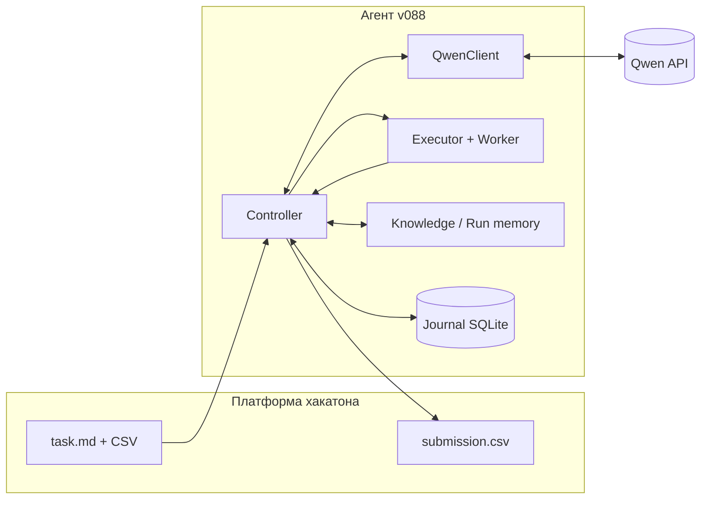
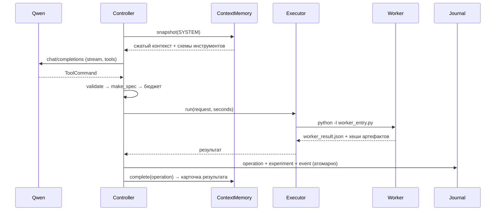
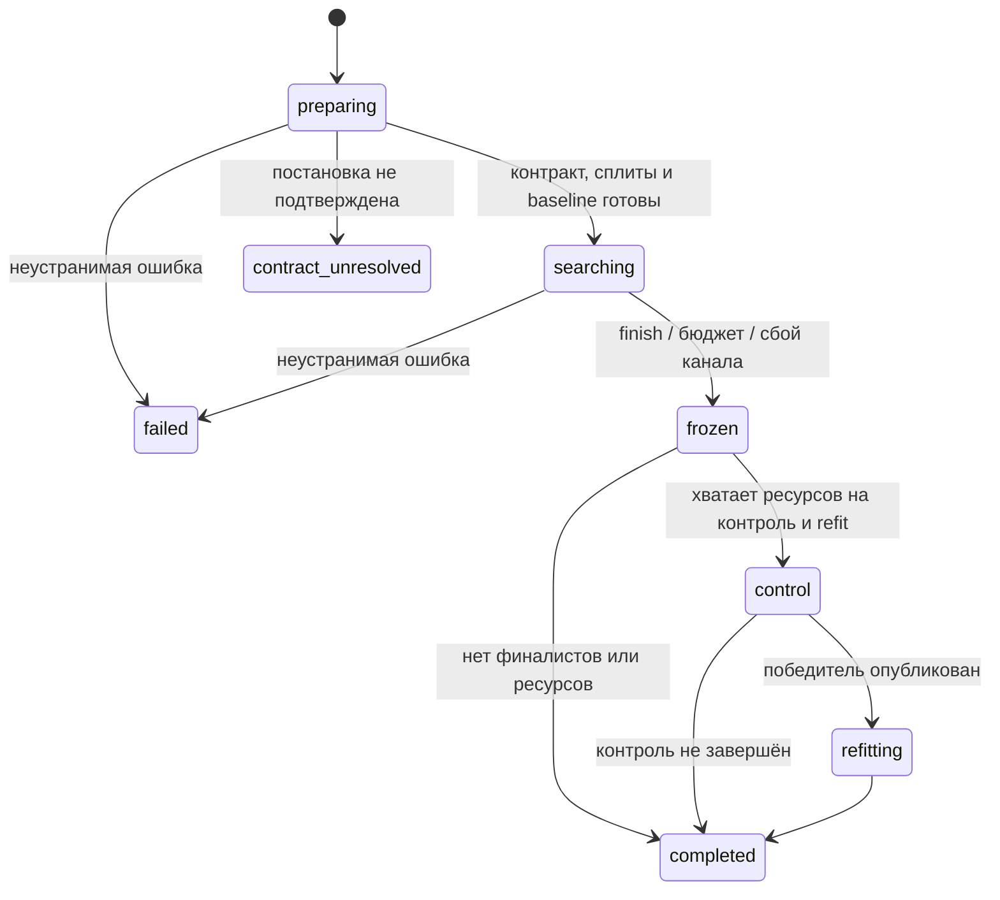

# Архитектура решения v088

**Автономный ML-агент для табличных задач хакатона «Альфа»**

Документ описывает устройство крайней собранной версии — `dist/solution_v088.zip` (24.10.2026, 23:07, Барнаул). Это архитектурное описание кода и контуров исполнения, а не отчёт о качестве модели: живое качество Qwen на v088 не измерялось.

## 0. Паспорт

| Параметр | Значение |
|---|---|
| Крайняя сборка | v088, `70 713 935` байт, SHA-256 `1074af2d…90ca8e`, 169 корневых файлов |
| Крайняя поставка с локальной приёмкой | v087 (тот же способ упаковки, 80 исходных файлов runtime) |
| Код агента | 66 модулей `automl_agent`, ~14,3 тыс. строк; сжиматель контекста — 7 модулей, ~2,0 тыс. строк |
| База знаний | 22 701 документ (22 512 — документация API), 16 библиотек, 18 версий, 38 467 фрагментов; SQLite 281 751 552 байта |
| Публичный API инструментов | 17 инструментов; 3 legacy-имени не рекламируются и не принимаются от модели |
| Тестовые файлы | 82 файла, ~11,5 тыс. строк; прогон v088 (остановлен после 5 падений) — 174 passed, 5 failed, 1 skipped (разбор в разделе 17) |
| Живое качество | не установлено; преимущество над бейзлайном не доказано |

Что важно понимать сразу: **v088 — это инженерная версия с исправлениями надёжности, а не новая модель**. От v087 её отличают 18 изменённых файлов и 547 строк диффа: защита финализации, устойчивость к сбоям канала, ранний валидный CSV, масштабирование refit, отказоустойчивый маршрут кластеризации. Подробно — в разделе 16.

## 1. Задача и внешний контракт

### 1.1 Что делает агент

На входе — текстовое описание задачи и набор CSV в одном каталоге. Агент:

1. подтверждает постановку: какую колонку предсказывать, какая метрика, какие роли у столбцов, какой формат ответа;
2. строит честный протокол проверки (fit / validation / закрытый control);
3. обучает и сравнивает классические ML-модели, ведёт журнал экспериментов;
4. выбирает финалистов, один раз открывает контроль, публикует победителя;
5. делает полный refit на всех разрешённых строках и заменяет CSV;
6. при любом сбое сохраняет последний валидный `submission.csv`.

Модель (Qwen) предлагает следующий эксперимент, но **не считает метрики, не видит control-метки и не пишет CSV**. Всё, что влияет на результат, принадлежит контроллеру.

### 1.2 Вход и выход

| Объект | Где | Кто создаёт |
|---|---|---|
| `task.md` | каталог задачи | платформа |
| `train.csv`, `test.csv` | каталог задачи | платформа |
| `sample_submission.csv`, `data_dictionary.csv` | опционально | платформа |
| `submission.csv` | рядом с `task.md` | агент, права 0644 |
| `.agent_work/<run_id>/` | рабочий каталог агента | агент |

Внутри рабочего каталога: `task_spec.json`, `validation_plan.json`, `journal.sqlite`, `knowledge_memory.sqlite`, `attempts/`, `finalization/`, `publications/`, `requests/`, `run_report.json`, `submission_provenance.json`.

### 1.3 Ограничения платформы

| Ограничение | Значение | Как учтено |
|---|---|---|
| Внешний лимит времени | 3 часа | агент по умолчанию берёт 170 минут и всегда резервирует окно финализации |
| CPU | 7 | `--cpu`, дополнительно ограничивается affinity и cgroup |
| Память | 28 ГБ | `--memory-mb`, дополнительно физическая память и cgroup |
| Архив | плоский ZIP ≤ 100 МБ | 70,7 МБ, только корневые `.py` и `requirements.txt` |
| Сеть | у агента нет произвольного доступа | модель — только через выданный `OPENAI_BASE_URL`; worker — без сети |
| Зависимости | фиксированный `requirements.txt` (37 пинов) | агент не устанавливает пакеты и не скачивает веса |
| Модель | Qwen через OpenAI-совместимый прокси | `OPENAI_API_KEY`, `OPENAI_BASE_URL`; модель по умолчанию `qwen/qwen3.8-27b` |
| Заданий | два независимых запуска | решение не делит бюджет одного задания между задачами |

### 1.4 Запуск

```sh
python solution.py task.md
```

Основные флаги:

| Флаг | Назначение |
|---|---|
| `--time-limit` | бюджет, по умолчанию 170 мин, жёстко ограничен 180 мин |
| `--memory-mb`, `--cpu` | ресурсы, ограничены 28 ГБ и 7 CPU |
| `--run-id` | имя запуска; по умолчанию `api2_<hash>` от содержимого входов |
| `--seed` | seed обучения, по умолчанию 42 |
| `--transport` | `auto` / `native` / `json` |
| `--no-llm` | опорный пайплайн без исследовательских решений модели; требует `task_spec.json` |
| `--clustering-contract` | явный контракт кластеризации, только вместе с `--no-llm` |
| `--research-focus` | подсказка направления для разработки, не меняет контракт и права |

Переменные окружения: `OPENAI_API_KEY`, `OPENAI_BASE_URL`, `OPENAI_MODEL`, `AGENT_CONTEXT_TOKENS` (262144), `AGENT_OUTPUT_TOKENS`, `OPENAI_EXTRA_BODY`. Опасные поля запроса (например, `model`, `messages`, `tools`, `max_tokens`) в `OPENAI_EXTRA_BODY` запрещены и вызывают ошибку; управляемые параметры генерации игнорируются с записью события.

## 2. Принципы архитектуры

1. **Контракт раньше обучения.** Пока роли, метрика и формат ответа не подтверждены, обучение не начинается. Неоднозначность — это `unresolved`, а не догадка.
2. **Контроллер владеет истиной.** Модель предлагает действие; контроллер решает, допустимо ли оно, сколько стоит, что и когда исполняется.
3. **Обучение только внутри fit.** Все преобразования, HPO, калибровка, пороги и ранняя остановка учатся на fit; validation — для сравнения, control — один раз и только после заморозки.
4. **Закрытый контроль.** Финальный пул фиксируется до чтения control-меток; повторно открыть контроль для другого состава нельзя.
5. **Всё долговечно.** Операции, эксперименты, события и публикации пишутся в SQLite до продолжения. Падение процесса не должно приводить к слепому повтору обучения.
6. **Неизвестный исход — не повод повторять.** Если генерация или fit могли выполниться, агент фиксирует неопределённость и завершает исследование, сохраняя проверенные результаты.
7. **Всегда есть валидный CSV.** Сначала шаблон `sample_submission`, затем константный прогноз, затем обученный результат; каждый шаг атомарен.
8. **Классический ML и только разрешённые данные.** Никаких нейросетей, внешних весов, интернета, установки пакетов и скрытых меток.

## 3. Архитектура в разрезе C4

### 3.1 Контекст (C4 L1)



Агент общается наружу только по двум каналам: читает файлы задачи и вызывает один разрешённый HTTP-эндпоинт модели. Всё остальное — локальные вычисления.

### 3.2 Контейнеры (C4 L2)

```
task.md + CSV
     │
     ▼
┌────────────────────────────────────────────────────────────────────┐
│ solution.py → agent_bundle.materialize → .agent_runtime/<sha>/     │
│                                                                    │
│  Controller ──► ContextMemory ──► ContextCompressor ──► QwenClient │
│      │               ▲                                      │      │
│      │               └──────── ToolCommand / result ◄───────┘      │
│      ├──► Dataset / TaskSpec v2 / ValidationPlan                   │
│      ├──► Executor ──► worker.py (python -I, sandbox) ──► model    │
│      ├──► Journal (SQLite WAL) ◄── operations / experiments        │
│      ├──► AgentKnowledge (SQLite FTS5, 22 701 документ)            │
│      └──► Publisher ──► submission.csv                             │
└────────────────────────────────────────────────────────────────────┘
```

Ключевые контейнеры:

| Контейнер | Ответственность | Не делает |
|---|---|---|
| `Controller` | состояния, бюджет, допуск, запуск инструментов, финализация | не обучает модель сам |
| `Dataset` / `TaskSpec` | инвентаризация, роли, проверка контракта, сплиты | не выбирает модель |
| `Executor` / `worker` | изолированный процесс обучения и предсказания | не знает ключа API |
| `ContextMemory` / `ContextCompressor` | долговечная память, сжатие запроса, доставка команд | не интерпретирует метрики |
| `QwenClient` | HTTP, SSE, повторы, учёт токенов | не исполняет код |
| `AgentKnowledge` | корпус, поиск, память доказательств | не даёт прав на зависимости |
| `Publisher` | атомарная публикация CSV и происхождение | не выбирает победителя |
| `Journal` | транзакционная истина о ходе запуска | не хранит сырые данные обучения |

### 3.3 Развёртывание

Платформа распаковывает плоский ZIP в каталог задачи и запускает `python solution.py task.md`.

1. `solution.py` загружает `.env` (если есть) и вызывает `agent_bundle.materialize()`.
2. `agent_bundle` проверяет SHA-256 встроенного payload, распаковывает 80 файлов в `.agent_runtime/<bundle_sha[:20]>/` и сверяет хеш каждого файла.
3. Запускается уже материализованный `solution.py`, который импортирует `automl_agent` и `context_compressor`.
4. При первом обращении к знаниям `ml_knowledge_bundle.restore()` собирает корпус из 160 shard-модулей в `.ml_knowledge_runtime/<corpus_hash>/` и проверяет размеры и хеши.

Такая схема нужна из-за лимита «только корневые .py»: исходники и корпус лежат внутри двух больших Python-модулей, а на диск попадают только после проверки целостности.

### 3.4 Один шаг исследования



### 3.5 Состояния контроллера



| Переход | Условие | Что сохраняется |
|---|---|---|
| `preparing → searching` | есть TaskSpec, ValidationPlan, baseline, опубликован первый CSV | `task_spec.json`, `validation_plan.json` |
| `searching → frozen` | `finish`, исчерпан бюджет, ошибка канала, Ctrl-C | `finalization_plan.json`, политики refit |
| `frozen → control` | финалисты прошли аудит, хватает времени и диска | `control_opened` фиксируется до чтения меток |
| `control → refitting` | победитель контроля опубликован | `publication` с областью `control_prepared` |
| любой → `completed` | финализация завершена или безопасно пропущена | `run_report.json` |

Терминальные состояния: `completed`, `failed`, `contract_unresolved`. Повторный запуск с тем же `run_id` продолжает состояние, а не начинает заново; завершённый поиск не переоткрывается.

## 4. Полный путь запуска

1. **Вход.** Парсинг флагов, проверка лимитов, создание `Limits`; `--clustering-contract` уводит в отдельный маршрут.
2. **Семантический маршрут кластеризации** (если в задании явно, без отрицания, упомянута кластеризация). Модель разрешает контракт, цитирует точный фрагмент задания, агент исполняет KMeans-контур. Любая ошибка маршрута не подавляет основной путь.
3. **Контроллер.** Блокировка `run.lock`, открытие журнала, проверка совместимости API v2 и неизменности `source_hash`.
4. **Подготовка.** Восстановление зависшего worker, копия `sample_submission.csv` в `submission.csv`, разрешение контракта, план валидации, публикация константного прогноза.
5. **Baseline.** Ridge / ExtraTrees / Naive (для прогноза — Naive); для табличных задач дополнительно LightGBM — в регрессии 1500 деревьев с early stopping, в классификации 300; для ранжирования — LGBM ranker, если контракт метки позволяет.
6. **Поиск.** Цикл «снимок контекста → Qwen → валидация команды → исполнение → журнал → карточка результата».
7. **Заморозка.** `finish` или исчерпание бюджета/канала; выбор до трёх финалистов, аудит компонентов, фиксация политик refit.
8. **Контроль.** Подготовка финалистов на fit+validation, однократное открытие контроля, скоринг, выбор победителя.
9. **Публикация.** CSV победителя контроля пишется до refit.
10. **Refit.** Полное переобучение на всех строках `train`, проверка идентичности строк и артефактов, публикация финального CSV.
11. **Отчёт.** `run_report.json`, читаемая сводка, учёт времени и токенов.
12. **Завершение.** Снятие блокировки, закрытие HTTP-клиента и баз.

## 5. Контракт задачи и данные

### 5.1 TaskSpec v2

Контракт — центральный объект; всё остальное ссылается на его хеш.

| Поле | Смысл |
|---|---|
| `contract_version` | 1 — legacy, 2 — текущий семантический контракт |
| `file_roles` | только `train.csv`, `test.csv`, `sample_submission.csv`, `data_dictionary.csv`; значения — точные относительные пути из инвентаря |
| `kind` | regression, classification, multioutput_*, multilabel, forecasting, ranking |
| `targets`, `id_columns`, `feature_columns` | непересекающиеся роли |
| `categorical_columns`, `text_columns` | подмножества признаков, не пересекаются |
| `service_columns` | служебные колонки, не признаки и не цели |
| `time_column`, `group_column`, `series_columns`, `horizon` | структурные роли для времени, групп и рядов |
| `metric` | 13 поддерживаемых метрик, направление оптимизации, average, k, веса |
| `output` | точный порядок колонок ответа и тип предсказания |
| `classes` | зафиксированный порядок классов |
| `related_tables` | до 5 дополнительных таблиц с ключами и агрегатами |
| `explicit_validation` | задаётся только при прямом указании в тексте задания |
| `evidence` | для каждого поля — список ID источников |
| `feature_constraints` | подтверждённые ограничения значений признаков |

Валидатор проверяет не только типы, но и смысл: цели не пересекаются с признаками и ID, категориальные и текстовые роли — подмножества признаков, структурные колонки не могут быть целями, выход обязан совпадать с `sample_submission`.

Поддерживаемые метрики: `rmse`, `mse`, `mae`, `r2`, `mape`, `f1`, `accuracy`, `balanced_accuracy`, `roc_auc`, `log_loss`, `average_precision`, `ndcg`, `map`. Типы выхода: `values`, `labels`, `probabilities`, `scores`.

### 5.2 Четыре канала разрешения

| Канал | Когда работает | Что гарантирует |
|---|---|---|
| Локальный контракт | в задании ровно одна явная строка метрики, метрика однозначна, `train.csv` и `test.csv` названы, цели подтверждены словарём или текстом | контракт подтверждается без API |
| Семантический Qwen | локально подтвердить не удалось | модель возвращает `TaskResolutionProposal` со ссылками на источники для каждого поля; контроллер проверяет структуру, роли и сами источники |
| Явный `task_spec.json` | `--no-llm` или ручной запуск | контракт читается с диска и валидируется |
| Кластеризация | задание явно требует кластеризацию без цели | отдельный `ClusteringContract`, не смешивается с supervised |

Семантическое разрешение повторяет запрос с обратной связью об ошибках; после третьей неудачи включает паузу, но продолжает, пока есть бюджет сверх резерва финализации. Источники для интерпретации: `task.md`, инвентарь CSV, схема, словарь, метаданные CSV с описаниями, текстовые описания. Сырые значения `train.csv` целиком в запрос не отправляются.

### 5.3 Доказательства, а не догадки

У каждого непустого поля контракта есть `evidence` — ID источников. Контроллер проверяет, что источник существует, относится к этой задаче и действительно покрывает поле. Имя файла или строка `sources.task` не считается доказательством.

Если смысл не подтверждается, модель обязана вернуть `unresolved`. Неподтверждённый контракт не порождает предположительный CSV: агент завершает запуск в `contract_unresolved`, сохраняя шаблон.

### 5.4 Ранний валидный CSV

До разрешения контракта контроллер копирует `sample_submission.csv` в `submission.csv` (если файл единственный и читается). Это страховка от падения на семантике: платформа в любом случае получает файл правильной формы.

После подтверждения контракта публикуется константный прогноз (среднее/мода/наивный перенос), затем — baseline. В отчёте фиксируются `first_csv_seconds` и `first_trained_csv_seconds`.

### 5.5 Роли данных и дополнительные таблицы

`Dataset` инвентаризирует все CSV, считает SHA-256, читает заголовки, исключает служебные каталоги и собственные `submission.csv`/`predictions.csv`. Источник истины — хеш набора файлов: смена любого входа запрещает продолжение старого `run_id`.

Дополнительные таблицы подключаются только через `related_tables`:

- файл обязан быть в инвентаре, хеш — совпадать;
- ключи и базовые ключи должны иметь одинаковую арность;
- таблица не может содержать цели задачи;
- для событийных таблиц обязательны `time_column` и `cutoff_column`, join — только по строго более ранним событиям;
- имена новых признаков — `prefix__column__aggregation`, коллизии запрещены.

### 5.6 Маршрут кластеризации

Если задание явно просит кластеризацию (упоминание не отрицается словами «не», «без», «not», «optional»), запускается отдельный контур:

1. Qwen разрешает `ClusteringContract`: файлы, числовые признаки, ID, число кластеров или кандидаты;
2. модель обязана вернуть точную цитату из задания; цитата проверяется подстрокой;
3. KMeans со стандартизацией, импутацией и silhouette-диагностикой;
4. на выходе — `submission.csv` с метками кластеров.

В v088 любая ошибка этого маршрута перехватывается и не мешает supervised-пути: агент печатает `clustering_route_failed` и продолжает обычный запуск. Это важно, потому что ложное срабатывание эвристики не должно стоить задания.

## 6. Валидация и защита от утечек

### 6.1 Три непересекающихся множества

`ValidationPlan` делит `train` на три части:

| Часть | Назначение | Кто видит |
|---|---|---|
| `fit` | всё обучение, преобразования, HPO, калибровка | worker и контроллер |
| `validation` | сравнение кандидатов в ходе исследования | контроллер; метки не уходят в API |
| `control` | однократная финальная проверка | только контроллер после заморозки |

Для независимых строк — примерно 70/15/15. Для классификации — стратифицированно по каждому классу. Для групп — 15% групп в control и 15% в validation. Для времени — последние `horizon` периодов в control, предыдущие `horizon` в validation, всё более раннее в fit.

Минимум — 8 строк, а для групповой задачи — ещё и 3 полные группы; иначе запуск не начинается. Недостаточное покрытие классов фиксируется как наблюдение, но не «исправляется» случайным перемешиванием.

### 6.2 Стратегии

| Стратегия | Когда выбирается | Что сохраняет |
|---|---|---|
| `random` | независимые строки | воспроизводимое разбиение по seed |
| `group` | объявлена группа | целостность групп во всех частях |
| `temporal` | есть время, тест позже train, или прогноз | хронологию: fit → validation → control |
| `temporal_group` | время + группы, прогноз, или тест явно позже | и хронологию, и целостность групп |

`explicit_validation` учитывается только при прямом указании в тексте задания или в источнике с областью `organizer_instruction`. Структура колонок, схема и «похожесть» на временной ряд — не указание. Если запрошенный `random` противоречит хронологии, стратегия усиливается до `temporal` или `group`, а факт усиления записывается в наблюдения.

### 6.3 Внутренние разбиения и OOF

Всё, что учится внутри кандидата, использует `inner_split`:

- временные задачи — только «прошлое → будущее»;
- групповые — без пересечения групп;
- `exact_group` — по точному совпадению признаков, если протокол это допускает;
- классы в inner-fit обязаны покрывать все классы, иначе ошибка, а не тихая подмена.

Для ансамблей и калибровки считается strict OOF: каждая строка предсказана моделью, не видевшей её. Метрики OOF — учебные, а не внешнее доказательство качества. `weighted_oof` и `stacked_oof` требуют одинаковых фолдов и минимум 10 общих строк; иначе отказ.

### 6.4 Политика обратной связи

Список отчётов фиксируется до первого скоринга: `missingness`, `seen_unseen`, `classes`, `entity_coverage`, `regression_errors` и отчёты разбиения. Срезы с малой поддержкой скрываются; произвольные внешние срезы запрещены (`arbitrary_external_slices=false`). Порядок классов фиксирован, чтобы модель не «переставила» вероятности.

### 6.5 Дисциплина контроля

1. Финалисты и их рецепты замораживаются `freeze()`.
2. Аудит компонентов проверяет, что из рецепта не выпали обученные части.
3. `control_opened` пишется в журнал **до** чтения control-меток.
4. Скоринг контроля выполняется один раз; повторное открытие с другим составом запрещено.
5. Победитель публикуется до полного refit.
6. Если контроль или refit не удались, остаётся предыдущий CSV, а статусы `control_status`/`refit_status` честно фиксируют причину.

### 6.6 Ревизия протокола и переносимые протоколы

`revise_validation` позволяет заменить активный протокол без нового подтверждения, но не может менять метрику, роли и закрытый контроль. Ревизия долговечна: активный протокол меняется только в момент коммита, прерванная ревизия восстанавливается.

Отдельно доступны opt-in протоколы `holdout`, `rolling` и `exact_group`: они меняют способ сравнения кандидатов, но не трогают исходный disjoint holdout и контроль.

### 6.7 Чек-лист анти-утечки

| Риск | Барьер |
|---|---|
| Обучение на validation/control | сплиты фиксированы, worker получает только fit-строки |
| Подбор порога по контролю | пороги и калибровка учатся внутри fit |
| ID как признак | роль `id_columns` запрещает участие в матрице |
| Цель в дополнительной таблице | `related_tables` отвергает таблицу с целевыми колонками |
| Будущие события | join только по строго более раннему времени |
| Восстановление меток по артефактам | worker не получает control-метки; предсказания маппятся по внутренним ключам |
| Случайный split при времени/группах | стратегия усиливается, а не «подгоняется» |
| Повторный скоринг контроля | `control_opened` и запрет смены состава |

## 7. Агентный цикл

### 7.1 Что видит модель

Живой путь — `ContextMemory.snapshot()`, а не legacy `Controller.context()`. Снимок собирается из:

- **core**: проекция задачи, политики, ресурсы, дедлайн, резерв, счётчики, текущая работа;
- **observations**: результаты инструментов, ожидающие доставки (защищённый бюджет 8192 байта);
- **history**: до 32 карточек: якоря (baseline, leader, активная гипотеза), последние 12 экспериментов, по одной на пару компонент/движок (до 8), зависимости; приоритет и причина отбора видны в карточке;
- **history_details**: полные детали — только на стадии 0;
- **known_failures**: отрицательные результаты и отклонённые операции;
- **profile**: агрегаты fit-профиля;
- **compaction**: какие записи включены, какие исключены и почему;
- **visual_diagnostics**: PNG-артефакты, если они есть и стадия < 2.

Карточка эксперимента — это компактная выжимка: модель, представление, импутация, параметры или ссылка на полный рецепт, статус, метрика, время, память, слабейшие срезы, диагностика классов. Полные рецепты и коды читаются отдельными инструментами.

### 7.2 Сжатие контекста

`ContextCompressor` делает до четырёх попыток уложить запрос в 262 144 токена (оценка консервативная, по UTF-8 байтам, с вычетом резерва ответа и запаса):

| Стадия | Что остаётся | Что убирается |
|---|---|---|
| 0 | всё: детали истории, профиль, ошибки, изображения | ничего |
| 1 | карточки, профиль, ошибки | детали истории |
| 2 | 8 карточек, краткий профиль, без ошибок | остальные карточки, изображения |
| 3 | ядро, наблюдения, метаданные сжатия | карточки, профиль, ошибки |

Инварианты: наблюдения не превышают 8192 байта, накладные расходы инструкций и схем — 65536 байт, резерв ответа не уменьшается, а исключённые записи можно перечислить по `request_id`. Если даже стадия 3 не влезает, исследование замораживается, а не обрезается контракт.

### 7.3 Публичный API инструментов

| Инструмент | Назначение | Ключевые ограничения |
|---|---|---|
| `preview_recipe` | применить проверенный рецепт и показать diff без обучения | не исполняет fit |
| `get_dataset_report` | profile, dictionary, missing, categories, correlations, slice, transfer, domain | target и произвольные срезы — только fit; domain не видит `y` |
| `get_diagnostic_report` | распределения, confusion matrix, residuals, PNG | до 3 колонок; модельная диагностика — отдельный fit-inner |
| `revise_validation` | сменить активный протокол | метрика, роли и контроль неизменны |
| `search_knowledge` | поиск по одной коллекции | выдача — кандидаты, не ответы |
| `list_knowledge` | каталог с фильтрами | не заявляет совпадение |
| `read_knowledge` | чтение версионированного источника | продолжение по курсору |
| `search_run_records` | поиск по прошлым результатам и ошибкам | только разрешённые записи |
| `list_run_records` | индекс запуска | без сырых меток |
| `read_run_records` | до 10 записей, код, страница контракта | без control-меток |
| `train_model` | один direct-пайплайн | бюджет, совместимость, evidence |
| `run_automl` | FLAML / AutoGluon / LightAutoML | только fit, без custom-трансформаций |
| `tune_model` | Optuna | ограниченное число trials, честный sampler |
| `run_experiments` | 2–4 независимые гипотезы последовательно | общий бюджет, отдельные operation_id |
| `run_custom_experiment` | Python-компонент | AST, зависимости, sandbox, хеш |
| `build_ensemble` | uniform / weighted_oof / stacked_oof | OOF-условия, состав участников |
| `finish` | необратимая заморозка | причина, завершённые результаты |

Legacy-имена `inspect_dataset`, `get_reference`, `analyze_experiments` остаются только для внутренней совместимости; в схемах модели их нет.

### 7.4 Жизненный цикл команды

1. **Разбор.** `ToolCommand`: `operation_id` (1–96 символов), имя инструмента, аргументы.
2. **Схема.** Аргументы валидируются Pydantic-моделью; лишние поля запрещены.
3. **Смысл.** Проверяются состояние `searching`, отсутствие незавершённой ревизии, бюджет сверх резерва, совместимость пайплайна, соответствие инструмента и движка, evidence-ссылки, отсутствие дубликата.
4. **Идентичность.** `begin_operation` пишет операцию с хешем канонических аргументов, данных и протокола. Повтор с тем же ID и теми же аргументами возвращает сохранённый результат; другой хеш — ошибка.
5. **Исполнение.** Инструмент вызывает соответствующий модуль; тяжёлая работа уходит в `Executor`.
6. **Запись.** Результат, эксперимент, событие и проекция в контекстную память коммитятся согласованно.
7. **Неизвестный исход.** Если операция осталась `running`, а worker исчез, восстановление не повторяет fit вслепую.

### 7.5 Транспорт Qwen

- Chat Completions, `stream: true`, `stream_options.include_usage`, сборка SSE до полного ответа.
- Native tool calling: `tool_choice="required"`, `parallel_tool_calls=false`. Берётся только первый вызов; остальные сохраняются как «намерения» и требуют нового решения.
- JSON-fallback: тот же запрос без инструментов, с `response_format=json_object` и полной схемой `ToolCommand`.
- Reasoning: `medium` для обычного шага, `xhigh` для старта, ошибок, сложных экспериментов и готовности сравнивать; лимит ответа 180 с (420 с для `xhigh`).
- `max_tokens`: 4096 / 12288, потолки 8192 / 24576; при обрезании ответа лимит увеличивается, а не повторяется тот же запрос.
- Ошибки: временные (408/409/429/5xx) помечаются retryable; после трёх подряд отказов провайдера канал считается недоступным. 401/402/403 — терминальная недоступность.
- Неизвестный исход: обрыв SSE, таймаут, обрыв соединения после отправки — фиксируются в `qwen_unknown_outcome`; новая генерация не отправляется.
- Учёт: серверные `prompt/completion/total_tokens`, `reasoning_tokens`, фактическое время; запросы сохраняются в `requests/<call_id>.json`.

### 7.6 Критик гипотез

Перед дорогим экспериментом (оценка ≥ 120 с) или любым custom-кодом запускается отдельная ограниченная проверка:

- собственный системный промпт и собственный контекст ≤ 98 304 байта;
- только публичные скаляры: гипотеза, компаратор, бюджет, условия;
- никаких меток, предсказаний и артефактов;
- verdict `approve` или `revise` с конкретными запросами;
- критик не может менять пайплайн, вызывать инструменты или разрешать ресурсы.

Дешёвые измеренные эксперименты критика не требуют — это защита от лишних вызовов, а не обязательный шаг.

### 7.7 Деградация канала, допуск и тупики

- **Admission.** Если канал модели деградировал, уже сформулированные дешёвые `train_model` (direct, без custom) могут быть допущены к исполнению без новой генерации. Очередь долговечна, при восстановлении канала не переоткрывает контроль.
- **Drain.** При `QwenUnavailable` очередь исполняется, затем исследование замораживается; новые гипотезы не генерируются.
- **Тупик.** После трёх неудач и 10 минут без нового доказательства запускается обзор направления: контроллер сам пробует другую поддерживаемую модель, а модель получает запрос «смени направление».
- **Направления.** `direction_map` показывает измеренные оси (семейство, представление, признаки, цель, решение, перенос, композиция), а `finish_readiness` — какие доступные действия ещё не пробованы. Квоты на число моделей нет.

## 8. Модельный слой

### 8.1 PipelineSpec

Один объект описывает рецепт целиком: движок, модель, представление, импутацию, трансформации, гиперпараметры, seed, objective, политику предсказания, диагностику, калибровку/смещения, target transform, custom-код, участников ансамбля, пространство поиска, текстовый анализатор, ресемплинг, early stopping, расписание итераций, перенос, отбор признаков, решение, обратное преобразование лога, sampler.

Рецепт хешируется. Всё обученное (смещения, калибровка, frozen iterations, веса ансамбля, inverse-состояние) помечено как `LEARNED_PIPELINE_FIELDS` и не может быть задано моделью напрямую — только выучено внутри fit и заморожено.

### 8.2 Семейства и движки

| Группа | Модели |
|---|---|
| Линейные | ridge, elastic_net, logistic, sgd, spline |
| Деревья | extra_trees, random_forest, hist_gradient_boosting |
| Бустинги | lightgbm, catboost, xgboost, lgbm_ranker |
| Соседи | knn (ограниченная матрица доноров и батчевое предсказание) |
| Константа / прогноз | constant, naive, exponential_smoothing, sarimax |

`mlp` намеренно заблокирован: политика — только классический ML.

| Движок | Что делает |
|---|---|
| `direct` | один пайплайн scikit-learn / catboost / lightgbm / xgboost |
| `optuna` | ограниченный HPO с восстановлением trials и random/TPE sampler |
| `flaml` | FLAML AutoML на fit |
| `autogluon` | selection / bagging / stacking, CPU-only, без random bagging на временных задачах |
| `lightautoml` | CPU, только learner `lgb`, замороженное семейство |
| `custom` | Python-компонент под sandbox |
| `ensemble` | композиция сохранённых предсказаний |

### 8.3 Признаки и импутация

- Числовые, категориальные и текстовые ветки; TF-IDF и hashing без внешних весов.
- Импутация: медиана, нативная поддержка модели, KNN, итеративная, модельная; индикаторы пропусков; сохранение пустых колонок; ограничения значений только из подтверждённых `feature_constraints`.
- Трансформации: datetime-признаки, log1p, агрегаты, история сущности, target encoding.
- Обученные трансформации (target encoding, history) кросс-фитятся снаружи fit-фолда; `supervised_transform=false` означает, что трансформер вообще не получает `y`.
- Отбор признаков: константы, корреляции, k-best; имена выходных признаков фиксируются в `output_schema.json`.

### 8.4 Поиск и AutoML

Поиск ограничен бюджетом кандидата и общим дедлайном. FLAML, AutoGluon и LightAutoML получают только fit-строки; их внутренние фолды не видят validation. AutoGluon не использует случайный bagging на временных задачах. LightAutoML делит бюджет фазы между fit и refit, чтобы не потребить окно дважды. Optuna восстанавливает историю trials, помечает незавершённые как `outcome_unknown` и не переобучает их вслепую.

### 8.5 Ансамбли и решение

- `uniform` — среднее совместимых предсказаний, допускает custom-участников.
- `weighted_oof` — веса подбираются на strict OOF.
- `stacked_oof` — мета-модель на strict OOF.
- Все learned-стратегии требуют общих фолдов, одинакового порядка классов и минимум 10 общих строк; ensemble-участники запрещены, custom допускается только при явном `custom_oof` и проверенном коде.

Финальное решение — отдельный слой после калибровки и композиции. Для многоклассового Macro F1 доступны смещения классов, обученные на inner holdout или pooled OOF; для бинарных метрик — порог/калибровка. Смещения не задаются моделью, а учатся и замораживаются.

### 8.6 Специальные задачи

| Задача | Механика |
|---|---|
| Прогноз | лаги, скользящие средние, календарные признаки, наивный и ETS-бейзлайн; хронологические фолды |
| Ранжирование | LightGBM ranker, проверка целочисленных relevance-меток, disjoint группы, NDCG |
| Multioutput / multilabel | отдельные цели, согласованный порядок классов, единая схема выхода |
| Сдвиг | importance weighting или pseudo-label только для классификации; веса и покрытие проверяются |
| Связанные таблицы | безопасный join с агрегатами и временными отсечками |
| Панель / rolling | хронологические переходы как поисковая обратная связь, затем development fit |

### 8.7 Пользовательский код

Разрешены три компонента: `pipeline`, `transformer`, `analysis`.

- AST-проверка: белый список импортов, запрет `eval/exec/open/getattr`, сетевых и загрузочных API, относительных импортов;
- запрет нейросетей и внешних весов;
- установка dependency guard: импорт пакета вне `requirements.txt` блокируется;
- код хешируется, сохраняется в `code/<sha>.py` и проверяется перед запуском;
- analysis возвращает только типизированные агрегаты; срезы с поддержкой < 30 подавляются;
- sandbox не даёт сети, subprocess и записи вне попытки.

Гарантия ограниченного доверия: это защита в глубину, а не ОС-изоляция. Вредоносные нативные расширения и намеренно враждебный Python вне гарантии — это прямо записано в `execution_policy.limitations`.

## 9. Исполнение

### 9.1 Executor

`Executor` — единственный путь тяжёлых вычислений:

1. проверяет дедлайн и память, добавляет резерв на накладные расходы worker;
2. пишет `request.json` и запускает `python -I worker_entry.py` в отдельной сессии;
3. подменяет окружение: `HOME`, `TMPDIR`, кэши — внутри попытки; потоковые переменные — по числу CPU; offline-флаги для HF/Transformers;
4. следит за RSS дерева процессов, временем, свободным диском (резерв 512 МБ) и размером лога;
5. при нарушении убивает группу процессов `SIGTERM` → `SIGKILL`;
6. проверяет хеши всех объявленных артефактов и возвращает результат.

Если лог превысил лимит, но `worker_result.json` валиден и хеши совпали, результат принимается: проверенный артефакт важнее ошибки логирования (v088).

### 9.2 Worker и песочница

Worker применяет audit hook:

- чтение — каталог попытки, пакет агента, системные библиотеки, явно разрешённые зависимости;
- запись — только каталог попытки, `/dev/null`, `/dev/shm`;
- запрещены `subprocess`, `fork`, `system`, `exec`;
- запрещены INET-соединения;
- ключ API в окружение worker не передаётся.

Модель сериализуется `cloudpickle`, затем загружается обратно и сравнивается: предсказания до и после сохранения должны совпасть по ключам строк и классам. Это ловит несериализуемые состояния и тихую порчу модели.

### 9.3 Артефакты попытки

| Файл | Смысл |
|---|---|
| `request.json` | точный запрос контроллера |
| `fit_X.json`, `fit_y.json` | только fit-строки |
| `validation_X.json`, `test_X.json` | признаки без целей |
| `model.pkl` | обученный пайплайн |
| `*_predictions.json` | предсказания с ключами строк и картой классов |
| `output_schema.json` | имена выходных признаков |
| `worker_result.json` | статус, сводка обучения, хеши, frozen pipeline |
| `worker.log`, `diagnostic_*.json` | диагностика |

### 9.4 Статусы

| Статус | Значение | Что делает контроллер |
|---|---|---|
| `completed` | fit и предсказания проверены | оценивает на validation |
| `timeout` | внешний монитор остановил по времени | фиксирует ресурсный отказ |
| `memory_limit` | превышен RSS | фиксирует ресурсный отказ |
| `disk_limit` | мало места | освобождает место или отказ |
| `log_limit` | лог превысил лимит | принимает валидный результат или отказ |
| `import_error` | зависимости/импорт | фиксирует недоступность |
| `error` | исключение | сохраняет traceback |
| `invalid_prediction` | схема/ключи/классы не сходятся | отказ без публикации |
| `outcome_unknown` | исход не установлен | запрет слепого повтора |

## 10. Финализация

### 10.1 Выбор финалистов

Кандидаты — только завершённые непilot результаты на активном протоколе, с уникальной идентичностью замороженного рецепта и известной стоимостью контроля+refit.

Политика версии 2:

1. baseline и leader входят первыми;
2. лучший кандидат, не доминируемый якорями по общим временным окнам;
3. в v088 — добор до трёх самых сильных **различных** рецептов, даже если validation ставит их ниже лидера. Причина: закрытый контроль — единственная защита от будущего, и около-периодный победитель не должен блокировать более сильную модель;
4. дорогие кандидаты отбрасываются, если полный граф контроль+refit не влезает в бюджет.

### 10.2 Аудит компонентов

Для каждого финалиста проверяется цепочка родителей и замороженный рецепт. Если из пайплайна выпали обученные компоненты (смещения, калибровка, веса, frozen iterations), это предупреждение. Без явного подтверждения `component_audit_hash` такой финалист исключается: повреждённый рецепт нельзя «подтвердить» дедлайном.

### 10.3 Контроль

- подготовка финалистов на `fit + validation`;
- запись `control_opened` до чтения меток;
- скоринг на `control`;
- выбор победителя: точный лучший; если в ничью попадает baseline — он, иначе самый дешёвый по замороженному refit;
- публикация CSV победителя;
- только затем — полный refit.

### 10.4 Публикация

`Publisher`:

1. собирает кадр в точном порядке `output.columns`;
2. проверяет отсутствие пропусков;
3. сериализует CSV, читает обратно и сверяет схему и написание ID (включая ведущие нули);
4. пишет артефакт в `publications/<sha>.csv` и `publication_pending` в журнал;
5. атомарно копирует в `submission.csv` и фиксирует происхождение;
6. при рестарте восстанавливает публикацию по хешу.

### 10.5 Refit

Полный refit идёт на всех строках `train`, без нового HPO. Проверяется:

- число строк и хеш их идентичностей;
- соответствие замороженному рецепту;
- целостность артефактов;
- бюджет: refit выполняется только если остаётся резерв на скоринг и публикацию.

Для бустингов число итераций масштабируется от размера fit к размеру полного train (sqrt, ограничение ×2), если это было заморожено (v088).

### 10.6 Отказные сценарии

| Сценарий | Поведение |
|---|---|
| Нет подтверждённых финалистов | остаётся прежний CSV, `completed` с причиной |
| Мало бюджета на контроль | контроль пропускается, остаётся baseline CSV |
| Контроль не завершён | победитель не публикуется, остаётся прежний CSV |
| Refit не удался | остаётся CSV победителя контроля |
| Компоненты потеряны | финалист исключается или требуется подтверждение |
| Диск кончился | освобождение воспроизводимых артефактов, иначе отказ |

## 11. Память, знания и наблюдаемость

### 11.1 Журнал

`journal.sqlite` (WAL, `synchronous=FULL`):

| Таблица | Содержимое |
|---|---|
| `metadata` | состояние, дедлайн, лимиты, task, validation, publication, счётчики |
| `operations` | операция, аргументы, статус, результат, хеш запроса |
| `experiments` | спецификация и результат эксперимента |
| `events` | последовательность событий с временем и payload |

События — не украшение: по ним считаются время чтения/восстановления, ошибки, восстановление и аудит.

### 11.2 Контекстная память

`ContextStore` живёт в том же файле отдельными соединениями и таблицами `cc_*`. Это позволяет одной транзакцией записать завершение операции и поставить результат в очередь доставки. Источники версионируются, срезы читаются по opaque-ссылкам, а исключённые записи можно перечислить.

### 11.3 База знаний

| Параметр | Значение |
|---|---|
| Документы | 22 701: 22 512 документации, 146 методов, 35 рецептов, 7 пространств поиска, 1 контракт |
| Библиотеки | 16, версии — 18 |
| Фрагменты | 38 467 |
| Индекс | SQLite FTS5 BM25 + лексический резерв |
| Целостность | `knowledge.lock.json`, SHA-256 корпуса |

Инструменты: поиск по коллекции, каталог, чтение с продолжением. Выдача поиска — кандидаты; применение требует чтения условий и совместимости. Пакет знаний (до 3 материалов, 6000 символов) сохраняется на всех стадиях сжатия, а перед отправкой проверяется аудитором: если материал потерян, запрос не отправляется.

Память знаний (`knowledge_memory.sqlite`) хранит источники, гипотезы, наблюдения и проверенные результаты отдельно от журнала; она восстанавливается как идемпотентная проекция.

### 11.4 Память запуска

`RunTools` даёт поиск и чтение прошлых экспериментов, ошибок, заметок и версионированных контрактов. Это позволяет модели не тащить всю историю в контекст: она читает нужную запись по ID.

### 11.5 Отчётность

`run_report.json` содержит: состояние, хеши задачи и данных, время до первого CSV и до первого обученного CSV, лидера, статусы контроля и refit, счётчики кандидатов и вызовов, токены, эффективные CPU/память, политику исполнения, ошибки, ограничения мониторинга. Отдельно пишется читаемая сводка. `verification_dimensions()` явно перечисляет, что именно подтверждено, а что нет.

## 12. Ресурсы и бюджет

### 12.1 Время

- Абсолютный дедлайн хранится в журнале и не сбрасывается при рестарте.
- Резерв финализации в v088: не меньше max(5 минут, 6% бюджета с потолком 15 минут) и не меньше прогноза полного графа контроля+refit.
- Каждый кандидат получает `min(запрошено, доступно - резерв)`.
- Пилоты (smoke, performance_1/2) измеряют стоимость до полного fit; при нехватке окна кандидат отклоняется, а не запускается «на авось».
- При исчерпании резерва исследование замораживается.

### 12.2 Стоимость

`completion.py` строит граф зависимостей кандидата (включая участников ансамбля), оценивает секунды и диск по измеренным фазам, учитывает HPO и вспомогательные fit. `cost_model.py` экстраполирует по фазовым замерам, а не по smoke-фитам. Оценка используется и для допуска, и для резерва, и для выбора финалистов.

### 12.3 Параллелизм и диск

Одновременно выполняется один обучающий процесс. Число CPU — минимум из запроса, affinity и cgroup. Память — минимум из запроса, физической и cgroup. Перед финализацией освобождаются воспроизводимые промежуточные файлы; удаление защищено хешами и идентификаторами.

## 13. Безопасность

| Угроза | Мера |
|---|---|
| Prompt injection в `task.md`, документации, коде | всё внешнее — данные, не инструкции; политика в системном промпте; критик с отдельным контекстом |
| Утечка control-меток | worker не получает control; API не получает метки validation |
| Кража ключа | ключ только в процессе контроллера; worker окружение очищено |
| Произвольный код | AST-белый список, dependency guard, audit hook, отсутствие сети/subprocess |
| Выход за каталог | разрешённые корни чтения/записи, `is_relative_to`, проверка хешей |
| Подмена данных | `source_hash` фиксируется; смена входов запрещает resume |
| Подмена артефактов | хеши в `worker_result.json`, повторная проверка при публикации |
| Огромный лог/память | ротация лога, монитор RSS, жёсткие лимиты |
| Ошибочная модель | метрики считает контроллер, а не модель; CSV проверяется побайтово |

## 14. Отказоустойчивость

| Сбой | Реакция |
|---|---|
| Падение процесса контроллера | рестарт с тем же `run_id` продолжает состояние; незавершённые операции восстанавливаются |
| Зависший worker | `recover_worker` проверяет PID и время создания, убивает только свой процесс |
| Обрыв SSE | `outcome_unknown`, исследование замораживается, проверенные кандидаты сохраняются |
| Три ошибки провайдера подряд | канал считается недоступным; допущенные работы дренируются |
| Контекст не влезает | стадии сжатия 1→3; затем заморозка |
| Кончился диск | освобождение воспроизводимых файлов; при нехватке — отказ без порчи CSV |
| Повторный запуск | lock-файл, проверка `source_hash`, запрет смены контракта и бюджета |
| Публикация прервана | `publication_pending` восстанавливается по хешу |

## 15. Поставка и воспроизводимость

### 15.1 Состав плоского архива

| Компонент | Размер / роль |
|---|---|
| `solution.py` | 607 байт, точка входа платформы: материализовать runtime и запустить его |
| `agent_bundle.py` | 420 799 байт, base85 + ZIP с 80 исходными файлами агента |
| `ml_knowledge_bundle.py` | сборка корпуса из shard-модулей |
| `mlkb_core.py`, `mlkb_context.py`, `mlkb_lexical.py`, `mlkb_memory.py`, `mlkb_runtime.py` | рантайм базы знаний |
| `mlkb_data_0000…0159.py` | 160 частей корпуса, ~87 МБ распакованного payload |
| `requirements.txt` | 37 пинов организаторов, побайтово исходный |

Итого 169 файлов, 70 713 935 байт. Лимит 100 МБ соблюдён с запасом ~29 МБ.

### 15.2 Цепочка сборки

1. Исходники агента и `context_compressor` собираются в детерминированный ZIP.
2. ZIP кодируется base85 и встраивается в `agent_bundle.py` вместе с картой хешей.
3. Корпус упаковывается в 160 shard-модулей с манифестом размеров и SHA-256.
4. `tools/build_flat_submission.py` формирует плоский каталог, проверяет синтаксис, соответствие исходников, неизменность `requirements.txt` и отсутствие вложенных путей.
5. Собирается ZIP, считается SHA-256, пишется манифест и свидетельство проверки.
6. Архив нумеруется: `solution_vNNN.zip`; метаданные — `solution_vNNN.manifest.json`.

### 15.3 Что проверяет манифест

| Поле | Смысл |
|---|---|
| `members` | 169 записей с размерами и хешами |
| `zip_and_syntax_valid` | ZIP читается, Python-файлы компилируются |
| `flat_layout_checked` | только корневые файлы, без вложенных каталогов |
| `source_match_checked` | исходники совпадают с заявленными |
| `requirements_match_checked` | `requirements.txt` не изменён |
| `archive_size_limit_bytes` | 100 000 000 |
| `dependency_policy_checked`, `embedded_payload_checked`, `runtime_interface_checked` | дополнительные флаги; в v088 равны `false` и не заменяют приёмку |

Отдельный аудит v088 подтвердил 169 файлов, 80 встроенных исходников и отсутствие расхождений `source_mismatches`. Это техническая целостность, а не доказательство качества.

### 15.4 Воспроизводимость

- `run_id` по умолчанию — хеш входов; повтор с теми же данными продолжает запуск с исходным дедлайном.
- `source_hash` включает `task.md`, все CSV, `task_spec.json` и текстовые описания; смена любого файла запрещает resume.
- Версии библиотек фиксируются в `capabilities.json` и в каждом эксперименте.
- Корпус знаний имеет версию и хеш; ссылки в гипотезах привязаны к версии.
- Модель и seed входят в хеш рецепта; повторный fit с теми же входами должен дать тот же рецепт.
- `dist/LATEST.json` (v019) и `dist/CANDIDATE.json` (v065) — исторические указатели, не обновлённые под v087/v088; актуальную сборку определяйте по номеру архива и манифесту.

## 16. Что изменено в v088

| Область | Изменение | Зачем |
|---|---|---|
| Бюджет | резерв финализации: max(5 мин, 6% до 15 мин) | защитить refit на коротких и длинных запусках |
| Вход | копия `sample_submission.csv` в `submission.csv` до разрешения контракта | валидный CSV даже при `contract_unresolved` |
| Baseline | LightGBM для регрессии: 1500 деревьев, lr 0.03, early stopping 100 | сильнее стартовый кандидат без роста времени |
| Контракт | fallback-роли по уникальному имени файла или цитате в `task.md` | меньше отказов на реальных раскладках |
| Кластеризация | отрицания, точная цитата, fail-open | ложный маршрут не должен ломать supervised |
| Финалисты | добор до 3 различных рецептов | контроль не блокируется около-периодным лидером |
| Refit | масштабирование итераций бустинга по числу строк | сохранить ёмкость модели на полном train |
| Ансамбли | пересечение ключей через set | линейная сложность вместо квадратичной |
| Идентичность | сжатие списков ключей > 5000 строк | артефакты не растут квадратично |
| Executor | streaming staging > 5M ячеек; закрытие группы процессов до чтения лога; приём валидного результата при log error | устойчивость на больших данных |
| Qwen | минимум 10 с окна на запрос | не отправлять заведомо бесполезный вызов |
| Related tables | карта позиций по ключу | быстрый join без повторного перебора |
| Search | refit_full с добавлением tuning-строк | выбранный рецепт видит все разрешённые fit-строки |
| Supervised features | uncovered-строки получают prior, а не 0 | нет искусственного нуля в target encoding |
| Selection | допуск 0.005 | меньше ложных «улучшений» |
| LightAutoML | бюджет делится между fit и refit | кандидат не потребляет двойное окно |

## 17. Статус проверки и ограничения

### 17.1 Что подтверждено

- v088 собран, ZIP цел, 169 файлов, 80 встроенных исходников совпадают, синтаксис валиден; отдельного `acceptance.json` у v088 нет — есть манифест и аудит ZIP.
- 8 адресных тестов v088 прошли (лог `new_tests.log`).
- Для v087 сохранена приёмка: 1265 уникальных случаев, первый полный прогон — 1259 прошли, 3 падения, 2 пропуска, затем 64 затронутых случая повторены успешно. Это историческое свидетельство v087, а не v088.
- Точный ZIP v087 прошёл четыре чистых mock-запуска с CSV, контролем и полным refit.
- Механика закрытого контроля, финалистов, sandbox и публикации покрыта тестами в репозитории.

### 17.2 Что не подтверждено

| Вопрос | Статус |
|---|---|
| Живое качество Qwen на v088 | не измерялось |
| Public/private score v088 | неизвестен |
| Преимущество над бейзлайном | не установлено |
| Непрерывный зелёный полный прогон v088 | нет: 174 passed, 5 failed, 1 skipped; падения разобраны в 17.3 |
| Отправка v088 на платформу | сведений нет |
| Поведение на образе платформы | воспроизведены зависимости, не официальный образ |
| Устойчивость к враждебному коду | ограниченное доверие, не ОС-изоляция |

### 17.3 Разбор падений полного прогона v088

Прогон в каталоге ревью (`outputs/code_review_v088_20261024/full_tests.log`) остановился после пятого падения: **174 passed, 5 failed, 1 skipped** за 463,7 с.

| Тест | Причина | Вывод |
|---|---|---|
| Три теста `test_goal_gateway_stream.py` | `PermissionError: [Errno 1] Operation not permitted` при bind `127.0.0.1` во вспомогательном HTTP-сервере | изолированно все три проходят; ограничение песочницы запуска, не код продукта |
| Два варианта `test_controller_compressed_research_trains_and_finishes` | worker не уложился в `budget_seconds=10`; в отчёте зафиксирован `timeout` | изолированно каждый проходит; чувствительность к нагрузке, дефект не доказан |

Ни один из пяти случаев не воспроизводится как логическая ошибка v088 в изолированном запуске. При этом единого зелёного полного прогона нет, и это нельзя выдавать за приёмку.

### 17.4 Архитектурные ограничения

1. **Один обучающий процесс.** Параллельные fit не выполняются; выигрыш только во времени ожидания.
2. **Контекст 262 144 токена.** На длинных историях включается сжатие; часть деталей доступна только чтением по ID.
3. **Контроль — обычно около 15% строк (для времени — последний горизонт).** На малых данных оценка шумная; допуск 0.005 снижает ложные улучшения, но не устраняет риск.
4. **Классический ML.** Нейросети и внешние веса запрещены; текстовые задачи ограничены TF-IDF/hashing.
5. **Пользовательский код.** AST и audit hook обходятся нативными расширениями; это записано в ограничениях.
6. **База знаний.** Полнота корпуса не доказана; `coverage.json` фиксирует пробелы, а отсутствие совпадения не означает отсутствия API.
7. **Платформа.** Официальный образ и точные пороги бейзлайна недоступны; локальная приёмка не переносится автоматически.

## 18. Карта модулей

| Группа | Модули | Роль |
|---|---|---|
| Ядро | `controller.py`, `budget.py`, `journal.py`, `util.py`, `identity.py`, `contracts.py` | состояния, бюджет, журнал, схемы, хеши |
| Вход и исполнение | `worker.py`, `worker_entry.py`, `executor.py`, `api.py` | sandbox, процессы, ресурсы, публичный интерфейс кандидата |
| Данные | `data.py`, `validation.py`, `protocols.py`, `protocol_revision.py`, `related_tables.py`, `profiling.py`, `feedback.py` | контракт, сплиты, профиль, дополнительные таблицы |
| Агент | `qwen.py`, `qwen_stream.py`, `context_memory.py`, `knowledge.py`, `knowledge_tools.py`, `run_tools.py`, `tool_results.py` | транспорт, память, знания, результаты |
| Исследование | `research.py`, `research_evaluation.py`, `critic.py`, `admission.py`, `directions.py`, `progress.py`, `action_cards.py`, `human_practice.py` | гипотезы, критик, допуск, направления, карточки |
| Модели | `pipelines.py`, `preprocessing.py`, `search.py`, `tuning.py`, `training_schedule.py`, `decision.py`, `learned_blend.py`, `automl_decision.py` | обучение, поиск, калибровка, ансамбли |
| Специальные | `forecasting.py`, `rolling.py`, `shift.py`, `supervised_features.py`, `lightautoml_adapter.py`, `custom.py`, `compatibility.py`, `dependency_policy.py`, `clustering.py`, `clustering_route.py` | время, перенос, custom, кластеризация |
| Финализация | `finalists.py`, `completion.py`, `cost_model.py`, `publication.py`, `cleanup.py` | финалисты, стоимость, публикация, диск |
| Наблюдаемость | `reporting.py`, `diagnostics.py`, `visual_diagnostics.py`, `parameter_docs.py`, `references.py` | отчёты, события, PNG, справка |
| Пакет | `recipe_patch.py`, `batch.py` | наследование рецептов, пакетные гипотезы |
| Контекст | `context_compressor/*` | снимок, сжатие, доставка, аудит |

## 19. Глоссарий

| Термин | Значение |
|---|---|
| TaskSpec | подтверждённый контракт задачи: роли, метрика, выход, доказательства |
| ValidationPlan | фиксированное разбиение fit/validation/control и политики обратной связи |
| fit | строки, на которых разрешено обучение |
| validation | строки для сравнения кандидатов |
| control | закрытая часть, читаемая один раз после заморозки |
| OOF | предсказание строки моделью, не видевшей её |
| Финалист | кандидат, допущенный к контролю |
| Заморозка | необратимый переход к финализации, новые гипотезы запрещены |
| Refit | полное переобучение победителя на всех строках train |
| operation_id | идемпотентный идентификатор команды |
| run_id | идентификатор запуска, по умолчанию хеш входов |
| Пакет знаний | до 3 материалов и 6000 символов, проверяемых перед отправкой |
| Сжатие | стадии 0–3 уменьшения контекста с сохранением обязательных якорей |
| Manifest | карта файлов, размеров и хешей поставки |

## 20. Коротко для защиты

1. **Разделение ответственности.** Qwen предлагает гипотезы; контроллер владеет контрактом, метриками, бюджетом и публикацией.
2. **Честный протокол.** Fit учится, validation сравнивает, control проверяет один раз; утечки закрыты на уровне ролей, join и sandbox.
3. **Долговечность.** SQLite-журнал, идемпотентные операции и запрет слепых повторов делают запуск восстанавливаемым.
4. **Всегда валидный CSV.** Шаблон → константа → baseline → победитель контроля → refit.
5. **Классический ML под ресурсным контролем.** 17 инструментов, 7 движков, 13 метрик, один worker.
6. **Знания не равны разрешению.** 22 701 документ, но ссылка не доказывает применимость; всё проверяется fit-экспериментом.
7. **Граница честности.** Техническая целостность v088 подтверждена; живое качество и преимущество над бейзлайном — нет.

---

*Документ подготовлен по коду и свидетельствам в рабочем каталоге проекта. Все числа относятся к v088, если явно не указано иное.*
