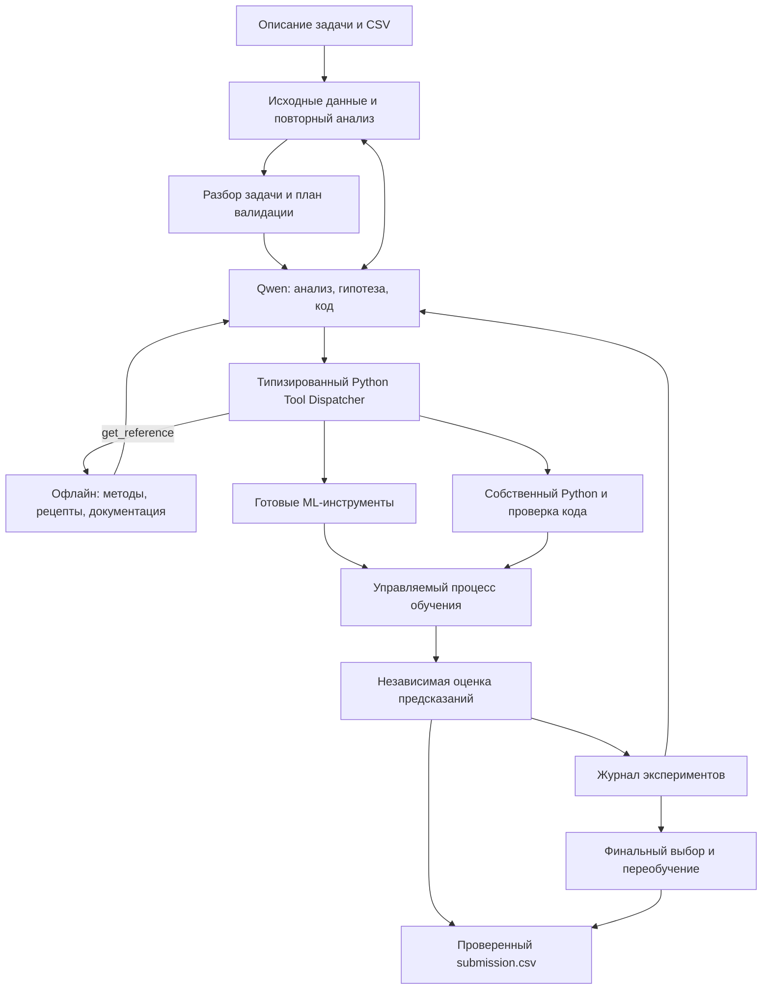

# Архитектура базового автономного ML-агента

## Итоговый кандидат v038 — 22 октября 2026 года

Подготовлен [solution_v038.zip](dist/solution_v038.zip): **94 716 249 байт**, SHA-256 `632dcd8a6a621df20ea70427db1f8dfc9f7b393cecc5463510fef5eadd0b5911`. [Финальный отчёт](outputs/qa_plan_implementation_A/FINAL_v038_REPORT.md), [проверки и ограничения](outputs/qa_plan_implementation_A/ACCEPTANCE_v038.json). Архив содержит исправленные исходники; 52 встроенных файла сверены побайтово, исходный requirements сохранён. На платформу архив не отправлялся.

Устранены ошибки завершения операций и диагностики, повторов при неизвестном исходе Qwen, семантического контракта и источников данных. Независимый аудит закрыл риск передачи непроверенного словаря в запрос модели и обход различия источников через ссылки. Для финального обучения исправлен слишком короткий внутренний слот: текущий подграф получает доступное время за вычетом других уникальных узлов; полный refit резервируется всегда. До открытия контроля состав повторно сокращается при изменении оценки ресурсов; сначала освобождаются воспроизводимые файлы. После открытия состав неизменен.

Реализованы Б1–Б4: контракт v2 до активации Dataset, обоснованный ранний finish, FeedbackPolicy v2 и до трёх уникальных финалистов с временными окнами внутри fit. Добавлены MAPE и balanced accuracy к прежним 11 метрикам, а также отдельная явная числовая кластеризация без targets. Пилоты более строгой ничьей, многоклассового правила и псевдоразметки не дали достаточных оснований для включения по умолчанию. [Описание расширений](docs/qa_section4.md).

Полный набор прежних сценариев: **423 passed**; финальные изменения: **76 passed**; отчётность и сравнение: **16 passed**. Группы пересекаются. Полный набор выполнен до последнего исправления очистки диска, которое отдельно покрыто финальными проверками. Сам итоговый ZIP прошёл шесть чистых офлайн-сценариев в точной среде зависимостей: MAPE, balanced accuracy, кластеризация с восстановлением без повторного fit, а также семантическая интерпретация без task_spec с отсутствующей, пустой и пробельной моделью в окружении. У supervised-задач завершены control/refit/full_train_refit. Запрос неуспешной подготовки регрессии Б отдельно воспроизведён на сохранённых входах: 45 312 строк обучения, успешный результат за 5,25 секунды при лимите 90 секунд. Нагрузка отличается от прошлого прогона; это не повтор всей реальной серии.

Повторная реальная А/v028 принята по обеим задачам. Реальная Б/v033 завершила классификацию, но регрессия осталась с резервным fit-CSV после таймаута подготовки. Поэтому сравнение А/Б невалидно; преимущество качества и полная реальная приёмка v038 не установлены. Исходные отрицательные отчёты сохранены. Повтор трёхчасовой репетиции отменён пользователем; новых платных запусков при подготовке итогового ZIP не было. Наблюдаемое суммарное изменение счётчика API — **42,72924 из 200**, последний сохранённый остаток — **505,64872**; задержка учёта провайдера не ограничена доказанным сроком. Временная память OrbStack возвращена с 12,5 до 12 ГиБ. Ниже сохранена история прежних поставок.

## 1. Что строим и что требует кейс

**Проектируем новую реализацию: один Qwen-агент самостоятельно исследует задачу, выбирает и комбинирует готовые ML-инструменты, пишет собственные Python-пайплайны для новых гипотез, анализирует результаты и улучшает решение.** Типовые операции выполняют разрешённые библиотеки; контроллер обеспечивает их совместимость, независимую оценку и соблюдение бюджета.

Под пайплайном понимаем полный путь от исходных признаков до предсказаний: очистка данных, преобразования, создание признаков, обучение и применение модели. Последовательность исследовательских действий тоже выбирает агент.

Основание — [исходное ТЗ](<Альфа Хак_AutoML .pdf>).

| Требование | Следствие для решения |
|---|---|
| Python 3.12; фиксированные зависимости | Проверять совместимость инфраструктуры и сгенерированного кода с выданными версиями |
| 8 CPU, 32 ГБ RAM, до трёх часов на задачу | Последовательное обучение, общий контроль ресурсов, резерв времени на завершение |
| Интернет недоступен; Qwen доступен через специальный API | Подготовить справочные материалы заранее; во время решения обращаться только к разрешённой модели |
| Обучение только на предоставленных данных; предобученные модели запрещены | Исключить загрузку весов, внешних датасетов и готовых эмбеддингов |
| ZIP с `solution.py` в корне | Сохранить интерфейс аргументов и переменных окружения из baseline |
| На private поступят новые задачи | Не зашивать названия датасетов, таргетов, признаков и отдельные рецепты для public |
| По завершении времени оценивается готовый CSV | Создавать результат рано и обновлять его после проверенных улучшений |

Контракт запуска берём из [baseline.py](data_for_participants/baseline.py), версии — из [requirements.txt](data_for_participants/requirements.txt). Уточнение организаторов об отсутствии `mcp` учитываем: инструменты Qwen исполняет собственный диспетчер решения.

По согласованной расширенной границе первая версия поддерживает:

- табличную регрессию, бинарную и многоклассовую классификацию;
- предсказания метками и вероятностями;
- текстовые признаки без предобученных моделей;
- несколько числовых или категориальных таргетов, multilabel;
- прогнозирование одного или нескольких временных рядов;
- ранжирование объектов внутри групп.

**Это расширенная базовая версия.** Она потребует отдельных проверок каждого семейства задач. Обещать качество на любых неизвестных private-задачах по двум публичным примерам нельзя.

После командной рецензии меняется способ реализации: стандартные эксперименты описываются конфигурациями и выполняются готовыми библиотеками, а генерация Python остаётся полноценным инструментом агента. Сохраняются согласованные требования к повторному исследованию исходных данных, валидации по структуре train/test и приоритетной проверке модельного восстановления пропусков.

Дополнение от 20.10.2026 включает офлайн-базу ML-подходов и документации, каталог воспроизводимых рецептов и выбор разных модельных семейств. Это план будущей подсистемы: корпус ещё не выгружен, индекс не построен, совместимость рецептов исполнением не подтверждена. Подробности подготовки и приёмки приведены в разделе 4; прежние требования к данным, широкому охвату задач и автономному Python сохраняются.

Реализацию начинаем с короткого сквозного эксперимента с живым Qwen, одним библиотечным адаптером и собственным Python-компонентом. Он проверяет исследовательский цикл до расширения инфраструктуры. Минимальный состав этого эксперимента определяет порядок разработки; весь согласованный функционал, включая офлайн-базу, AutoML и семейства P0/P1/P2, остаётся в объёме итоговой базовой версии.

## 2. Выбор подхода и его обоснование

Рекомендуемая основа — **гибрид готовых ML-инструментов, генерации Python и небольшого контроллера с независимым оценщиком**. Агент управляет исследованием на уровне гипотез. Для типовых моделей, преобразований и подбора параметров он вызывает библиотечные инструменты; для нестандартной идеи создаёт собственный модуль. Все попытки сохраняются как версии воспроизводимых экспериментов независимо от способа их создания.

| Подход | Что берём | Ограничение переноса |
|---|---|---|
| [AIDE](https://arxiv.org/html/2502.13138v1) | Операции создания, исправления и улучшения решения; отдельная версия кода на эксперимент; краткая история результатов | Готовая реализация не заменяет адаптацию к нашим зависимостям и бюджету |
| [AIRA](https://arxiv.org/html/2507.02554v2) | Разделение генерации изменений, стратегии поиска и оценки; внимание к разрыву между validation и test | Сложное дерево поиска полезно только при качественных операторах и достаточном бюджете |
| [MLE-STAR](https://arxiv.org/html/2506.15692v3) | Изменение конкретного компонента пайплайна и проверка его вклада | Веб-поиск во время запуска нам недоступен; полный многоступенчатый процесс слишком дорог для начальной версии |
| [R&D-Agent](https://arxiv.org/html/2505.14738v2) | Разделение гипотезы, реализации, исполнения и оценки; память о подтверждённых и неудачных попытках | Отдельные LLM-роли пока объединяем в одном агенте |
| [autoresearch](https://github.com/karpathy/autoresearch) | Узкая область редактирования, воспроизводимый эксперимент, сохранение улучшений и откат неудач | Его конкретный эксперимент рассчитан на обучение нейросети на GPU |
| [FML-bench](https://arxiv.org/html/2605.17373v2) | Проверка простого поиска перед усложнением; расширение направлений после остановки прогресса | Результаты другого бенчмарка не доказывают преимущество стратегии на нашей Qwen |

Это обоснование архитектуры, а не прогноз результата соревнования: опубликованные показатели получены с другими моделями, задачами и ресурсами.

**Оркестрация.** Используем простой цикл состояний, прямой клиент Qwen и типизированный Python Tool Dispatcher. MCP для вызова обычных Python-функций не требуется. Основной транспорт — native function calling после успешной проверки выданного endpoint; резервный транспорт — структурированные JSON-команды с теми же схемами. Для одного агента с последовательным исполнением LangGraph пока не даёт необходимой функции, которая оправдывала бы дополнительный слой. Такой старт согласуется с рекомендациями начинать с простых компонуемых механизмов и измерять пользу усложнений. [Building effective agents](https://www.anthropic.com/engineering/building-effective-agents)

**ML-инструменты.** scikit-learn, CatBoost и LightGBM образуют основу прямого обучения; XGBoost подключается через тот же контракт после проверки окружения. Бустинги заслуживают ранних проб на табличных данных, но победителя определяет эксперимент. Исследования табличного обучения поддерживают такой старт, не устанавливая универсально лучшую модель. [Исследование моделей для табличных данных](https://arxiv.org/abs/2207.08815)

**Готовый AutoML.** FLAML и AutoGluon становятся полноценными инструментами исследования. Qwen выбирает движок, допустимые семейства моделей и бюджет, получает реальные результаты и решает, что проверять дальше. Каждый движок запускается как один ограниченный эксперимент с независимой внешней оценкой. Собственный AutoML-алгоритм не разрабатываем. [FLAML](https://microsoft.github.io/FLAML/docs/Use-Cases/Task-Oriented-AutoML/), [AutoGluon 1.3.1](https://auto.gluon.ai/1.3.1/tutorials/tabular/tabular-faq.html)

| Библиотека | Роль в системе | Условия применения |
|---|---|---|
| CatBoost 1.2.8, LightGBM 4.6.0, XGBoost 2.1.4 | Прямое обучение и модели для специализированных адаптеров | Агент выбирает модель и параметры; единый исполнитель контролирует ресурсы и возвращает предсказания оценщику |
| FLAML 2.3.6 | Поиск моделей и гиперпараметров в выделенном бюджете | Только проверенные learners и внутреннее разбиение внутри fit; без внешнего Optuna вокруг уже работающего поиска |
| AutoGluon Tabular 1.3.1 | Альтернативный табличный AutoML и библиотечные ансамбли | Явный список разрешённых моделей, последовательное исполнение, ограничения времени и CPU, внешний монитор памяти; без предобученных компонентов |
| Optuna 4.2.1 | Целенаправленная настройка одного выбранного семейства | Последовательные trials на внутренних разбиениях fit; завершённые конфигурации и стоимость сохраняются |
| scikit-learn 1.5.2, Feature-engine 1.8.3 | Пайплайны, импутация, кодирование, математические преобразования, отбор и создание признаков | Использовать готовые преобразователи, где они соответствуют гипотезе; обучать их только на допустимой части данных |
| imbalanced-learn 0.12.4 | Проверяемые гипотезы обработки дисбаланса | Ресэмплинг проводится только внутри обучающего fold; validation и контроль не ресэмплируются |
| statsmodels 0.14.0 | Классические статистические модели и прогнозирование | Только для соответствующего адаптера с подтверждённой временной структурой |
| LightAutoML 0.4.2 | Дополнительный AutoML-движок | Подключается после проверки совместимости выданного образа; его доступность не является условием работы базового ядра |

Feature-engine используем для готовых математических и относительных признаков, преобразований распределений, отбора константных, дублирующихся и коррелирующих столбцов. Календарные и лаговые преобразования подключаются с учётом порядка, границ рядов и доступной истории: сам интерфейс `fit/transform` не обеспечивает причинность. Агент задаёт преобразование и его параметры, а новый алгоритм пишет при необходимости. [Feature-engine](https://feature-engine.trainindata.com/en/1.8.x/user_guide/creation/index.html)

Наличие библиотеки в списке организаторов не подтверждает работоспособность всех её режимов. До включения инструмента проверяются версия, импорт, минимальный запуск и необходимые зависимости в фактическом образе. Например, дополнительные extras FLAML `blendsearch` ограничивают Optuna версией ≤3.6.1, а `catboost` для Python ≥3.11 — версией ≤1.2.5; это расходится с выданными pins. Не устанавливаем эти extras, не понижаем версии и не добавляем зависимости. Проверяем режим `flaml[automl]`, а связь с уже установленным CatBoost тестируем отдельно. [Метаданные FLAML 2.3.6](https://raw.githubusercontent.com/microsoft/FLAML/v2.3.6/setup.py)

Готовые AIDE/AIRA/R&D-Agent используем как источники архитектурных решений. Их пакеты не входят в выданный список и не включаются в решение целиком. Переиспользование отдельного кода возможно только после проверки лицензии и зависимостей; базовый план этого не требует.

**Выбор подхода и локальная справка.** Агент выбирает полную постановку эксперимента: семейство задачи, представление данных, семейство модели, реализацию, функцию потерь, способ поиска и правило получения ответа. FLAML и AutoGluon выполняют поиск, а CatBoost, LightGBM и XGBoost представляют варианты бустинга; сравнение только трёх бустингов не охватывает линейные модели, леса, текстовые представления и компактные нейросети. Офлайн-карточки помогают сформулировать альтернативы, а точная документация — реализовать их разрешёнными библиотеками. Каталог не задаёт одинаковый маршрут всем задачам и не ограничивает самостоятельные гипотезы Qwen.

**Правила агентного кодинга.** Подготовим короткую политику с контрактом кода, ограничениями данных и порядком проверки гипотез. Большую универсальную инструкцию не считаем заведомым улучшением: исследования файлов `AGENTS.md` показывают разные результаты на разных протоколах. Пользу дополнительных правил проверяем отдельно. [Исследование успешности и стоимости](https://arxiv.org/html/2602.11988v3), [исследование эффективности](https://arxiv.org/html/2601.20404v2)

## 3. Архитектура, интерфейсы и поведение



**Распределение ответственности**

| Модуль | Ответственность |
|---|---|
| Разбор задачи | Найти входные файлы, определить таргеты, роли столбцов, метрику и формат ответа |
| Данные и повторный анализ | Сохранить исходники, проверить схемы, построить профиль, исследовать пропуски и различия выборок; возвращать дополнительные срезы по запросу агента |
| ValidationStrategySelector | Выбрать схему по описанию и структуре train/test; зафиксировать внешнюю исследовательскую проверку, закрытый контроль и внутренние разбиения fit для библиотек |
| Агент | Анализировать наблюдения, выбирать гипотезы, библиотеки и бюджеты, составлять конфигурации, писать и исправлять собственные пайплайны |
| Контроллер | Хранить состояние запуска, разрешать переходы, фиксировать завершение поиска и восстанавливать выполнение по сохранённым операциям |
| Рабочая память | Формировать компактное состояние исследования из подтверждённых наблюдений, результатов, отклонённых направлений и открытых вопросов |
| Python Tool Dispatcher | Проверять типизированные аргументы и доступность действия, разрешать ссылки на артефакты, учитывать идентификатор операции и передавать её исполнителю |
| Готовые ML-инструменты | Вызывать разрешённые библиотеки для обучения, поиска параметров, преобразований, диагностики и ансамблей через единые контракты |
| Офлайн-база знаний | Выдавать методические карточки, совместимые рецепты, пространства параметров и документацию точных версий через `get_reference`; сохранять происхождение и ограничения |
| Рабочая область пайплайнов | Хранить декларативные спецификации и версии собственного кода; проверять синтаксис и ограничения, готовить короткий пробный запуск |
| Исполнитель | Обучать и применять пайплайн с контролем времени, памяти и процессов |
| Оценщик | Проверять предсказания, рассчитывать метрики и диагностику |
| Менеджер бюджета | Учитывать стоимость всех внутренних обучений и прогнозов, предотвращать вложенный поиск, сохранять резерв завершения |
| Журнал и публикация | Хранить историю, конфигурации, модели и зависимости ансамблей; выбирать допустимые результаты и атомарно обновлять CSV |

**Контракты данных**

- `TaskSpec`: семейство задачи, таргеты, идентификаторы, роли признаков, метрика с параметрами, схема ответа; для соответствующих задач — время, группы, идентификаторы рядов и горизонт. Подтверждённая версия содержит хеш исходного комплекта, основания для принятых значений и хеш контракта; подтверждение записывает только контроллер.
- `TaskResolutionProposal`: идентификатор запроса уточнения, хеш исходного комплекта, статус `proposed` или `unresolved`, предлагаемый полный `TaskSpec` либо `null`, ссылки на основания по уточняемым полям, перечень нерешённых полей и противоречий. Это структурированный ответ этапа подготовки; сам по себе он не подтверждает контракт и не разрешает обучение.
- `DataProfile`: схема и смысл полей, пропуски и специальные значения, категории, дубликаты, периоды и группы, различия train/test; каждый результат содержит область анализа, источник и версию.
- `ValidationPlan`: режим переноса на новые данные, обоснование стратегии, индексы, seed, контроль покрытия классов, версия протокола и хеш разбиения. Вложенная `feedback_policy` задаёт допустимые отчёты и срезы внешней validation, минимальную наполненность, правила скрытия и кэширования; `selection_policy` — абсолютный и относительный допуски к практической ничьей и правила выбора. Политики фиксируются до первой внешней оценки и имеют собственные хеши.
- `ImputationPlan`: методы восстановления по столбцам или блокам, вспомогательные модели и параметры, исходные маски пропусков, ограничения значений, резервные стратегии и область обучения. Используется и декларативным сборщиком, и собственными Python-пайплайнами.
- `PipelineSpec`: представление и семейство модели, движок и реализация, упорядоченные преобразования, `ImputationPlan`, гиперпараметры, параметры внутреннего поиска, версии библиотек, seed; при собственном коде — ссылка на модуль и его хеш. Поля `training_objective`, `prediction_policy` и `postprocess_fit_policy` отделяют обучение от метрики и формата ответа. Кастомный компонент можно сочетать с готовыми преобразователями и моделью.
- `ExperimentSpec`: родительская версия, гипотеза, ссылки на наблюдения, `PipelineSpec`, версии данных, обработки и валидации, бюджет, цель исследования и хеш; дополнительно `search_action` (`draft`, `improve`, `debug`), корень цепочки исправлений, `method_refs`, `recipe_ref`, `reference_ids`, `search_space_ref`, `knowledge_bundle_version`, статус проверки компонентов и режим пилота или полного эксперимента.
- `ExperimentResult`: статус, независимо рассчитанные внешние метрики, отдельно обозначенные внутренние показатели движка, время, память, стоимость импутации и внутреннего поиска, диагностика и ссылки на артефакты. В представление для Qwen входят только разрешённые отчёты с областью расчёта, версией `feedback_policy` и статусами скрытия; ссылки не открывают доступ к защищённым построчным результатам оценщика.
- `PredictionBundle`: версия данных, идентификатор части выборки и протокола, внутренние ключи строк и хеш их порядка, имена целевых выходов, тип предсказаний, массивы по каждому выходу и явное соответствие столбцов вероятностей классам.
- `ResearchState`: версия состояния, ссылки на действующие контракты, подтверждённые факты с источниками, лучшее сырое значение метрики и выбранный по `selection_policy` лидер, проверенные направления и причины отказа, открытые вопросы, текущая гипотеза, счётчики поиска и оставшийся бюджет. Предположения хранятся отдельно от подтверждённых фактов; сводка и счётчики обратной связи не раскрывают скрытые отчёты.
- `OperationRecord`: `run_id`, `operation_id`, имя инструмента, хеш канонических аргументов, ссылка на эксперимент, состояние выполнения, время начала/окончания, бюджет и ссылки на проверенные результаты. Для незавершённой операции отмечается, подтверждён ли исход, а для повторного исполнения сохраняются причина и связь с прежней попыткой.
- `ExecutionPolicy`: проверенный режим доступа worker к данным, коду контроллера, каталогам записи, сети и учётным данным; фактические ограничения, результаты технических проб и выбранная модель доверия.
- `CapabilityRegistry`: доступность конкретной комбинации компонента, версии, задачи и режима; поддержанные представления, NaN/категории, веса, группы, методы предсказания, внутренние разбиения, CPU, сериализация и refit. Статусы `unverified`, `verified`, `disabled` сопровождаются причиной и идентификатором проверки. Успешный import или бинарный fit не подтверждает все возможности пакета; при недоступном режиме агент выбирает другой путь.
- `MethodCard`: наблюдения, гипотеза, альтернативы, ограничения данных и валидации, минимальный сравнительный эксперимент, ссылки и статус рецензирования.
- `RecipeSpec`: версия рецепта, семейство и представление, требуемые capabilities, шаблон `PipelineSpec`, допустимые objectives и выходы, ссылки на пространство параметров, пилот и `RefitPolicy`.
- `SearchSpaceSpec`: типы, диапазоны, условные зависимости параметров, исходные настройки и ограничения стоимости; выполняется готовым владельцем HPO.
- `ReferenceRecord`: библиотека, целевая и фактическая версии справки, `doc_id`, символы API, происхождение, commit/хеши, лицензия, статус полноты текста и отдельный статус проверки API. Это единый контракт документа; `DocumentRecord` из входного предложения отдельно не дублируется.
- `KnowledgeBundle`: версия неизменяемого корпуса, хеш requirements, состав карточек, рецептов, справки и индекса, лицензии, покрытие и зарегистрированные пробелы; после сборки фиксируется в `knowledge.lock.json`.
- `RefitPolicy`: граф компонентов, замороженная конфигурация, правила выбора числа итераций, переобучения преобразований и постобработки, состав ансамбля, допустимые строки и бюджет; не разрешает новый поиск после контроля.

Имена целевых столбцов и идентификаторов определяем по описанию, словарю и схемам файлов. Противоречия фиксируем как ошибку контракта. Отсутствующие пути из текста разрешаем через файлы рядом с `task.md`, только если комплект единственный и согласованный.

**Уточнение и подтверждение постановки задачи**

Уточнение выполняется в состоянии `preparing`, до исследовательского цикла. Это отдельный структурированный ответ Qwen, а не десятый исследовательский инструмент. До подтверждения `TaskSpec` диспетчер не допускает обучение, подбор, ансамбли и собственный Python. Если локальные источники однозначны, обращение к Qwen для подтверждения не требуется.

1. Доверенный разборщик собирает черновик из `task.md`, словаря, заголовков и схем CSV и шаблона ответа. Однозначные значения отмечаются как зафиксированные, для остальных перечисляются вопросы. Комплект и используемые фрагменты получают хеши и идентификаторы источников. Для такого уточнения агенту не передаются строки целевых значений или статистики закрытого контроля.
2. При неоднозначности Qwen получает черновик, зафиксированные значения, относящиеся к вопросам фрагменты источников и схему `TaskResolutionProposal`. Для статуса `proposed` требуется полный предлагаемый контракт, основания уточнений и пустые списки нерешённых вопросов и противоречий; при недостаточных основаниях возвращается `unresolved`. Объявленная моделью уверенность не заменяет ссылки на материалы задачи.
3. Ответ проходит локальную проверку общей схемой Pydantic независимо от транспорта. Для обычного chat-ответа используется один JSON-объект; поддержка серверного JSON mode не предполагается. Проверяются принадлежность запроса и хешей текущему комплекту, существование столбцов, совместимость ролей и выходов, классы и параметры метрики, её наличие в независимом оценщике и согласованность с явными требованиями источников. Числовой таргет сам по себе не определяет регрессию, имя столбца не подтверждает группу или время. Qwen не может переопределить уже однозначные значения или устранить противоречие игнорированием одного из источников.
4. Невалидный ответ возвращается с перечнем конкретных ошибок. Допускаются до двух исправлений в общем бюджете обращений и времени Qwen; исходные материалы и зафиксированные значения при этом не меняются. При `unresolved`, недоступном API, исчерпании исправлений или бюджета неполный контракт получает статус `contract_unresolved` с причиной. Противоречие явных требований остаётся ошибкой контракта; выдуманный таргет, метрика или формат ради CSV не допускаются.
5. При успешной проверке контроллер сохраняет подтверждённый `TaskSpec`, основания, историю предложений и свой результат проверки. По нему готовятся валидация, ранний резерв и короткая обученная опора. Только после обязательной подготовки разрешается переход в `searching`. Все эксперименты ссылаются на хеш подтверждённого контракта; предложение Qwen и подтверждённая версия хранятся раздельно.

После начала исследования таргеты, роли, основная метрика и схема ответа не меняются через инструменты или текст Qwen. Обнаруженная ошибка постановки останавливает исследование с причиной, а имеющийся файл сохраняется вместе с исходным контрактом и не объявляется правильным для другой постановки. Обоснованное изменение исследовательского разбиения остаётся возможным через версию `ValidationPlan` по правилам раздела «Валидация»; оно не меняет `TaskSpec` и не открывает закрытый контроль. Повтор ответа или смена транспорта не подтверждают контракт заново и не сбрасывают бюджет.

**Состояния контроллера и выполнение операций**

Состояние запуска сохраняется независимо от контекста Qwen. Переходы разрешает контроллер; текст агента не может отменить завершение поиска, повторно открыть контроль или продлить исходный дедлайн.

| Состояние | Допустимая работа и переход |
|---|---|
| `preparing` | Детерминированно подтвердить контракт либо проверить `TaskResolutionProposal` Qwen; до подтверждения обучение запрещено. Затем подготовить данные и разбиения, выбрать `ExecutionPolicy`, создать резерв и короткую обученную опору; перейти в `searching` только с подтверждённым `TaskSpec` |
| `searching` | Выполнять разрешённые исследовательские инструменты; `finish`, исчерпание бюджета или лимитов переводят запуск в `frozen` |
| `frozen` | Сохранить финалистов, версии протокола, `RefitPolicy` и план завершения; после этого новые гипотезы, поиск гиперпараметров и изменение разбиений запрещены |
| `control` | Подготовить замороженных финалистов по одному протоколу и выполнить запланированное сравнение оценщиком; результаты не передаются обратно в поиск |
| `refitting` | Переобучить выбранный пайплайн по зафиксированному рецепту и проверить его тестовые предсказания; при сбое сохранить пригодный результат выбранного кандидата |
| `completed` | Завершить запуск с проверенным CSV и явными статусами контроля и refit, включая пропущенные или незавершённые фазы |
| `failed` / `contract_unresolved` | Остановить дальнейшую работу; сохранить существующий проверенный результат, если он есть, и причину остановки; не создавать ответ по выдуманному контракту |

Контроллер записывает переход в `frozen` до подготовки финалистов, а факт открытия контроля — до доступа оценщика к его меткам. При восстановлении незавершённого сравнения разрешается закончить только тот же сохранённый набор финалистов по прежнему протоколу. Если это невозможно, контроль отмечается незавершённым; подбор новых кандидатов и возврат к поиску запрещены.

Каждая операция получает `operation_id`, общий для native-вызова и его JSON-представления. Хеш аргументов включает версии данных и протокола. Один ID с другими аргументами отклоняется. Состояния операции — `pending`, `running`, `succeeded`, `failed`; поле исхода различает подтверждённую неудачу и `outcome_unknown`.

1. После проверки команды контроллер сохраняет `pending` и выделенный бюджет; перед запуском исполнителя фиксирует `running`.
2. Исполнитель пишет артефакты в каталог своей попытки. Контроллер выполняет проверки по виду инструмента; для обучения это полнота артефактов, хеши, предсказания и результат независимой оценки. Затем сохраняются итоговый манифест и `succeeded`.
3. Повтор завершённой операции возвращает сохранённый результат; для выполняющейся возвращается её состояние. Повтор запроса или смена транспорта не запускают второе обучение.
4. Если процесс завершился, а подтверждение потеряно, контроллер сначала проверяет готовые артефакты и принадлежность оставшихся процессов текущему запуску. При неизвестном исходе автоматический повтор обучения запрещён. Новая попытка допускается после исключения продолжающегося исполнения, с причиной, новым ID и учётом прежних затрат.
5. Публикация выполняется отдельным сохраняемым шагом после проверки кандидата. При сбое между заменой CSV и записью происхождения контроллер сверяет фактический хеш файла с готовыми артефактами и восстанавливает запись; наличие файла само по себе не подтверждает завершение операции.

Восстановление не обнуляет счётчики, потраченное время и исходный дедлайн. Наличие автоматического перезапуска контейнера не предполагается: этот протокол нужен также для сбоев worker, потери ответа и смены транспорта внутри одного запуска. Контрольные точки и сохранение результатов завершённых задач можно реализовать небольшим собственным механизмом; обязательной зависимости от LangGraph нет. [Пример восстановления в LangGraph 0.6.7](https://github.com/langchain-ai/langgraph/blob/0.6.7/docs/docs/how-tos/use-functional-api.md)

**Исходные данные и повторное исследование**

Агент может возвращаться к данным после любого эксперимента. Первичный профиль служит отправной точкой: заранее вычислить все полезные связи и полностью передать таблицы в контекст Qwen невозможно. Данные остаются доступны через инструменты, а модель получает сводку и запрошенные подробности.

- Исходные CSV и словарь не перезаписываются. Сохраняются их хеши, исходные значения, правила чтения и порядок строк. Каждая версия обработки воспроизводится из исходных данных.
- При чтении различаются пустая ячейка, специальная категория и подозрительное числовое значение. Например, `service = "-"` обозначает отсутствие определённого сервиса; нули в `year_built` требуют отдельной проверки смысла. Нули, строки `NA` и другие токены не объявляются пропусками для всех столбцов автоматически.
- Первичная структурная проверка охватывает размеры, типы, роли, диапазоны периодов, группы, пропуски, категории и совместимость train/test. Статистики с использованием таргета и произвольный исследовательский код ограничиваются обучающей частью выбранного протокола.
- Повторные запросы позволяют исследовать совместные пропуски, распределения по периодам и группам, выбросы, новые категории и связи признаков. Например, агент может проверить, у каких типов объектов отсутствует рейтинг и как отличаются их доступные признаки.
- После эксперимента оценщик возвращает основную метрику и разрешённую `feedback_policy` агрегированную диагностику ошибок по классам, периодам, группам и наличию пропусков. Произвольные подробные срезы с использованием таргета доступны на fit; внешняя validation не принимает новые маски строк по результатам ошибок. Агент связывает доступную диагностику с новым анализом обучающей части и предлагает следующую версию обработки.
- Исследовательские метки валидации не передаются произвольному коду обучения или анализа; закрытые контрольные метки доступны только оценщику после завершения поиска. По test можно проверять схему и различия распределений признаков; обучать на нём импутеры, кодировщики и другие преобразования нельзя.
- Подробные результаты анализа сохраняются с областью расчёта, версией данных и ссылками на эксперимент. В текущий контекст включаются необходимые разрешённые факты; агент может повторно запросить прежний доступный отчёт без полного повторного расчёта. Кэш, ссылки на артефакты и сокращение контекста сохраняют ту же границу доступа.

**Подтверждённые особенности открытых данных**

Структурная проверка предоставленных CSV выявила следующие особенности. Они служат примерами требований к анализатору; имена полей и значения периодов не становятся условиями в коде агента.

| Наблюдение | Следствие |
|---|---|
| В [train регрессии](data_for_participants/Регрессия/train.csv) `Year_Factor` принимает значения 1–5, в [test](data_for_participants/Регрессия/test.csv) — только 6 | Проверять перенос на следующий период; обычное случайное разбиение не воспроизводит это разделение |
| `energy_star_rating` отсутствует примерно в 41,7% train и 20,0% test | Анализировать различия пропусков и проверять обработку на подходящем разбиении |
| `max_wind_speed` отсутствует примерно в 49,4% train и 65,8% test | Проверять устойчивость к росту доли пропусков; сохранять исходную маску |
| В [описании классификации](<data_for_participants/Многоклассовая классификация/task.md>) указан отдельный исходный hold-out; есть редкие классы и специальные категории | Не считать внутреннюю случайную проверку точной копией внешнего теста; контролировать покрытие классов и категорий |

**Модуль написания пайплайнов**

Поддерживаем два способа создать один и тот же вид исполняемого артефакта:

- **Декларативный пайплайн:** агент задаёт `PipelineSpec`; доверенный сборщик создаёт цепочку scikit-learn/Feature-engine и вызывает выбранную модель или AutoML-адаптер. Названия компонентов разрешаются через реестр, а не через `eval`. Агенту не нужно переписывать обучение CatBoost, Yeo-Johnson или стандартный отбор признаков.
- **Пайплайн с собственным Python:** агент пишет новый преобразователь, процедуру обучения или полный модуль. Этот путь доступен для обоснованной гипотезы, даже если есть готовый базовый вариант; отдельного разрешения человека на обычный эксперимент не требуется. Действуют те же ограничения библиотек, данных, оценки и ресурсов.

Пример декларативной спецификации; параметры иллюстрируют формат и не являются результатом подбора:

```yaml
engine: direct
model: catboost
preprocessing:
  imputation:
    numeric: iterative_bayesian_ridge
    categorical: missing_category
    indicators: true
  transformations: []
hyperparameters:
  iterations: 600
  depth: 6
validation_id: temporal_v1
seed: 42
custom_module: null
```

Сгенерированный модуль и адаптер готовой библиотеки предоставляют общий интерфейс:

```text
build_pipeline(context) → CandidatePipeline
CandidatePipeline.fit(X, y, context) → TrainingSummary
CandidatePipeline.predict(X, context) → PredictionBundle
```

- `X` содержит признаки; `y` всегда представлен таблицей целевых столбцов.
- Контекст передаёт схему, seed, ресурсы и необходимые метаданные времени или групп.
- Агент может писать собственные преобразователи, обучение и обёртки над разрешёнными библиотеками; это возможность исследовательского цикла, а не обязательная перепись стандартного кода в каждом эксперименте.
- Импутация включается в этот же пайплайн: `fit` обучает заполнение на своей обучающей части, `predict` применяет сохранённые преобразования и вспомогательные модели.
- `TrainingSummary` содержит сведения для повторного обучения, включая выбранное число итераций, способ импутации, параметры вспомогательных моделей и стоимость их обучения.
- Метрики из сгенерированного кода и stdout не используются для выбора победителя.
- Сериализованные модели загружает только исполнитель. Контроллер получает массивы предсказаний и проверенный JSON.

Каждая попытка сохраняется в новой директории. Выполняемая версия и прежний лидер не редактируются. Хеш эксперимента строится по канонической спецификации, версиям библиотек, данным, разбиениям, seed и собственному коду. Точный дубль не обучается без явно указанной причины; близкие поиски отмечаются как уже исследованные направления. У AutoML сохраняются фактическая конфигурация победителя и артефакты, а не только запрос к движку: повторный запуск по одному таймауту не гарантирует ту же модель.

Перед полноценным экспериментом выполняются проверка синтаксиса, импортов, интерфейса и короткое обучение на части обучающих данных. Проверяются форма результата, конечность чисел, классы и сохранение порядка строк.

**Идентичность строк и контракт предсказаний**

Доверенный модуль данных назначает неизменный внутренний ключ каждой исходной строке. Он отличается от пользовательского ID, который может повторяться, и не передаётся модели как обучающий признак. Если пайплайн сортирует, объединяет или фильтрует строки, соответствие ключей переносится вместе с данными; заново пронумеровать уже переставленный результат недостаточно.

Оценщик сопоставляет `PredictionBundle` с ожидаемыми версией данных, частью выборки, протоколом и полным набором внутренних ключей. Пропущенные, лишние или повторённые ключи отклоняются; допустимая перестановка восстанавливается однозначно до расчёта метрики. Затем проверяются имена и формы выходов, тип ответа, классы и вероятности. Для ranking сохраняется соответствие строк исходным запросам. Ансамбли объединяются по внутренним ключам и выходам, а финальный CSV формируется в исходном порядке test с исходными пользовательскими ID. Эти проверки выявляют ошибки сопоставления; они не заменяют выбранную модель доверия к собственному Python.

**Инструменты агента**

В основном каталоге девять операций; исследовательский цикл использует их после подтверждения `TaskSpec`. Отдельный ответ `TaskResolutionProposal` в `preparing` не добавляет операции в каталог и не даёт доступа к исполнителю. Аргументы включают ссылки на данные и артефакты текущего запуска; произвольные пути к чужим задачам не принимаются.

| Инструмент | Назначение |
|---|---|
| `inspect_dataset` | Повторный профиль, столбцы, совместные пропуски, срезы, различия train/test и обоснованное предложение изменить исследовательскую проверку; произвольные срезы с таргетом ограничены fit, внешние диагностики подчиняются `feedback_policy` |
| `get_reference` | Локальные режимы `methods`, `recipes`, `api`, `search`, `read`, `search_space`; поиск по наблюдениям, проверка совместимости и чтение с продолжением |
| `train_model` | Создать версию из `PipelineSpec`, применить преобразования и обучить конкретную модель в выделенном бюджете; пилот и полное обучение имеют разные статусы |
| `run_automl` | Запустить FLAML или AutoGluon с выбранными learners, метрикой из `TaskSpec` и ограничением ресурсов |
| `tune_model` | Проверить ограниченное условное пространство выбранного пайплайна через Optuna, в том числе по `search_space_ref` |
| `analyze_experiments` | История, сравнение результатов, ошибки по разрешённым срезам и признаки важности с указанием области расчёта; скрытые внешние отчёты не выдаются по новому запросу или ссылке |
| `build_ensemble` | Создать отдельный кандидат из совместимых сохранённых моделей и независимо проверить его |
| `run_custom_experiment` | Сохранить, проверить и исполнить собственный Python-пайплайн или анализ на разрешённой обучающей части |
| `finish` | Завершить поиск и передать управление финальной проверке и публикации |

Сборка преобразований, отбор признаков и импутация задаются в `PipelineSpec` и вызываются инструментами обучения. Внутренние функции `apply_transformations` и `select_features` не требуют отдельных обращений к Qwen. Проверка схем, расчёт основной метрики, контроль ресурсов и сохранение результата выполняются автоматически.

Один реестр схем Pydantic используется для обоих транспортов. При подтверждённом native function calling клиент отправляет определения функций через `tools`, получает имя и JSON-аргументы и передаёт их диспетчеру; результат связывается с исходным вызовом. Встроенный MCP-сервер не создаётся. Запрос исполняет одну исследовательскую операцию за раз. Пример такого API уже есть в `baseline.py`, однако совместимость конкретного Qwen-шлюза проверяется живым запросом.

Если endpoint не поддерживает native tool calling или возвращает непригодный формат, используется резерв: одна JSON-команда по тем же схемам в обычном chat-ответе. Смена транспорта не меняет полномочия инструментов и не повторяет уже выполненное обучение; дубли проверяются по идентификатору операции и спецификации. Невалидные аргументы возвращаются агенту как диагностическая ошибка. Конкретные endpoint и model ID берутся из окружения runner.

**Рабочая память и формирование контекста**

Перед следующим запросом контроллер формирует `ResearchState`: действующие контракты, существенные факты профиля, лидера, проверенные направления с причинами отказа, открытые вопросы, текущую гипотезу и остаток ресурсов. Отклонённая идея сохраняется вместе с областью проверки: ошибка API, маленький пилот и проигрыш на полном протоколе имеют разный смысл. Новые факты и выводы ссылаются на наблюдения, эксперименты или справку; предположение Qwen не становится измеренным результатом без соответствующего артефакта.

Метрики, статусы и счётчики подставляются из журналов контроллера. Агент может предложить гипотезу, вопрос или интерпретацию, но не переписать зафиксированный результат. Сводка хранит версии данных и протокола, чтобы устаревшая оценка не применялась к новому сравнению.

В текущий контекст входят компактное состояние, необходимые части описания задачи, последние ошибки и краткий индекс применимых семейств. Полный код, доступные представления старых результатов и документация доступны по идентификаторам через существующие инструменты; текущий модуль передаётся целиком только при необходимости написания или исправления. Ссылки на результаты не разрешают чтение защищённых меток, построчных ошибок или скрытых срезов. `analyze_experiments` позволяет восстановить причины прежних решений, `inspect_dataset` — нужные допустимые срезы. Ограничения объёма и правила сокращения контекста проверяются на фактическом Qwen; при сокращении сохраняются обязательные контракты, незавершённые действия и ссылки на источники. [Управление контекстом и внешняя рабочая память](https://www.anthropic.com/engineering/effective-context-engineering-for-ai-agents)

**Автоматическое восстановление пропусков**

Агент самостоятельно выбирает и реализует обработку пропусков. Для пайплайнов, требующих заполненной матрицы, это обязательный этап. Предпочтение команды проверять восстановление моделью включаем в приоритет исследования: при наличии числовых пропусков и бюджета после рабочего базового решения проверяется хотя бы один модельный вариант. Пропуск такой пробы должен иметь записанную причину, например отсутствие наблюдённых значений, нехватку времени или превышение памяти.

Медиана даёт быстрый резерв. Модельное восстановление использует другие признаки и может оказаться полезнее, но само по себе не гарантирует улучшения конечного прогноза. Выбор делается по основной метрике задачи на неизменной валидации с учётом времени и памяти; при равном качестве сохраняется более дешёвый вариант.

| Метод | Применение в базовой версии | Ограничения и обоснование |
|---|---|---|
| Медиана для чисел, отдельная категория или мода для категорий; индикаторы пропусков | Обязательный быстрый базовый вариант и резерв для столбцов, где модель восстановить значение не может | Сохраняет работоспособность и даёт точку сравнения; игнорирует часть связей между признаками. [SimpleImputer и индикаторы](https://scikit-learn.org/1.5/modules/impute.html) |
| Итеративная регрессия: `IterativeImputer` с `BayesianRidge` | Приоритетная модельная проба для числовых признаков: каждый неполный столбец предсказывается по другим | В scikit-learn 1.5.2 API экспериментальный и требует `enable_iterative_imputer`; ограничиваются число проходов и число признаков-предикторов. По умолчанию получаем один набор восстановленных значений, а не полную множественную импутацию MICE. [Документация 1.5.2](https://scikit-learn.org/1.5/modules/generated/sklearn.impute.IterativeImputer.html) |
| Восстановление деревьями: `ExtraTreesRegressor`, `RandomForestRegressor` или CatBoost; для категориального столбца — классификатор | Следующая модельная гипотеза, когда нужны нелинейные связи; реализация из разрешённых библиотек | Для каждого восстанавливаемого столбца модель учится на реально наблюдаемых значениях fit. Числовая реализация с деревьями использует идею missForest, но не объявляется точной реализацией всей исходной методики для смешанных данных. [Исследование missForest](https://arxiv.org/abs/1105.0828) |
| `KNNImputer` | Дополнительная проба для числовых признаков, если пилот укладывается в ресурсы | Расстояния чувствительны к масштабу; преобразование масштаба обучается только на fit. Поиск соседей и хранение доноров могут оказаться слишком дорогими на крупных таблицах. [Метод ближайших соседей](https://scikit-learn.org/1.5/modules/impute.html#nearest-neighbors-imputation) |
| Нативная обработка числовых NaN в CatBoost или LightGBM | Отдельный контрольный кандидат для проверки, нужно ли явное заполнение данной модели | Допустима, если библиотека поддерживает такой вход и вариант выигрывает проверку. Пропуски категориальных полей обрабатываются отдельно. [CatBoost](https://catboost.ai/docs/en/concepts/algorithm-missing-values-processing), [LightGBM 4.6.0](https://lightgbm.readthedocs.io/en/v4.6.0/Advanced-Topics.html#missing-value-handle) |

Порядок работы:

1. Сохранить маски пропусков до заполнения и проверить смысл специальных значений. Для чисел и категорий выбрать совместимые методы; категориальные коды не восстанавливать обычной регрессией как непрерывные числа.
2. Для пайплайнов, которым нужна заполненная матрица, получить рабочий результат с простым заполнением. Для поддерживающей NaN модели нативная обработка может дать самостоятельную дешёвую опору; простое заполнение не навязывается всем семействам. Для признаков сохранить возможность добавить индикатор отсутствия, включая случай, когда на fit пропусков не было, а на новых строках они появились.
3. Проверить модельную импутацию как отдельное изменение относительно того же пайплайна с простым заполнением. Для первой итеративной пробы установить `initial_strategy="median"`, `sample_posterior=False`, фиксированный seed, до трёх проходов и не более 20 признаков-предикторов на столбец. Это начальные настройки, которые агент может менять в пределах бюджета.
4. Дорогие методы сначала проверить на подвыборке fit. Первый пилот ограничить меньшим из двух значений: 120 секунд или 20% бюджета эксперимента. Все дополнительные обучения и преобразования входят в общий бюджет кандидата; более полный запуск разрешается после оценки стоимости.
5. Сравнить основную метрику конечной модели, время, память и ошибки на строках с пропусками. Пробное скрытие известных значений внутри fit можно использовать для диагностики восстановителя; оно не заменяет проверку конечного прогноза и не доказывает точность восстановления реальных пропусков.
6. Сохранить выбранный импутер и вспомогательные модели вместе с моделью задачи. При финальном переобучении заново обучить весь выбранный пайплайн на доступном train; для validation и test использовать только применение уже обученного заполнения.

Обязательные ограничения:

- Импутеры, начальные медианы, кодировщики и модели восстановления учатся заново только на обучающей части каждого разбиения. Для восстановления признаков не используются прямой таргет задачи, метки исследовательской валидации или закрытого контроля. Таргеты для оценки качества не заполняются предсказанными значениями.
- Если на fit столбец полностью пуст, регрессионную модель для него обучить нельзя. Сохраняются столбец и маска, используется явно записанная константа: 0 для чисел и отдельная категория для категорий, пока описание поля не задаёт другое допустимое значение. Реальное наблюдение и восстановленное значение остаются различимыми по маске.
- Если пропуски впервые появились при применении, используется заранее определённая стратегия из fit. В частности, при `skip_complete=True` итеративный импутер применит начальное заполнение к столбцу, который был полным на fit; это должно отражаться в отчёте.
- Восстановленные значения проверяются на конечность, допустимые категории и явно заданные ограничения поля. Округление и ограничения диапазона вводятся только при подтверждённом смысле признака; минимум и максимум наблюдённой выборки сами по себе не объявляются границами возможных значений.
- Для временных задач восстановление учитывает доступность данных к моменту прогноза и границы рядов. Заполнение будущими наблюдениями и перенос значений между независимыми рядами запрещены.
- Ошибка или превышение бюджета модельной импутации отклоняют кандидат и сохраняют прежний проверенный результат. Нельзя незаметно заменить прошедший валидацию импутер другим способом только во время финального предсказания и приписать ему прежнюю метрику.

Нейросетевые методы восстановления тоже существуют, например [GAIN](https://proceedings.mlr.press/v80/yoon18a.html). В базовую версию их обязательное обучение не включаем: сначала измеряем пользу перечисленных методов в CPU-бюджете. Нейросетевое расширение потребует отдельной реализации и проверки; внешние пакеты и предобученные веса для него недопустимы без изменения условий кейса.

**Поддержка семейств задач**

Разделяем очередь реализации и статус проверенности. P0 — первый рабочий срез, P1/P2 — последующие расширения внутри уже согласованной широкой базовой версии. Эти уровни не отменяют поддержку, выбранную командой; до прохождения своих проверок расширение помечается экспериментальным и не объявляется гарантированно поддержанным.

| Очередь | Семейство | Базовая реализация | Существенная проверка |
|---|---|---|---|
| P0 | Табличная регрессия, бинарная и многоклассовая классификация; метки и вероятности | Прямые модели, scikit-learn/Feature-engine, FLAML и AutoGluon при подтверждённых возможностях | Пропуски, неизвестные категории, редкие классы, соответствие вероятностей классам; случайные, групповые и периодные проверки по структуре задачи |
| P1 | Текстовые признаки | TF-IDF со словными или символьными признаками и линейная модель; сочетание с табличными признаками | Словарь и статистики обучаются только на fit; без предобученных компонентов |
| P1 | Multioutput и multilabel, дополнительные метрики | Независимые модели по целям либо поддерживающие их алгоритмы | Отдельные пространства классов, формы вероятностей, агрегация метрик и бюджет всех моделей |
| P2 | Временные ряды | Наивный прогноз как резерв; календарные и лаговые признаки с обучаемой моделью | Горизонт прогноза, доступность будущих признаков, отсутствие будущих таргетов |
| P2 | Ранжирование | Базовая модель релевантности; адаптер LightGBM Ranker | Целостность групп, корректные размеры групп и восстановление порядка |

Валидация табличной задачи на следующем периоде входит в P0, даже пока отдельный адаптер прогнозирования ещё не готов. AutoGluon Tabular сам по себе не обеспечивает все перечисленные семейства; `CapabilityRegistry` разрешает только проверенные комбинации задачи, движка и формата ответа. При неизвестном семействе агент может предложить собственный пайплайн, но кандидат принимается только при наличии однозначного контракта, поддержанной независимой метрики и успешных проверок.

Эти расширения поддерживаются разрешёнными инструментами: scikit-learn описывает multioutput и multilabel, LightGBM требует явных размеров групп, statsmodels показывает проверку прогнозов через последовательные временные отсечения. [Multioutput](https://scikit-learn.org/1.5/modules/multiclass.html), [LightGBM Ranker](https://lightgbm.readthedocs.io/en/v4.6.0/pythonapi/lightgbm.LGBMRanker.html), [проверка прогнозирования](https://www.statsmodels.org/v0.14.0/examples/notebooks/generated/statespace_forecasting.html)

**Валидация**

Семейство задачи и режим валидации определяются отдельно: табличная регрессия тоже может требовать переноса на следующий период или новые группы объектов. Сначала агент и контроллер изучают описание задачи и структуру train/test, затем выбирают соответствующую проверку. Для подтверждённо независимых наблюдений начальное разбиение — 70% fit, 15% исследовательская проверка, 15% финальный контроль; эти доли не распространяются автоматически на остальные случаи.

`ValidationStrategySelector` фиксирует наблюдения и обоснование выбранной стратегии. Использует готовые разделители scikit-learn, включая стратифицированные и групповые проверки и `TimeSeriesSplit`, где они соответствуют задаче. Смысл столбца, порядок кодированных периодов и недопустимость разделения одной группы определяются отдельно: стандартный разделитель сам их не обнаруживает. Для проверки целых периодов формируются границы по упорядоченным уникальным значениям. [Разбиения scikit-learn 1.5.2](https://scikit-learn.org/1.5/modules/cross_validation.html)

- Для классификации используется стратификация с проверкой редких классов.
- Для multilabel применяется распределение строк по частотам отдельных меток; комбинации всех меток не становятся отдельными классами.
- Для групповых задач группы целиком относятся к одному разбиению.
- Для ранжирования разделяются запросы.
- При переносе на следующий период, в том числе для табличной задачи, используются проверки по упорядоченным периодам. Для прогнозирования дополнительно воспроизводится горизонт. Последний доступный период или окно остаётся для финального контроля.

Пример для текущей регрессии: fit на периодах 1–3, исследовательская проверка на 4, закрытый контроль на 5. После завершения поиска кандидаты переобучаются на периодах 1–4 и проверяются на 5; победитель обучается на 1–5 и предсказывает 6. Это пример обнаруживаемого режима проверки, а не правило по имени `Year_Factor`. Поскольку фактическая погода известна, задача остаётся табличной регрессией; перенос на новый период учитывается отдельно.

Повторяющиеся признаки служат поводом исследовать структуру данных. Автоматически объявлять каждое совпадение отдельной сущностью нельзя.

Разбиение фиксируется до сравнения моделей. Агент может обосновать изменение исследовательской проверки; контроллер создаёт новую версию протокола и повторно оценивает сравниваемые кандидаты. Закрытая контрольная часть и её метки остаются недоступными и не переназначаются в ходе поиска. Оценки разных протоколов не сравниваются напрямую. Если выясняется, что сам закрытый контроль выбран неверно, это фиксируется как ограничение проверки; его нельзя исправлять подбором нового контроля по результатам моделей.

**Обратная связь по исследовательской валидации**

До первой внешней оценки контроллер фиксирует `feedback_policy` по постановке, схеме, профилю fit и структуре признаков, групп и времени. Набор срезов и границы интервалов не подбираются по ошибкам моделей на внешней validation. Политика действует для всех инструментов, автоматических ответов, рабочей памяти, журналов, доступных агенту артефактов и повторных чтений.

| Область | Доступная обратная связь |
|---|---|
| Fit | Подробный повторный анализ, произвольные обоснованные срезы с таргетом, построчная диагностика и собственный Python в разрешённой области |
| Признаки validation/test без меток | Схема, пропуски, категории и различия распределений; без выдачи целевых значений и обучения преобразований на этих данных |
| Внешняя исследовательская validation | Основная метрика на всей части и заранее разрешённые агрегированные отчёты: классы, достаточно крупные периоды или блоки групп, фиксированные диапазоны признаков и маски пропусков |
| Закрытый контроль | Только зафиксированное финальное сравнение после `frozen`; метрики, метки и диагностика не возвращаются в исследовательский цикл |

Правила выдачи внешних диагностик:

1. Агент запрашивает отчёт по зарегистрированному идентификатору. Произвольные предикаты, списки ID, внутренние ключи строк, маски и комбинации условий для нового среза внешних ошибок не принимаются. Новую гипотезу о срезе можно подробно исследовать на fit; профили признаков без меток сохраняются. Для ranking отдельный запрос или малая группа не становятся автоматически разрешённым отчётом об ошибках.
2. Стартовый `min_slice_rows` — 30 строк; для поклассовой диагностики проверяется поддержка соответствующего класса и вычислимость метрики. Порог фиксируется до внешних оценок и не снижается по запросу Qwen. Малые срезы объединяются только по заранее заданному правилу, не зависящему от ошибок; иначе возвращается `suppressed` с причиной без отдельной метрики и точного малого счётчика. Связанные дополнительные итоги тоже скрываются, если вместе с обязательной основной метрикой они позволяют точно восстановить скрытую ячейку. Это инженерное ограничение детализации, а не гарантия статистической надёжности или формальной приватности.
3. Ограничения срезов не отменяют основную метрику на всей validation, проверку редких классов и анализ на fit. При малой выборке или отсутствии допустимых срезов оценщик сообщает ограничение диагностики; он не исключает строки из основной метрики и не меняет её определение.
4. Результат содержит `report_id`, область расчёта, версии данных и протокола, хеш политики и статус `available`, `suppressed` или `unsupported`. Повтор возвращает тот же доступный отчёт из кэша. Смена транспорта, формулировки запроса или идентификатора чтения не создаёт новый срез и не открывает скрытые значения. Контроллер хранит журнал выданных отчётов; защищённые результаты оценщика не доступны агенту через файл, ссылку или сводку.
5. Внешняя оценка относится к сохранённой версии кандидата. Автоматические пилоты и внутренние trials получают обратную связь только внутри fit. Если отдельному пилотному кандидату нужна внешняя оценка, он оформляется собственной версией и расходует общий лимит исследовательских кандидатов; его статус не приравнивается к полному обучению. Повтор с другим кодом, seed или настройками также учитывается как новая версия; это исключает неучтённый подбор по внешним меткам внутри инструмента.
6. Новая версия исследовательского разбиения не сбрасывает историю внешних оценок, выдач и общие лимиты. Для неё заново фиксируются допустимые отчёты по тем же правилам, а детализация не расширяется на основании уже увиденных ошибок. Предыдущая обратная связь остаётся частью истории адаптивного поиска; смена протокола не делает её независимой.

Ограниченная выдача снижает риск раскрытия меток и чрезмерной подгонки диагностик, но не устраняет адаптивное переобучение: Qwen всё равно выбирает гипотезы по повторным внешним оценкам. Поэтому сохраняются общий лимит кандидатов, зафиксированные правила принятия улучшений и недоступный поиску финальный контроль. В разработочных сравнениях записываются версии промптов, политик и факт использования контрольных результатов: подбор следующей версии системы по этим результатам не превращает повторный прогон на тех же данных в независимую проверку. Разрыв между validation и test рассматривается как ограничение вывода о качестве. [Проблема оценки исследовательского поиска в AIRA](https://arxiv.org/html/2507.02554v2)

Все обучаемые преобразования выполняются внутри fit. Это относится к заполнению пропусков, кодированию категорий, отбору признаков, TF-IDF и преобразованиям с использованием таргета. При ранней остановке используется внутренняя часть fit; исследовательские метки не передаются произвольному коду обучения. [Рекомендации scikit-learn 1.5.2](https://scikit-learn.org/1.5/common_pitfalls.html)

Проверяются внутренние разбиения каждого компонента, включая кодировщики, калибраторы, раннюю остановку и stacking. Например, `TargetEncoder.fit_transform` в scikit-learn 1.5.2 принимает число folds и использует `KFold`/`StratifiedKFold`; это не автоматическая поддержка группового или временного режима. Для несовместимой схемы нужен проверенный адаптер либо другое представление. [TargetEncoder 1.5.2](https://scikit-learn.org/1.5/modules/generated/sklearn.preprocessing.TargetEncoder.html)

**Граница доступа к меткам**

Повторное исследование исходников сохраняется через доверенный модуль данных. Обучающий worker получает разрешённую часть, схему, группы/время и признаки для предсказания; исходный `train.csv` с остальными метками должен оставаться вне доступной ему файловой области. Доверенный оценщик отдельно читает внешние метки. Неизменность CSV, скрытое имя файла, AST-проверка и отдельный subprocess сами по себе не создают такой границы.

До заявлений о технической недоступности меток проверяются возможности платформы: файловая изоляция, права пользователей/процессов и ограничение доступа к исходному каталогу. Если настоящая изоляция недоступна, в отчёте указывается ограниченная модель доверия; отрицательные технические пробы уменьшают риск, но не доказывают изоляцию произвольного Python. Обычный доступ агента к профилям и повторным срезам при этом сохраняется, а ограничения на исследовательские и контрольные метки остаются обязательным правилом исполнения.

До раннего эксперимента с собственным Python выбирается `ExecutionPolicy`. Проверяются чтение исходного train и чужих меток, запись в код контроллера, оценщика и готовый CSV, доступ к сети и учётным данным. Политика задаёт конкретные разрешённые каталоги и полномочия. Ключ Qwen остаётся у контроллера и не передаётся worker; очистка окружения сама по себе не доказывает недоступность ключа через файловую систему или другие процессы.

В режиме `isolated` заявляются только подтверждённые ограничения средств ОС. Если нужная изоляция в контейнере недоступна, выбирается явно обозначенный `limited_trust`: собственный Python сохраняется как инструмент с договорными ограничениями, внешним контролем ресурсов и проверкой артефактов, но техническая недоступность меток и защищённость контроллера от намеренного обхода не обещаются. Режим и незакрытые границы включаются в отчёт раннего эксперимента и итогового запуска. Непроверенный режим не получает статус изолированного; независимый расчёт метрики отдельно от worker не считается доказательством отсутствия доступа worker к меткам.

**Независимая проверка AutoML и подбора параметров**

У оценки три разные области. Внутренние train/validation для библиотеки выделяются только из внешнего fit. Исследовательская внешняя validation используется нашим оценщиком и даёт обратную связь Qwen. Закрытый контроль используется после завершения поиска. Само название библиотечного параметра `validation` или `holdout` не делает его нашей независимой проверкой.

- `run_automl` и `tune_model` не получают меток внешней validation или контроля. Все внутренние подборы, ранняя остановка, обучение весов ансамбля и калибровка ограничиваются внешним fit.
- Для AutoGluon `tuning_data` формируется только внутри fit. Документация 1.3.1 предупреждает, что при bagging/stacking эти данные могут участвовать в обучении; внешний исследовательский или закрытый контроль передавать сюда нельзя. Параметр `use_bag_holdout` не используется как замена нашему разделению данных. [AutoGluon 1.3.1: контракт fit](https://auto.gluon.ai/1.3.1/api/autogluon.tabular.TabularPredictor.fit.html)
- Первый AutoGluon-адаптер использует последовательное обучение и явный набор LightGBM/CatBoost/XGBoost; bagging и stacking выключены. Их включение создаёт отдельный эксперимент после проверки ресурсов и внутренней схемы. Предобученные модели и режимы, требующие невыданных зависимостей или скачивания, исключены.
- Для временной или групповой структуры внутренняя проверка также сохраняет порядок или целостность групп. Произвольное случайное внутреннее разбиение не включается автоматически. Если движок не поддерживает нужную схему, выбирается явный внутренний holdout либо прямой адаптер с Optuna.
- Пользовательская импутация и отбор признаков не выполняются один раз на объединении train/validation до поиска. Их обучение привязано к обучающему fold. Если AutoML-адаптер не может безопасно переобучать нужный пользовательский преобразователь внутри своих разбиений, такая комбинация не включается: используется прямой пайплайн с Optuna либо отдельный кандидат с нативной библиотечной обработкой.
- Каноническая метрика из `TaskSpec` сопоставляется метрике движка или проверенному внутреннему callback. Проверяются направление оптимизации, усреднение, порядок классов и тип предсказаний; совпадение текстового имени не считается достаточной проверкой.
- Внутренние leaderboard и лучшие trial scores сохраняются как внутренние показатели. Претендент на публикацию обязан вернуть корректные предсказания внешней validation и пройти наш оценщик по тому же протоколу, что прямые и кастомные пайплайны. Внутренний победитель может проиграть по внешней оценке.
- Для диагностики можно использовать библиотечную важность признаков на fit. Если нужна важность на исследовательской validation, её рассчитывает доверенный оценщик по заранее разрешённому рецепту `feedback_policy`: фиксируются признаки или правило их выбора по fit, повторения, seed и формат агрегированного ответа. Промежуточные оценки перестановок и построчные ошибки не выдаются; повтор возвращает сохранённый отчёт. Стоимость входит в бюджет диагностики, а метки не передаются произвольному Python или обучающему движку.

**Метрики и финальный выбор**

Оценщик содержит проверенный реестр: основные регрессионные метрики, F1 с нужным усреднением, Accuracy, ROC AUC, Log Loss, Average Precision, NDCG@k и MAP@k. Для нескольких целей явно задаётся агрегация.

Положительный класс, порядок классов, усреднение, `k` и трактовка релевантности входят в контракт. Неоднозначную или неподдерживаемую метрику агент не заменяет похожей.

Функция потерь модели и правило получения ответа задаются отдельно от неизменной метрики организаторов. `decision_function` не приравнивается к вероятностям; калибровка и подбор порога обучаются только внутри fit и учитываются в бюджете. `TunedThresholdClassifierCV` из scikit-learn 1.5.2 можно использовать для проверенного бинарного рецепта с нужным scorer и внутренним split; его интерфейс не переносится автоматически на многоклассовый Macro F1. [Подбор порога 1.5.2](https://scikit-learn.org/1.5/modules/generated/sklearn.model_selection.TunedThresholdClassifierCV.html)

**Практическая ничья и принятие улучшений.** До первой внешней оценки `selection_policy` фиксирует направление основной метрики, неотрицательные `min_delta_abs` и `min_delta_rel` и порядок разрешения ничьей. Допуск равен максимуму абсолютного порога и относительного порога, умноженного на модуль сравниваемой опорной оценки. Разница в пределах допуска, включая границу, считается практической ничьей; сырые значения основной метрики сохраняются без округления для выбора. Стартовые настройки: абсолютный допуск 0,001 и относительный 0 для метрик в шкале 0–1 и R²; для RMSE, MSE, MAE и Log Loss — относительный допуск 0,1% с абсолютным минимумом 1e-12. Для другой шкалы или агрегации допуск задаётся в проверенном описании метрики до поиска. Это инженерные настройки; они не означают статистическую значимость и не меняют метрику организаторов. Уточнять их по внешним ошибкам текущего запуска или результатам контроля нельзя.

В поиске отдельно сохраняются лучшее сырое значение и выбранный лидер. Среди сопоставимых полноценных кандидатов в пределах допуска от лучшего сырого значения выбирается менее затратный по зафиксированному порядку: оценка времени полного завершения, затем память, затем ранее принятая версия. Область ничьей каждый раз отсчитывается от лучшего сырого значения, чтобы последовательные замены не накапливали ухудшение. Смена лидера на практически равнозначный дешёвый вариант не считается улучшением качества и не сбрасывает стагнацию. Результаты пилотов и разных протоколов в это сравнение не включаются.

После завершения поиска фиксируются выбранный исследовательский кандидат и опорный пайплайн. Они однократно сравниваются на контрольной части по заранее сохранённой `selection_policy`: при разнице больше допуска выигрывает лучший по основной метрике, при практической ничьей — опорный. Порог и правило не подбираются заново после открытия контроля. Результат контроля не возвращается в исследовательский цикл.

До открытия контрольных меток сохраняются список финалистов, план их подготовки и правила выбора. Если финалисты совпадают, повторное обучение и сравнение одной версии не требуются. При нехватке ресурсов на обязательную подготовку обоих финалистов по одному протоколу контроль не открывается, а сохраняется последний готовый результат со статусом `control_skipped_budget`. Неполное сравнение после сбоя получает `control_incomplete`; успешный финальный выбор по нему не объявляется.

Поскольку контроль выбирает между двумя финалистами, это последний набор для выбора и приёмки, а не несмещённая оценка уже выбранной модели. Отдельный третий holdout автоматически не добавляется; протокол и смысл опубликованной оценки указываются явно.

При проверке переноса на следующий период или временное окно кандидаты перед контролем переобучаются на доступной к этому моменту истории. Победитель затем обучается на всех предоставленных размеченных данных вместе с выбранной обработкой пропусков. Контрольная оценка относится к проверенной версии модели; качество последующего полного переобучения на скрытом test остаётся неизвестным.

Тестовые предсказания и зависимости каждого подготовленного финалиста сохраняются до завершения сравнения. После выбора сначала публикуется пригодный результат контрольного победителя, затем выполняется его полный refit. Если победитель отличается от прежнего исследовательского лидера, сбой refit оставляет результат победителя. Неудачная подготовка или неполный контроль сохраняют прежний CSV с явным статусом незавершённой финализации.

**Фиксированное финальное переобучение**

`RefitPolicy` фиксируется до финального контроля. Архитектура, гиперпараметры, состав ансамбля и алгоритм обучения порогов/калибровки после него не меняются. Статистики импутации, кодировщики и веса моделей заново оцениваются на расширенной допустимой обучающей области по этому рецепту; число итераций задаётся сохранённым значением либо заранее согласованным внутренним правилом. Повторный HPO под видом refit запрещён.

У AutoGluon 1.3.1 отдельно проверяется `refit_full`: какие известные predictor данные он использует, где учитывается `train_data_extra` и сохраняется ли структура ансамбля. Дополнительные строки через этот параметр предназначены для L1-моделей, а refit bagged-моделей может изменить число участников. Универсальное обещание «обучить на всём train» не заменяет проверки фактических строк и графа. Если адаптер не может выполнить выбранный `RefitPolicy`, сохраняется проверенный результат либо используется заранее проверенный путь без нового поиска; ограничение отражается в журнале. [AutoGluon 1.3.1: refit_full](https://auto.gluon.ai/1.3.1/api/autogluon.tabular.TabularPredictor.refit_full.html)

**Ансамбли и сохранение моделей**

`build_ensemble` создаёт отдельную спецификацию со ссылками на версии участников и их обработку. Начальный вариант — равновесное усреднение числовых прогнозов либо вероятностей совместимых классификаторов. Перед сравнением проверяются строки, таргеты, порядок классов, протокол оценки и возможность полного предсказания всеми участниками. Смешивать целочисленные коды классов арифметическим средним нельзя.

Веса, метамодели stacking и калибровка, которым нужны метки для обучения, обучаются только на внутренних отложенных или out-of-fold предсказаниях fit. Внешние validation и контроль не используются для обучения такого ансамбля. Библиотечный ансамбль AutoGluon соблюдает то же внешнее разделение и проходит общую оценку.

При принятии кандидата сохраняются конфигурация, версии библиотек, обученная модель, импутеры, кодировщики, собственный код, рецепт повторного обучения, происхождение и хеш CSV. Для AutoML сохраняются все зависимости выбранной модели; для ансамбля — все участники. Очистка не удаляет артефакты действующего результата и его зависимостей. Стоимость финального переобучения и размер на диске рассчитываются для всей цепочки.

**Ресурсы и сохранение результата**

Начальные настройки:

| Ограничитель | Значение |
|---|---|
| Внутренний дедлайн | 175 минут от входа в `solution.py` |
| Параллельное обучение | Один процесс |
| CPU обучения | До семи доступных CPU |
| Рабочая граница памяти | Остановка кандидата до приближения общей памяти к 32 ГБ |
| Полноценный эксперимент | До 20 минут и только при сохранении финального резерва |
| Первый пилот дорогой импутации | До 120 секунд или 20% бюджета эксперимента, что меньше; входит в бюджет кандидата |
| Исследовательские кандидаты | До 12 версий, включая исправления, дошедшие до обучения, и отдельные пилотные кандидаты с внешней оценкой; внутренние trials и автоматические пилоты без внешних метрик учитываются в бюджете своей версии |
| Исправления одной нерабочей попытки | До двух в одной цепочке, с учётом общего лимита кандидатов и времени |
| Обращения Qwen | До 32 с отдельным суммарным ограничением времени |

В каждый момент выполняется одна ресурсоёмкая исследовательская операция. Бюджет учитывает внутренние trials, импутацию, bagging, stacking, подбор порогов, диагностику, предсказания и переобучение. Ограничения времени библиотеки дополняются внешним контролем процесса; например, `memory_limit` AutoGluon — мягкий предел, а таймаут поиска не гарантирует немедленную остановку текущего обучения. [AutoGluon 1.3.1](https://auto.gluon.ai/1.3.1/api/autogluon.tabular.TabularPredictor.fit.html), [Optuna 4.2.1](https://optuna.readthedocs.io/en/v4.2.1/reference/generated/optuna.study.Study.html)

Вложенный поиск отключён: нельзя запускать Optuna вокруг операции, внутри которой уже работает HPO FLAML или AutoGluon. Для одной операции выбирается владелец поиска; включение встроенных ансамблей и других дорогих режимов задаётся явно. Trials Optuna выполняются последовательно с фиксированным sampler seed и ограничением количества и времени. Новый запрос к другому движку допустим как отдельная гипотеза, но менеджер бюджета сообщает агенту, какие семейства и области параметров уже изучены и сколько они стоили.

Журнал различает новый алгоритм, настройку параметров, обработку признаков, ансамбль и повторную проверку. Дубликат определяется по полной спецификации; пересечение пространств разных движков отмечается как возможное повторение, но не объявляется точным дублем без совпадающей конфигурации. После операции агент получает внешний результат, стоимость и оставшийся бюджет. Продление поиска требует явно новой версии эксперимента с учётом уже потраченного времени.

Чтение индекса, подготовка фрагментов и все обращения Qwen входят в общий runtime-бюджет. Выгрузка и сборка корпуса выполняются до соревнования. Полные проверки всех библиотек относятся к разработке; при запуске сверяется окружение и коротко проверяются только нужные режимы.

Финальный резерв покрывает весь оставшийся путь завершения:

```text
T_finish = T_prepare_finalists + T_control + T_refit_winner + T_predict_write + T_safety
```

Подготовка включает необходимые переобучения обоих финалистов, их преобразователей и участников ансамблей, а также предсказания для контроля и сохранённого тестового результата. Стоимость уже выполненных шагов повторно не закладывается; чтение и проверка сохранённых артефактов учитываются. До выбора победителя для его полного refit берётся более дорогая оценка среди финалистов. Вычисление метрик, запись и проверка CSV и остановка процессов также учитываются. Оценки обновляются по измерениям с поправкой на объём обучающих строк, состав пайплайна и запас; неизвестная стоимость требует короткого пилота либо сохранения прежнего результата.

Для полной трёхчасовой задачи резерв составляет максимум из оценки `T_finish` и стартовых 30 минут. В коротких разработочных прогонах минимум масштабируется под заданный лимит, но обязательные фазы не исключаются из расчёта. Новое обучение не начинается, если его ограниченный бюджет вместе с резервом не помещается в остаток. При дефиците времени поиск замораживается раньше; допустимо пропустить полный refit и оставить проверенный результат контрольного победителя. Обязательная подготовка финалистов не заменяется сравнением моделей на несопоставимых данных. Если не помещается и контроль, действует описанный статус пропуска без открытия меток.

После подтверждения контракта и необходимой подготовки создаётся допустимый константный резервный CSV. Затем короткий опорный пайплайн по типу задачи получает отдельный небольшой бюджет: при успехе он заменяет константу обученным результатом. При однозначных локальных источниках первый CSV создаётся до обращения к Qwen; если требуется уточнение, он создаётся после того, как контроллер проверит предложение модели. При `contract_unresolved` формальный ответ по предположенному контракту не публикуется. Первый файл не ждёт завершения AutoML. Дальнейший порядок гипотез выбирает агент; короткая опора обеспечивает ранний результат и контрольную точку сравнения.

После принятого по `selection_policy` улучшения или выбора менее затратного кандидата при практической ничьей сохраняются проверенные тестовые предсказания и полный комплект модели. Новый файл сначала полностью записывается и проверяется, затем атомарно заменяет прежний `submission.csv`; журнал хранит его связь с готовыми артефактами и причину замены. Финальный refit выполняется только при достаточном времени, памяти и месте на диске, включая всех участников ансамбля.

Ошибка API, обучения или финального переобучения оставляет предыдущий проверенный результат.

**Правила исследования**

Каждая гипотеза содержит наблюдение, ожидаемый эффект, изменяемый компонент и условие принятия. Изменения по возможности проверяются отдельно. Qwen выбирает содержательную гипотезу, а контроллер проверяет допустимость вида действия, родителя и расхода попыток.

| Вид действия | Правило |
|---|---|
| `draft` | Открыть новую ветвь с другим представлением, семейством или существенным устройством пайплайна; сохранить отличие от уже проверенных направлений |
| `improve` | Изменить успешный кандидат и проверить ожидаемый вклад на том же протоколе; одинаковая спецификация не становится новой гипотезой из-за другой формулировки |
| `debug` | Исправить технически неработающий кандидат с сохранением корня цепочки; максимум два исправления, новый код получает новый хеш и версию |

Начальный сигнал стагнации — три завершённых сопоставимых кандидата подряд без улучшения качества больше допуска `selection_policy`. Для этого используется лучшая оценка на момент последнего признанного улучшения: несколько малых шагов могут вместе превысить зафиксированный допуск. Смена лидера только ради меньшей стоимости счётчик не сбрасывает. После сигнала следующее обучение должно открывать новую ветвь, либо агент завершает поиск. Выбор новой ветви отмечает сигнал обработанным и начинает следующий интервал наблюдения; её исправления допускаются по общим правилам. История результатов и общие лимиты сохраняются. Ремонт технических ошибок не считается улучшением ML-качества; смена ID не обнуляет цепочку ремонта. Порог стагнации фиксируется в политике запуска и уточняется на разработочных прогонах. Новая версия протокола требует повторной оценки кандидатов и не используется для сокрытия затрат, прежней обратной связи или неудачных направлений. Это ограниченная политика поиска без обязательного сложного дерева. [Операторы, память и политика поиска AIRA](https://arxiv.org/html/2507.02554v2)

Три последовательных справочных или аналитических действия без нового наблюдения, документа или уточнения гипотезы вызывают требование выбрать эксперимент либо завершение. Повтор того же чтения возвращается из кэша. Дополнительный запрос после сигнала допускается при указанном конкретном пробеле, который мешает выполнить следующую гипотезу. Все обращения, в том числе невалидные и справочные, расходуют общий лимит Qwen; готовая диагностика включается в результат обучения без обязательного отдельного запроса анализа.

До глубокой настройки одного семейства агент по возможности проверяет несколько разных представлений или модельных семейств. Пилот сохраняет редкие классы, группы и временную структуру; если подвыборка разрушает задачу, уменьшается сложность модели. Предварительный результат пилота не смешивается с итоговой оценкой на полном протоколе. Приоритетная модельная импутация сохраняется, но её стоимость сопоставляется с проверкой других направлений, а пропуск объясняется в журнале.

Каталог из раздела 4 даёт варианты, ограничения и источники. Qwen может менять представление, objective, регуляризацию и политику ответа, предлагать новый рецепт или писать Python вне каталога; каждый вариант проходит прежние проверки. Неуверенность LLM и ошибка API не считаются доказательством слабости модельного семейства. Статусы `import_error`, `unsupported_mode`, `invalid_prediction`, `timeout`, `memory_limit`, `completed` различаются; ремонт ограничен прежним бюджетом попыток.

Предложения команды проходят ту же проверку. Например:

- логарифмирование таргета проверяется по итоговой метрике в исходной шкале;
- веса классов оцениваются экспериментом;
- разности временных полей требуют совместимых единиц и смысла;
- новый компонент сохраняется после измерения его вклада.

## 4. План офлайн-базы ML-подходов и документации

**Назначение.** База помогает агенту обосновать, что проверить, и найти правильный API разрешённой версии. Цепочка работы: `наблюдение → методическая карточка → рецепт → документация/API → проверка совместимости → пилот/эксперимент → независимая оценка`. Справочник поддерживает исследование; победитель по-прежнему определяется измерениями.

Раздел объединяет предоставленные командой план офлайн-базы и дополнение по выбору моделей. Предварительный машиночитаемый реестр сохранён рядом: [documentation_sources.yaml](documentation_sources.yaml). Его статус `planning_manifest_not_download_lock` означает план источников; `not_downloaded`, `unverified` и пустые хеши не заменяются вымышленными результатами. SHA-256 выданного `requirements.txt` совпадает с указанным основанием: `9173b0388532fbd2a709e4f4b3029e3b9ccab685fce43a85261ffa1ba95efbe6`.

### 4.1. Состав и разделение ответственности

| Составная часть | Содержание | Как используется |
|---|---|---|
| Методический корпус `MethodCatalog` | Наблюдения, гипотезы, альтернативы, ограничения, критерии сравнения и первичные источники | Помогает выбрать исследовательский вопрос |
| Документация `LocalReferenceStore` | Сигнатуры, параметры, типы входов/выходов, warnings, руководства и выбранные примеры точных версий | Помогает корректно реализовать выбранный подход |
| Исполняемые рецепты `RecipeCatalog` | Машинные `RecipeSpec`, связанные с `PipelineSpec`, обработкой данных, пилотом и refit | Собирает типовые пайплайны без повторного написания стандартного кода |
| Пространства `SearchSpaceRegistry` | Типы параметров, диапазоны, исходные настройки, условные зависимости, ограничения стоимости | Передаёт проверенное пространство Optuna/FLAML/AutoGluon; собственного оптимизатора не создаёт |
| Реестр `CapabilityRegistry` | Результаты проверок конкретных версий, адаптеров, задач и режимов | Разрешает только фактически проверенные комбинации |

Методическая карточка, рецепт и документ имеют отдельные идентификаторы и связи. Наличие страницы о модели не делает рецепт исполняемым, а наличие рецепта не доказывает его полезность на текущих данных. История гипотез и результатов текущей задачи хранится отдельно от неизменяемой базы. Удача на одном public-наборе автоматически не превращается в правило для private.

Контроллер, доступ к данным, оценщик и публикация остаются фиксированными. Текст документации и примеров трактуется как справочный материал; он не может разрешить внешние данные, новый пакет, сетевую загрузку, доступ к контрольным меткам или изменение основной метрики.

### 4.2. Методические карточки и рецепты

Стартовый ориентир — 25–40 коротких карточек, затем расширение по обнаруженным пробелам. Число карточек не является критерием качества. Нужны темы постановки и метрик, валидации, представлений данных, пропусков, модельных семейств, признаков, поиска, диагностики, ансамблей и специализированных задач.

Карточка содержит `method_id`, версию, русские и английские теги; проблему и необходимые наблюдения; гипотезу и альтернативы; требования к данным и разбиениям; связанные рецепты/capabilities; минимальный сравнительный эксперимент; критерий улучшения с учётом стоимости; противопоказания и типичные ошибки; ссылки, происхождение и статус рецензирования. Документированный факт отделяется от проектной эвристики. Формулировка «при высокой кардинальности всегда выбирать X» недопустима: сравниваются подходящие варианты и их стоимость.

Рецепт описывает представление, обработку пропусков, преобразования, семейство и реализацию, допустимые objectives и тип предсказаний, пространство параметров, структурно корректный пилот и фиксированный `RefitPolicy`. Совместимость — жёсткое ограничение, приоритет проверки — эвристика. Диапазоны поиска версионируются; их изменение создаёт новую конфигурацию. Например, параметры сложности деревьев проверяются совместно, а ограничение итераций рассматривается вместе с learning rate.

Каталог фильтруется по `TaskSpec`, `DataProfile`, `ValidationPlan`, фактическим capabilities и бюджету. Агент получает применимые варианты, причины приоритета, противопоказания и уже проверенные направления. Он может предложить расширение пространства или новый Python-компонент; это предложение получает экспериментальный статус и обычную проверку до дорогого обучения.

### 4.3. Портфель разных подходов

Портфель означает доступные альтернативы, а не обязательный перебор всех моделей в каждой задаче.

| Семейство или представление | Разрешённая основа | Что проверяется |
|---|---|---|
| Линейные модели | Ridge, ElasticNet, LogisticRegression, SGD из scikit-learn | Регуляризация, линейный сигнал, совместимое масштабирование/кодирование и дешёвое обучение |
| Градиентный бустинг | CatBoost, LightGBM, XGBoost | Нелинейные взаимодействия, обработка категорий/NaN, сложность и устойчивость |
| Случайные леса | RandomForest, ExtraTrees | Иное устройство модели и ошибок, качество и полезность для ансамбля |
| Компактная нейросеть | MLPClassifier/MLPRegressor; NN_TORCH AutoGluon только после отдельной проверки | Ограниченное обучение с нуля на CPU, масштабирование, размер представления, переобучение |
| Разреженный текст | TF-IDF/HashingVectorizer со словными/символьными признаками и линейной моделью | Польза текстовой ветви и сочетания с таблицей без внешних корпусов и весов |
| Гладкие зависимости | SplineTransformer + регуляризованная линейная модель | Ограниченная гипотеза о гладком/аддитивном сигнале на подходящих числовых признаках |
| Временной прогноз | Наивная опора, проверенные statsmodels-модели, причинные лаги + регрессия | Горизонт, сезонность, доступная история, границы рядов и перенос |
| Multioutput/multilabel и ranking | Проверенные обёртки и LGBMRanker | Отдельные выходы, группы, формат и метрика соответствующего адаптера |

KNN и ядровые методы остаются дополнительными рецептами после оценки размеров и стоимости fit/predict. Наличие всех классов scikit-learn не означает автоматического включения каждого из них. Рецепты P1/P2 сохраняют ранее согласованный охват и экспериментальный статус до собственных сквозных проверок. AutoGluon NN_TORCH также не входит в первый ограниченный набор его адаптера автоматически.

Для MLP достаточно ограниченного библиотечного поиска: например, `(64,)`, `(128,)`, `(128, 64)`, `(256, 128)`, регуляризация, learning rate, batch size и эпохи. Это стартовое пространство пилотов, не рекомендация одной архитектуры для всех таблиц и не самостоятельный NAS. До fit оцениваются число параметров, ширина матрицы и память; широкая sparse-матрица не переводится в dense без проверки. Масштабирование и ранняя остановка подчиняются внутреннему разбиению. В scikit-learn 1.5.2 `MLPClassifier.fit(X, y)` не принимает `sample_weight`; возможности новых версий не переносятся предположением. [MLPClassifier 1.5.2](https://scikit-learn.org/1.5/modules/generated/sklearn.neural_network.MLPClassifier.html)

Разведка адаптивна: текстовая задача не ждёт обязательного перебора трёх бустингов, а небольшая таблица не запускает тяжёлый AutoML автоматически. Продолжение после пилота зависит от валидности, скорости и качества. Неудача на слишком маленькой подвыборке не доказывает непригодность семейства на полном объёме; финалисты сравниваются при сопоставимых данных и основном протоколе.

### 4.4. Какие версии документировать

Источником целевых версий остаётся выданный `requirements.txt`. Изменение его хеша требует сверки корпуса, рецептов и относящихся к ним проверок. Очереди A/B/C описывают подготовку справки и не заменяют очередь задач P0/P1/P2.

| Очередь | Библиотеки | Необходимая справка |
|---|---|---|
| A | scikit-learn 1.5.2 | Pipeline/ColumnTransformer, imputation, encoding/selection, linear/ensemble/MLP, TF-IDF, splitters, metrics, multioutput, calibration/thresholds, persistence |
| A | CatBoost 1.2.8; LightGBM 4.6.0; XGBoost 2.1.4 | fit/predict, категории/NaN, параметры и CPU, loss/метрики, callbacks/ранняя остановка, формы выходов, сохранение; ranking для соответствующего адаптера |
| A | FLAML 2.3.6; AutoGluon Tabular 1.3.1 | Разрешённые learners/модели, метрики, внутренние разбиения, budgets, search spaces, bagging/stacking, refit и полный состав артефактов |
| A | Optuna 4.2.1; Feature-engine 1.8.3 | Условный поиск, samplers/pruners, timeout/storage/seed; импутация, кодирование, преобразования, отбор, создание признаков, datetime/lag и причинность |
| A | pandas 2.2.3; NumPy 1.26.4; SciPy 1.12.0 | CSV/dtypes/categories/NaN/datetime, индекс и порядок строк, groupby/merge, arrays/sparse и используемые численные операции |
| B | imbalanced-learn 0.12.4; category-encoders 2.6.4 | Pipeline/resampling внутри train fold; неизвестные категории, target-зависимые преобразования и их разбиения |
| B | statsmodels 0.14.0; torch 2.5.1 | Используемые регрессионные/временные API; только нужные CPU-разделы nn/optim/data, serialization и воспроизводимость, без model zoo/весов |
| C | LightAutoML 0.4.2 | Выбранный адаптер после подтверждения зависимостей: роли, validation, бюджеты, serialization |
| По использованию | polars 1.26.0; pyarrow 19.0.1; joblib 1.4.2; threadpoolctl 3.6.0 | Реально вызываемые символы, форматы и управление ресурсами |
| Служебная | Python 3.12; Pydantic 2.10.6; jsonschema 4.23.0; psutil 6.1.1 и используемый LLM-клиент | Контракты, процессы, introspection, ресурсы и транспорт; целевые pins клиента также берутся из requirements |

Состав AutoGluon ограничивается разрешённым Tabular и проверенными моделями: страницы Multimodal/TimeSeries на том же сайте не расширяют установленные extras. Во FLAML описанный в общей документации learner не становится доступным без проверки библиотек, режима и отсутствия загрузок. Конфликтующие extras и pins учитываются по разделу 2.

### 4.5. Подготовка корпуса и исполнение на платформе

**Среда подготовки команды:** с интернетом получить разрешённые источники, закрепить версии/commit, сохранить оригиналы, проверить лицензии, собрать недостающую API-справку, нормализовать, подготовить карточки и индекс. Предпочтительна уже собранная официальная документация нужной версии. Сборочные инструменты документации не включаются молча в runtime.

**Платформенный запуск:** читать готовый пакет без скачивания, `pip install`, `git clone`, обновления справки и загрузки весов. Сеть используется только контроллером для разрешённого Qwen; справочник и ML-worker сетевых функций не получают. Полный тест всех библиотек не повторяется при каждой трёхчасовой задаче.

До включения базы в ZIP требуется подтвердить правила платформы: допустимость справочной документации и собственных методических карточек, максимальный размер архива, ограничения среды подготовки. Эти вопросы не блокируют составление плана; неизвестный лимит не заменяется вымышленным числом. База не содержит внешних тренировочных наборов, решений конкретных соревновательных датасетов, готовых прогнозов, скрытых меток, pretrained-весов и внешних предиктивных моделей. TF-IDF по документации служит только поиску справки и используется при допустимости такого индекса; при ограничении остаётся лексический поиск.

Приоритет источников:

1. Официальный HTML или готовый offline-архив, соответствующий целевой версии.
2. Исходники документации из релизного тега с зафиксированным конкретным commit.
3. Сигнатуры, докстроки и необходимые фрагменты исходников точной установленной версии.
4. Сайт без версии — только дополнительная явно помеченная справка после сверки, без подмены точного API.

Путь ветки вроде `/1.5/`, `/1.8.x/` или `/2.1/` сам по себе не подтверждает patch-версию: фиксируются полученный заголовок, метаданные, release tag и хеш. Проверка ссылки на один файл не подтверждает полноту документации. Для ещё не выбранных точных источников torch/LightAutoML и условных библиотек сохраняется непроверенный статус; автоматической подстановки `latest`/`main` нет.

У CatBoost релизные Markdown-страницы содержат include и подстановки, а Sphinx API может заполняться из docstrings при сборке. Нужны разрешённые включения и непустые описания, параметры и возвращаемые значения. Неразрешённая директива считается пробелом покрытия. Если нужна отдельная сборка, автоматическое исполнение примеров/ноутбуков и скачивание данных отключаются; импорты autodoc проверяются в контролируемой среде, поскольку могут иметь побочные эффекты. [CatBoost v1.2.8: исходная страница](https://raw.githubusercontent.com/catboost/catboost/v1.2.8/catboost/docs/en/concepts/python-reference_catboostclassifier.md), [Sphinx autodoc](https://www.sphinx-doc.org/en/master/usage/extensions/autodoc.html)

Загрузчик использует готовые HTTP-клиенты/парсеры и ограниченный allowlist официальных источников. Задаются timeout/retry, контроль редиректов, MIME и фактического тела, лимиты размера/числа файлов, кэш и безопасная распаковка без выхода из каталога. Он не обходит весь сайт и другие версии. Если есть offline-архив, сайт повторно не зеркалируется. Проверяются условия распространения конкретных страниц/примеров, сохраняются нужные LICENSE/NOTICE и авторство; лицензия репозитория не подменяет такую проверку. Невозможность получить или собрать раздел фиксируется, а не скрывается LLM-пересказом.

### 4.6. Нормализация, происхождение и фиксация сборки

Оригиналы в `knowledge_build/raw/` сохраняются неизменными у команды. Для runtime создаются нормализованные Markdown/JSONL: удаляются меню, баннеры и повторяемая навигация, сохраняются заголовки, сигнатуры, параметры и значения по умолчанию, условия применимости, warnings/notes, выходы, таблицы и код. Существенная информация на рисунках требует отдельной проверки и текстового описания; удаление изображения не означает полноту раздела. Русские методические пояснения отделяются от английского оригинала и помечаются как аннотации.

`ReferenceRecord` содержит `doc_id`, библиотеку, `required_version`, `doc_version`, `version_match`, `source_kind`, исходный URL, `source_commit`, дату получения, хеш оригинала и нормализованной записи, путь раздела, полные `api_symbols`, ссылку на лицензию, `content_status` и `runtime_api_status`. Неполученные даты, URL и SHA-256 не заполняются фиктивными значениями. Статус текста не доказывает исполнение API.

Статусы соответствия версии различают `exact_release`, `version_family`, `mismatch` и `missing`. Отсутствующая версия возвращает зарегистрированный пробел; похожая новая страница не выдаётся за нужный релиз. При повторной сборке изменения версий, контента и рецептов попадают в отчёт.

После реальной сборки создаётся `knowledge.lock.json`: версия корпуса, хеш requirements, версия сборщика, источники и commit/hash, лицензии, состав и размер документов, покрытие API, хеши индекса и ошибки. До сборки существует плановый `documentation_sources.yaml`, а не фиктивный lock. Сборка из закреплённого кэша воспроизводит тот же состав без сети; изменившийся источник создаёт новую версию. Runtime открывает справочник только для чтения, а оперативные результаты, кэши запросов и capabilities текущего запуска хранит отдельно.

### 4.7. Локальный поиск и `get_reference`

Основной вариант — SQLite FTS5 с BM25 через стандартный `sqlite3`. Наличие FTS5 проверяется в целевом образе; база не требует динамического скачивания или сборки расширения. Обязательный резерв — точные символы API и поиск по тегам/ключевым словам; TF-IDF разрешённого scikit-learn можно добавить как проверенный вариант для справочных текстов. Нейросетевые эмбеддинги и отдельный поисковый агент для базовой версии не требуются. [SQLite FTS5/BM25 и условия сборки](https://www.sqlite.org/fts5.html)

Отдельный индекс хранит полные имена: `sklearn.preprocessing.TargetEncoder` и `category_encoders.TargetEncoder` остаются разными объектами. Для русских запросов используются двуязычные теги и словарь соответствий, например «пропуски / missing values / imputation». Токенизация сохраняет целое dotted/snake_case имя и его полезные компоненты; качество проверяется запросами, а не предполагается по факту наличия FTS.

Поиск сначала фильтрует по задаче, библиотеке, версии и capabilities, затем ищет точный `method_id`/`recipe_id`/символ и дополняет полнотекстовыми фрагментами. Разделы о неподдержанном API могут возвращаться для диагностики с явным статусом и причиной; они не попадают в список исполняемых рецептов как проверенные.

Фрагменты формируются по разделам и объектам API. Сигнатура остаётся связана с важными warnings и условиями применимости. Стартовый ответ — 3–5 фрагментов в общем лимите контекста, затем чтение с курсором. Лимит уточняется по доступному Qwen tokenizer/endpoint; приблизительный подсчёт не выдаётся за точный. Ответ содержит источник, версию, статус совместимости и идентификаторы продолжения.

| Режим существующего `get_reference` | Результат |
|---|---|
| `methods` | Подходы по наблюдениям и задаче, альтернативы и ограничения |
| `recipes` | Применимые рецепты либо точный рецепт по ID; необходимые capabilities и причины исключения |
| `api` | Справка точного объекта разрешённой версии и зарегистрированные несовпадения |
| `search` | Поиск по выбранному корпусу и проверенным фильтрам |
| `read` | Раздел по `doc_id`, источнику и курсору продолжения |
| `search_space` | Типизированное условное пространство и ограничения поиска |

Аргументы валидируются общей Pydantic-схемой диспетчера. Произвольные URL для загрузки и пути к файлам не принимаются; версия разрешается через manifest и фактическую среду. Чтение не исполняет пример и не запускает обучение. Неизвестный ID, отсутствующая версия и неполный раздел возвращают разные диагностические статусы. Чтение кэшируется с версией корпуса; общее число внешних LLM-инструментов остаётся равным девяти.

Внутренние операции будущей реализации: `lookup_methods`, `resolve_recipes`, `lookup_symbol`, `search_local_reference`, `read_reference`, `validate_recipe_against_environment`; для исполнения — `validate_pipeline_spec`, `compile_search_space`, `prepare_pilot_data`, `estimate_cost`, `freeze_refit_recipe`. Это проектные контракты, не существующий код. Расчёт метрик, ресурсов и сериализация выполняются автоматически, без дополнительного вызова Qwen.

Для новой комбинации версии/компонента перед дорогой попыткой проверяются критичные API и короткий запуск. Уже подтверждённая операция не повторяет весь поиск перед каждым trial. Разрешённая интроспекция сигнатур/докстрок выполняется в ограниченном процессе, дополняет справку и фиксирует конфликт, если сигнатура неполна или отличается; она не заменяет проверку поведения.

Пример использования: профиль показывает высокую долю пропусков → карточка описывает нативный бустинг, простое и модельное заполнение → агент выбирает сравнимые рецепты и читает точный API → запускает пилоты и независимую оценку по одному протоколу. Наш приоритет модельной пробы сохраняется; документация не назначает победителя заранее. Аналогично выбираются категории, текстовые представления и альтернативные семейства. Ссылки на карточки, справку, пространства и версию базы записываются в `ExperimentSpec` и происхождение итогового CSV.

### 4.8. Структура файлов и поставка

Фактическая структура после интеграции 21.10.2026 в v019 заменяет первоначальный эскиз. Основа — архитектура v016 со сжимателем; самостоятельный блок — `ml_knowledge_v003`. Поставка и проверки описаны в [отчёте интеграции](outputs/knowledge_integration/REVIEW_AND_TESTS.md). Полная приёмка качества и полнота корпуса этим не подтверждаются.

```text
ml_knowledge/
  manifest.json                   # точные версии и официальные источники
  sources/                        # только подготовка, вне submission
  frozen/                         # закреплённые входы сборки
  corpus/                         # knowledge.sqlite, lock, покрытие, лицензии
  runtime.py                      # FTS5/лексический поиск, entry/entries, курсоры
  context.py                      # подбор и пакет до 3 материалов / 6000 символов
  memory.py                       # факты, рекомендации, гипотезы, результаты
  releases/ml_knowledge_v003.zip   # неизменяемая поставка отдельного блока

automl_agent/
  knowledge.py                    # соединение с контрактами и памятью задачи
  context_memory.py               # атомарные результаты и очередь наблюдений
  capabilities.py                 # независимая проверка исполнения

.agent_work/<run_id>/
  journal.sqlite                  # основной журнал и таблицы сжимателя
  knowledge_memory.sqlite         # отдельная восстанавливаемая проекция знаний
  knowledge_audits/               # аудит фактических запросов перед отправкой

solution_v019.zip                 # только корневые .py и requirements.txt
  solution.py, agent_bundle.py, ml_knowledge_bundle.py, mlkb_data_*.py
```

Полные репозитории, git-история, сборочные окружения, лишние медиа и оригинальные выгрузки остаются в архиве разработки. В ZIP попадают нужные нормализованные материалы, индекс, рецепты, разрешённый код и обязательные атрибуции. Сборка формирует отчёт о размере ZIP, использовании диска, памяти и времени открытия индекса. Неполный корпус не останавливает работающий опорный пайплайн; справочник возвращает точные пробелы, а агент использует проверенную альтернативу либо свой Python с теми же ограничениями.

Автоматический подбор начинается после подтверждения `TaskSpec` и использует разрешённые агрегаты fit, текущий пайплайн, протокол и реестр возможностей. Материалы с условиями и предупреждениями остаются целым блоком `reference_evidence` во всех четырёх стадиях сжатия. Аудит проверяет окончательное тело запроса до сетевого вызова; при потере блока отправка отклоняется. `answer_usable` характеризует сохранность известных условий, а применимость и факт обучения устанавливает контроллер отдельно. Чтение источника, ссылка в гипотезе и измеренный результат не смешиваются. Дедлайн задачи и журнал исполнения при восстановлении не сбрасываются.

### 4.9. Этапы подготовки и критерии готовности

| Этап | Результат | Приёмка |
|---|---|---|
| K0. Контракт | Правила включения справки, лимит ZIP, целевые версии и правила подготовки | Допущения явно записаны; справка не приравнивается к разрешению внешних тренировочных данных |
| K1. Источники | Реестр точных источников, fallback-стратегии и пробелы | Нет неявных `latest`/`main`; planning-статусы сохранены до фактической выгрузки |
| K2. Выгрузка | Raw snapshots, commit/hash, лицензии и отчёт | Повторная сборка из кэша без сети; ошибки 404, HTML-ошибки и повреждённые архивы не принимаются за документы |
| K3. Нормализация | Читаемые API/руководства/примеры с происхождением | Нет пустых include/autodoc; сохранены сигнатуры, предупреждения, код и таблицы |
| K4. Карточки и рецепты | Методы, `RecipeSpec`, пространства и `RefitPolicy` | Для каждого активного рецепта есть альтернативы, ссылки, проверка и фиксированное переобучение |
| K5. Поиск | Exact lookup, локальный индекс, fallback и `get_reference` | Корректные русские/английские ответы, фильтры версий, ограничения объёма и `not_found` |
| K6. Исполнение | Проверки адаптеров и `CapabilityRegistry` в совместимой среде | fit/predict/save/load/refit, выходы и внутренние разбиения проверены без сети для заявленного режима |
| K7. Агент и пакет | Интеграция с Qwen, зафиксированный корпус и полный запуск | Агент использует справку в реальном эксперименте; нет неразрешённых загрузок и изменения корпуса |

K4 можно готовить во время K2/K3, но готовность карточки требует подтверждённых ссылок и API. Для раннего сквозного эксперимента достаточно минимальной проверенной справки используемого адаптера и Python-интерфейса; готовность полного корпуса K2–K5 не является условием этого эксперимента. Офлайн-база целиком остаётся обязательной для итоговой базовой версии. K6 связано с проверками исполнителя; K7 подтверждает интеграцию расширенного корпуса с уже проверенным живым агентом и полную репетицию. Полный набор тяжёлых проверок выполняется при разработке, а не внутри каждого соревновательного запуска.

Проверка корпуса охватывает происхождение каждой записи, соответствие версий, полноту include/autodoc и сохранность предупреждений. У каждого используемого API есть раздел либо явно зарегистрированный пробел; у каждого активного рецепта есть проверка поведения и восстановления. Данные/веса, сетевые действия и команды установки из примеров не исполняются и не расширяют capabilities.

Для поиска готовятся 40–60 контрольных запросов с ожидаемыми разделами: имена API, симптомы ошибок, валидация/утечки, русские и английские формулировки, отсутствующие версии и одноимённые объекты разных библиотек. Стартовый проектный порог — Recall@5 не ниже 90% на обычных запросах; это цель приёмки, не измеренный результат. Все заранее определённые критичные проверки версии, утечки и запрещённых загрузок обязательны. Дополнительно измеряются задержка, объём ответа и корректность `not_found`.

Исполнитель проверяется с отключённой внешней сетью и пустыми пользовательскими кэшами: ML-worker и справочник не требуют загрузок, разрешённый Qwen-канал контроллера учитывается отдельно. Пилот сохраняет редкие классы/группы/время; сохраняются выбранные параметры и структура MLP/деревьев, а не только текстовый отчёт. Ошибка API не превращается в отрицательный вывод о семействе. Финальный refit использует предусмотренные строки и не открывает новый поиск.

Польза справочника измеряется отдельным сравнением при одинаковом полном бюджете и протоколе: без справки, только документация, методы + рецепты + документация. Сравниваются доля успешных экспериментов, ошибки API, расход Qwen, время до результата, ресурсы и внешнее качество. Наличие большой базы или хорошего Recall@5 не считается доказательством роста ML-качества; результаты используются для сокращения шума и доработки карточек.

## 5. Последовательность реализации и проверки

Первый сквозной эксперимент проверяет исследовательское поведение Qwen до расширения корпуса и портфеля. Он не заменяет приёмку P0/P1/P2. В итоговый объём по-прежнему входят повторный анализ данных, приоритетная модельная импутация при наличии условий, декларативные и собственные Python-пайплайны, оба AutoML-инструмента и согласованный охват задач.

| Этап | Результат | Критерий готовности |
|---|---|---|
| 1. Контракт, данные, оценщик и ранний результат | Чтение задач и неизменных CSV, подтверждение `TaskSpec`, протокол `TaskResolutionProposal`, профиль, начальный `ValidationStrategySelector`, `feedback_policy`, `selection_policy`, независимая метрика, константный резерв и обученная опора; основные pins, Qwen-шлюз и K0–K1 | Обнаруживаются периодный перенос и различия train/test; прогнозы соответствуют строкам; при однозначном контракте CSV готов до Qwen; иначе предложение проходит проверку в `preparing`; неподтверждённый контракт не допускает обучение; политики фиксируются до первой внешней оценки; native/JSON проверяются на выданном endpoint |
| 2. Ранний сквозной эксперимент с Qwen | Минимальный диспетчер, один библиотечный адаптер, выбранный `ExecutionPolicy`, минимальная проверенная справка и собственный Python-компонент | Живой Qwen изучает профиль, формулирует гипотезу, создаёт новый компонент, получает реальную метрику или ошибку, корректирует решение; проверены оценка, публикация и фактические границы доступа без фиксированного сценария решений |
| 3. Надёжное управление исследованием | Состояния контроллера, `OperationRecord`, `ResearchState`, идентичность строк, политики обратной связи и выбора, ограничения поиска, внешние лимиты и полный резерв завершения | Потеря ответа, повтор команды и смена транспорта не дублируют обучение; причины отказа, выдачи отчётов и политики восстанавливаются; скрытая диагностика не раскрывается через память, кэш или артефакт; практическая ничья не сбрасывает стагнацию; контроль не открывается повторно для нового выбора; исходный дедлайн сохраняется |
| 4. Портфель пайплайнов, AutoML и ансамбли | `PipelineSpec`, разные семейства, импутация, FLAML/AutoGluon, Optuna, пилоты, сохранение моделей, простые ансамбли, `RefitPolicy` и K6 | Проверены fit/predict/save/load/refit, формы выходов и внутренние разбиения; учтены все зависимости, стоимость импутации и подготовки финалистов; нет вложенного поиска и неразрешённых загрузок |
| 5. Расширенный офлайн-корпус и поиск | K2–K5: закреплённые выгрузки, нормализация, карточки, рецепты, пространства, `get_reference`, индекс и fallback | Сохранены источники/хеши/лицензии; корректны версии, warnings и поиск; статус справки отделён от статуса исполнения; неполная справка не повреждает опору |
| 6. Сравнение подходов без LLM | Линейная опора, бустинги, леса и доступные AutoML при одинаковых данных, протоколах и бюджетах; MLP после проверки стоимости | Получены раздельные показатели качества, надёжности, времени, памяти, импутации и refit; разные реализации бустинга не выдаются за полный портфель |
| 7. Полное автономное исследование P0 | Qwen использует расширенные профиль, справку и портфель, выбирает гипотезы и инструменты, пишет и исправляет компоненты; интеграция K7 | Повторные живые запуски проходят сценарии поведения и сравнение с опорой/AutoML; поддержаны заявленные метки и вероятности; ссылки на знания сохранены, невалидные команды не обучают модель, native/JSON имеют одинаковые полномочия |
| 8. Расширения P1/P2 и обобщение Python-пути | Сочетание собственных и готовых компонентов для текста, multioutput/multilabel, прогнозирования и ranking | Каждое заявленное семейство проходит путь от CSV до ответа, включая метрику, обработку пропусков, бюджет и восстановление; непроверенные режимы остаются экспериментальными |
| 9. Полная репетиция | Распакованный ZIP в совместимой Linux-среде, неизменяемая база, выбранная политика доступа и трёхчасовой внешний лимит | С пустыми пользовательскими кэшами и без внешней сети worker восстанавливает модели/справку; Qwen — отдельный разрешённый канал; при остановке остаётся проверенный результат с достоверным статусом контроля и refit |

Обязательные проверки:

- **Контракт:** другие названия таргетов и ID, несколько целей, ведущие нули в идентификаторах, конфликтующие схемы, отсутствующие файлы.
- **Инструменты и транспорт:** корректные и повреждённые native tool calls, неподдерживаемый endpoint, резерв JSON, неизвестные инструменты и аргументы, повтор команды после смены транспорта; обучение не запускается дважды.
- **Состояния и операции:** сбой до запуска worker, после завершения обучения до записи результата и после замены CSV до записи происхождения; разные аргументы с одним ID отклоняются, неизвестный исход не запускает слепой повтор, восстановление не обнуляет бюджет и не возвращает поиск после открытия контроля.
- **Рабочая память и поиск:** отклонённое направление и причина восстанавливаются после сокращения контекста; предположения не подменяют метрики; стагнация и бесполезные чтения вызывают предусмотренное действие, переименование попытки не обходит лимит ремонта.
- **Автономный старт и уточнение задачи:** однозначный контракт подтверждается без Qwen; неоднозначный разрешается только проверенным `TaskResolutionProposal` в `preparing`. Проверяются невалидная схема, неполное предложение, неверные ссылки и хеши источников, конфликт с явно заданной метрикой или ролями, исчерпание исправлений, повтор ответа и смена транспорта. До подтверждения обучение запрещено; недоступный API при неполном контракте возвращает `contract_unresolved`; после начала поиска инструменты не меняют `TaskSpec`.
- **Офлайн-база:** происхождение, версии, полнота include/autodoc, лицензии и lock после сборки; фильтры, точные символы, русские/английские запросы, объём ответа, отсутствующие версии и fallback без FTS5. Текст примера не изменяет политику и не запускает загрузки.
- **Воспроизводимость:** декларативный пайплайн собирается без генерации нового кода; фактический победитель AutoML восстанавливается из артефактов; кастомный компонент определяется своим хешем; зависимости ансамбля сохраняются полностью.
- **Исследование данных:** исходные CSV сохраняются неизменными; повторный запрос восстанавливает нужный отчёт; `-`, `NA` и числовые нули не теряют смысл; сведения о пропусках и периодах учитываются при выборе проверки.
- **Обратная связь валидации:** срезы с 29 и 30 строками при стартовом пороге, редкий класс, малая группа ranking, запрос одной строки, список ID, новый предикат и восстанавливаемая из итогов скрытая ячейка. Разрешённые агрегаты сохраняются, скрытые значения и точные малые счётчики не выдаются; основная метрика охватывает всю validation. Проверяются повтор чтения, другой инструмент, ссылка на артефакт, сокращение контекста, восстановление и смена транспорта: политика и история не обходятся. Произвольный анализ fit и профили признаков без меток остаются доступны; внешняя важность признаков выдаётся только по зафиксированному рецепту.
- **Практическая ничья:** оба направления метрики, граница допуска, относительный порог при нулевой опорной ошибке, отрицательный R² и заданная агрегация целей. Сырые метрики сохраняются; цепочка дешёвых замен не уходит за допуск от лучшего значения; смена лидера только по стоимости не объявляется ростом качества. Несколько малых улучшений оцениваются относительно последнего признанного улучшения; на контроле применяется прежняя политика с предпочтением опоры при ничьей.
- **Импутация:** медиана, итеративная регрессия и деревья сравниваются на одном протоколе; проверяются полностью пустой столбец, первые пропуски только в validation/test, неизвестная категория, ограничения значений, индикаторы и воспроизводимость после сохранения пайплайна.
- **Предсказания:** перепутанные классы и строки, неверные вероятности, NaN, бесконечности, неправильное число выходов; повторяющиеся пользовательские ID при уникальных внутренних ключах, потерянные/лишние ключи и результат от другой версии данных или разбиения.
- **Утечки:** обучение импутера или других преобразований на validation/test, использование прямого таргета как входа восстановителя, заполнение контрольных меток, попадание будущего таргета в лаги, смешение групп и доступ сгенерированного кода к контрольным меткам. Изменение исследовательского разбиения не открывает закрытый контроль.
- **Фактический доступ и внутренние split:** worker пробует прочитать исходный CSV, чужие метки и учётные данные, изменить контроллер, оценщик или готовый CSV; результат определяет `ExecutionPolicy` и пределы гарантий. Кодировщики, калибраторы, ранняя остановка и stacking отдельно проверяются на соблюдение групп/времени.
- **AutoML:** внешние метки не попадают в `tuning_data`, раннюю остановку, HPO, bagging/stacking, обучение весов и калибровку; внутренняя схема сохраняет периодный или групповой режим. Намеренно отличный внутренний leaderboard не влияет на выбор без внешних предсказаний.
- **Поиск и бюджет:** второй внутренний оптимизатор отклоняется; время trials и вспомогательных моделей учитывается; автоматические пилоты и внутренний поиск не получают внешних метрик. Отдельный пилот с внешней оценкой и повтор с другим seed расходуют общий лимит кандидатов; смена протокола не сбрасывает историю оценок и выдач. Затянувшееся обучение останавливается извне; после завершённых попыток сохраняются только целостные пригодные артефакты.
- **Ансамбли:** переставленные строки и классы, несовместимые таргеты, отсутствующий участник, утраченный препроцессор и нехватка времени на полный refit не приводят к публикации неверного результата.
- **Разбиение:** в примере регрессии обнаруживается следующий период в test; периоды не смешиваются случайно; новая версия протокола требует повторной оценки кандидатов.
- **Расширенные задачи:** неизвестные слова, постоянная multilabel-цель, короткие ряды, несколько рядов, перемешанные группы ранжирования.
- **Портфель, пилот и refit:** рецепты меняются по данным; пилот сохраняет структуру, ограничения MLP и памяти проверяются до fit; `sample_weight` не передаётся неподдержанному API; refit сохраняет конфигурацию, использует нужные строки и не запускает новый HPO.
- **Сбои:** таймаут и превышение памяти импутера или основной модели, ошибка API, повреждённая команда Qwen, падение refit и принудительное завершение; неудачное восстановление не повреждает прежний CSV.
- **Финализация:** резерв включает подготовку двух финалистов и их зависимостей, контроль, полный refit и публикацию; при пропуске контроля его метки не открываются, неполное сравнение не выдаётся за успех, сбой refit сохраняет готовый результат выбранного контрольного победителя.
- **Артефакты:** воспроизводимость происхождения CSV, сохранность последнего результата, отсутствие ключей, данных и локального окружения в архиве.

**Проверка поведения живого агента**

Технические проверки инструментов отделяются от сценариев принятия решений Qwen. Для последних задаются условия и проверяемый исход, а точная последовательность инструментов не фиксируется. Протокол допускает разные корректные гипотезы и решения.

| Сценарий | Проверяемый исход |
|---|---|
| Неоднозначная постановка | Qwen возвращает обоснованный структурированный контракт либо `unresolved`; контроллер проверяет его до обучения, отклоняет неподтверждённые значения и сохраняет основания |
| Недоступная подробная диагностика validation | Агент использует разрешённые агрегаты, анализ fit или обоснованно завершает поиск; он не пытается восстановить скрытую метку через ID, новый срез или артефакт; основная метрика и прежний CSV сохраняются |
| Ошибка собственного Python | Агент использует реальную диагностику, исправляет компонент в пределах цепочки либо обоснованно отказывается; прежний CSV пригоден |
| Таймаут или превышение памяти | Агент учитывает причину и стоимость, выбирает более доступную гипотезу либо завершение; ошибка исполнения не объявляется доказательством низкого ML-качества |
| Неподдерживаемый API или неполная справка | Агент получает точный статус и выбирает проверенную альтернативу либо допустимый собственный компонент без загрузок |
| Отсутствие улучшений | Срабатывает правило стагнации; агент открывает отличающуюся ветвь либо завершает поиск без повторения той же спецификации |
| Повторные справочные запросы и сокращение контекста | Сохраняются факты и причины отказа, повторные чтения не расходуют остаток запуска бесконечно, новая гипотеза опирается на доступные источники |
| Исчерпание бюджета или отказ Qwen | Контроллер сохраняет готовый результат и достоверные статусы завершения независимо от наличия последнего ответа агента |

Отдельно проверяются доля запусков с валидным CSV, доля с обученным результатом, успешность восстановления после заданного сбоя, соблюдение границы контроля и качество относительно опоры. Константный резерв не считается успешным обучением, а один завершённый эксперимент не подтверждает устойчивость поведения. Технические сбои можно вводить контролируемо, но в живом сценарии решение об исправлении или смене направления принимает настоящий Qwen. Начальная приёмка требует прохождения каждого обязательного сценария во всех предусмотренных начальных повторах; отказы сохраняются в общем отчёте, а не исключаются из статистики. [Проверка результатов, траекторий и повторяемости агентов](https://www.anthropic.com/engineering/demystifying-evals-for-ai-agents)

Для оценки пользы агента сначала сравниваем доступные движки без LLM, затем гибридного агента с фиксированной опорой и лучшим проверенным фиксированным AutoML. Условия одинаковы: данные, внешние разбиения, ресурсы и полный бюджет от запуска; время и обращения Qwen входят в бюджет агента. Сначала проводим короткие прогоны, затем сравнение на трёх seed обучения с одинаковыми протоколами для сравниваемых подходов. Вариативность решений LLM проверяется отдельно повторными живыми запусками на фиксированных данных и настройках обучения; на старте — не менее трёх повторов каждого обязательного сценария. Параметры генерации и версия промптов сохраняются, LLM seed записывается только при фактической поддержке endpoint. Три повтора служат начальной проверкой, а не доказательством надёжности на private. Если агент не улучшает качество или устойчивость, исследуем выбор гипотез и распределение ресурсов; увеличение числа запросов само по себе не считается решением.

Универсальность проверяем переименованием полей, изменением схем и техническими синтетическими CSV-фикстурами. Обучающие эксперименты для кейса используют только выданные данные; внешние реальные датасеты не добавляются без подтверждённого разрешения организаторов. Технические фикстуры подтверждают исполнение, но не качество на неизвестных реальных задачах.

Отдельно измеряем корректность результата, время до первого CSV, качество, долю успешных экспериментов, ресурсы и расход API. Для импутации записываем метод по столбцам, стоимость и число вспомогательных обучений, изменение основной метрики и качество на строках с пропусками. Проверка протокола с имитацией ответов не считается проверкой качества Qwen.

## 6. Допущения и границы базовой версии

- Генерация охватывает ML-пайплайны и исследовательский анализ. Контроллер, оценщик, правила публикации и ограничения ресурсов остаются фиксированными.
- Уточнение постановки сохраняет автономность: Qwen предлагает контракт по материалам задачи, контроллер подтверждает его до исследования. Подтверждённый `TaskSpec` неизменен; версия исследовательского разбиения не разрешает менять постановку или основную метрику.
- Политики обратной связи и практической ничьей ограничивают адаптивный поиск по внешней validation, сохраняя повторный анализ fit, все инструменты и заявленные семейства задач. Порог среза и допуск не гарантируют отсутствие переобучения или статистическую значимость; закрытый контроль остаётся обязательной отдельной границей.
- Готовые библиотечные операции и собственный Python имеют одинаковые контракты оценки и бюджета. Кастомный путь остаётся полноценной возможностью агента; фиксированная последовательность вызовов AutoML не считается подтверждением автономного исследования.
- Обязательный формат расширений — задачи из предоставленного CSV-комплекта. Генерация текста, обработка изображений и произвольные дополнительные источники требуют отдельного расширения.
- Очередь P0/P1/P2 описывает этапы реализации согласованного покрытия. Расширения не исключаются из объёма, но до собственных проверок отмечаются экспериментальными; наличие универсального исполнителя Python не доказывает поддержку произвольной задачи.
- Ранний сквозной эксперимент выполняется до расширения корпуса и портфеля; он не сокращает согласованное покрытие. Собственный Python проверяется уже в начале, а полная база знаний, AutoML, модельная импутация и все заявленные семейства сохраняют свои критерии итоговой приёмки.
- Справка по API готовится заранее под разрешённые версии. Пакеты допускаются к использованию после проверки их фактической доступности и короткого запуска.
- Офлайн-база из раздела 4 входит в обязательную архитектуру: методический корпус, документация, рецепты и пространства параметров доступны через существующий `get_reference`. Сейчас подготовлены план и предварительный реестр, а не готовый корпус или подтверждённый индекс.
- Правила включения справочного пакета и лимит ZIP требуют уточнения до его упаковки. Это не разрешает внешние тренировочные данные, веса или дополнительные runtime-зависимости. Сборка документации выполняется заранее; поиск работает без сети и pretrained-эмбеддингов.
- Совместимость и приоритет различаются: `CapabilityRegistry` ограничивает исполнимость, карточки предлагают проверяемые гипотезы, а измерения выбирают результат. Польза каталога проверяется отдельно от самого наличия документации.
- Отдельный процесс, ограничения импортов и анализ кода уменьшают риск ошибок, но не обеспечивают полноценную изоляцию намеренно вредоносного Python. Возможности системной изоляции проверяются в окружении организаторов. Документация Python прямо предупреждает, что audit hooks не подходят для реализации sandbox. [Python 3.12](https://docs.python.org/3.12/library/sys.html#sys.addaudithook)
- Точный model ID, возможности endpoint, тариф и квоты требуют живой проверки. До получения тарифа сохраняются фактические токены; стоимость не вычисляется по предположениям.
- Native function calling предпочтителен только после подтверждения шлюза; резерв JSON обязателен. Наличие `mcp` в baseline не делает его зависимостью решения. Режимы библиотек, требующие конфликтующих версий, дополнительных extras или скачивания, не включаются автоматически.
- Пороговые значения бюджетов — начальные инженерные настройки. Их меняем по измерениям.
- Автоматическая обработка пропусков и повторное исследование данных входят в обязательную базовую версию. Предпочтение модельному заполнению означает приоритет его проверки; выбор в пользу медианы или нативной обработки NaN допустим по измеренному качеству и ресурсам с записанным обоснованием. Нейросетевое восстановление остаётся отдельным расширением.
- В рамках текущего исследования проверены материалы, структура данных и применимость интерфейсов. Новая реализация, живой Qwen и платформенное окружение ещё не проверены.

Актуальное правило остановки: закрытие допуска по бюджету/неизвестному исходу Qwen постоянно запрещает новые генерации, но оставляет исходный дедлайн для локального control/refit. Независимый отказ диагностики/heartbeat/хранилища по-прежнему вызывает строгую остановку. Допуск учитывает измеренный максимум длительности upstream-ответа с коэффициентом 1,25; это оценка, не гарантия. [Проверенный патч supervisor](outputs/qa_plan_implementation_A/POST_LIVE_SUPERVISOR_REVIEW.json).
